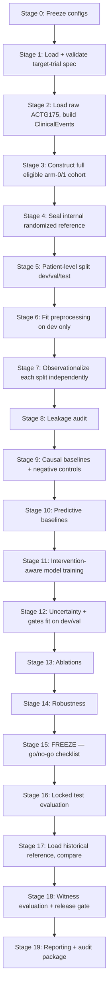

# Design Document

## Causal Witness Patient World Model

This design implements `requirements.md` using the frozen parameters in `decisions.md`. Every concrete number, formula, threshold, and named algorithm below is taken directly from `decisions.md`; this document does not introduce new discretion. Where `decisions.md` intentionally left something open (none remain — see its Section 25 amendment log), this document would flag it, but no such gaps exist at time of writing.

## Overview

The system is a batch, config-driven research pipeline, not a service. There is no runtime API and no persistent server. A single entry point (`scripts/run_paper.py`) and a handful of stage-specific scripts (`scripts/run_stage.py --stage <name>`) execute deterministic stages that read from and write to a versioned `results/<experiment_id>/` directory tree. Every stage is idempotent given the same config and seed, and every stage's outputs are consumed only by later stages, never by earlier ones — this one-directional data flow is what makes the non-negotiable execution order (`requirements.md` Section 3) enforceable in code rather than just in policy.

The codebase follows the repository layout from the original backlog:

```text
causal-witness-pwm/
├── configs/
│   ├── datasets/actg175_v3_2.yaml
│   ├── target_trials/main.yaml
│   └── experiments/paper.yaml
├── src/
│   ├── infra/          # config, logging, seeding, registry, manifests
│   ├── data/            # loaders, ClinicalEvent, normalization, timelines
│   ├── protocols/       # target-trial schema, eligibility DSL, time-zero, endpoints
│   ├── cohorts/         # cohort construction, splitting, observationalization
│   ├── causal/          # propensity, overlap, causal baselines, negative controls
│   ├── models/           # non-neural baseline, GRU baseline, intervention-aware model
│   ├── uncertainty/      # ensembles, calibration, gates
│   ├── witnesses/        # temporal, causal, clinical witnesses + aggregation
│   ├── evaluation/       # metrics, ablations, robustness, statistics
│   └── reporting/        # tables, figures, model card, audit reports
├── scripts/
├── tests/
├── results/
├── notebooks/
└── docs/
```

Two design principles run through every component:

1. **Gates are pure functions of frozen thresholds and computed diagnostics.** No gate reads a model's own predictions to decide whether to trust them, and no gate reads the historical/RCT reference (`decisions.md` Section 8, Section 16).
2. **Every artifact is traceable.** Every file written under `results/<experiment_id>/` is registered in that experiment's manifest (Requirement 1.8-1.11), and every manifest records the source commit, seed, and config hash.

## Architecture

### 2.1 Pipeline stages (execution order, matching `decisions.md`/`requirements.md` Section 3)



Stage 4 (seal internal reference) is deliberately placed before Stage 5 (split) — this is `decisions.md` Section 9's frozen order of operations, enforced structurally: the reference-sealing function only accepts the pre-split cohort object type, so it cannot compile against a post-split dataset.

Stages 0–14 may be repeated freely during development. Stage 15 is a hard checkpoint implemented as a script (`scripts/check_go_no_go.py`) that reads a checklist config and exits non-zero if any item is unresolved. Stages 16–19 are meant to run exactly once per submission and are gated behind an explicit `--confirm-locked-evaluation` CLI flag that requires Stage 15 to have passed.

### 2.2 Configuration and experiment identity

Every run is driven by three composed YAML configs (dataset contract, target-trial spec, experiment config), loaded via `src/infra/config.py` using a schema-validated loader (Pydantic models). The experiment ID is a deterministic hash of the fully-resolved config (post-defaults, post-overrides):

```python
experiment_id = sha256(canonical_json(resolved_config)).hexdigest()[:16]
```

Two runs with identical resolved configs but different seeds get different experiment IDs (seed is part of the resolved config), so re-running with a new seed never collides with, or overwrites, a prior run's directory (Requirement 1.6).

### 2.3 Directory conventions

```text
results/<experiment_id>/
├── manifest.json          # Requirement 1.8-1.11
├── registry_entry.json    # Requirement 1.5-1.7
├── config.resolved.yaml
├── cohort/
│   ├── flow_table.json
│   ├── split_membership.parquet   # patient_id -> split, no PII beyond internal ID
│   └── observationalization/{dev,val,test}.json
├── reference/
│   └── internal_randomized_reference.sealed.json   # not readable by later stages until Stage 17
├── baselines/
├── models/{sequence_gru, intervention_aware}/checkpoints/
├── uncertainty/
├── witnesses/
├── ablations/
├── robustness/
├── statistics/
└── reporting/{tables,figures,model_card.md,audit_reports/}
```

The `reference/` directory uses filesystem permissions plus an explicit access-check function (`assert_reference_unlocked()`) that every pre-Stage-17 stage calls defensively — any code path that tries to read the sealed reference before Stage 17 raises `ReferenceAccessError` rather than silently succeeding.

## Components and Interfaces

### 3.1 `src/infra` — reproducible experiment foundation (Requirement 1)

- `config.py`: `load_config(paths: list[Path]) -> ResolvedConfig` — merges dataset contract, target-trial spec, and experiment config; validates against Pydantic schemas; fails loudly on unknown keys.
- `seeding.py`: `derive_seed(master_seed: int, label: str) -> int` — implements the HMAC-SHA-256 derivation from `decisions.md` Section 9 step 7, reused for split-specific observationalization seeds, ensemble-replica seeds, and bootstrap seeds. One function, many callers, so the derivation logic is never duplicated.
- `registry.py`: `ExperimentRegistry.register(config, git_commit, dirty) -> experiment_id`; append-only SQLite or JSONL store at `results/registry.jsonl`; raises `DuplicateExperimentError` if an identical `experiment_id` already has a non-empty results directory (Requirement 1.6).
- `manifest.py`: `ManifestWriter` accumulates artifact hashes, cohort definition reference, feature list, checkpoint paths, metric summaries, and environment versions (`pip freeze` snapshot) throughout a run and writes `manifest.json` at the end of each stage. `PrivacyScanner.scan(manifest) -> list[Violation]` runs before any manifest is finalized (Requirement 2.7).
- `logging_setup.py`: structured JSON logging; every log record includes `experiment_id`, `stage`, and `seed`.
- Nondeterminism registry: `nondeterminism.py` exposes `@mark_nondeterministic(reason: str)` decorator; any function so decorated has its call recorded in the manifest (Requirement 1.6). Used on GPU-nondeterministic ops if mixed precision is enabled.

### 3.2 `src/protocols` — target-trial specification (Requirement 3)

- `schema.py`: `TargetTrialSpec` Pydantic model with required fields `population`, `intervention`, `comparator`, `time_zero`, `follow_up`, `outcome`, `censoring`, `estimand`, `analysis`, plus the causal-specification fields from Requirement 3.4-3.6 (`causal_diagram`, `adjustment_set`, `assumptions`). Validation failures raise `pydantic.ValidationError` with field-level messages (Requirement 3.2).
- `eligibility_dsl.py`: a small expression tree (`And`, `Or`, `Not`, `Threshold`, `TemporalWindow`, `DiagnosisHistory`, `MedicationExposure`) with an `evaluate(patient_timeline) -> EligibilityResult(eligible: bool, reason: str, missing_fields: list[str])`. Only the operators required by ACTG175 eligibility (HIV status, baseline CD4 range, age) are implemented — no speculative operators (`decisions.md` Section 4).
- `time_zero.py`: `validate_time_zero(timeline, spec) -> list[Violation]` — checks baseline-feature timestamps <= assignment timestamp; used both as a unit-testable function and inside the leakage auditor (3.4).
- `endpoints.py`: `CompositeEndpoint` implementing the ACTG composite (>=50% CD4 decline, AIDS-defining event, or death) — exactly the one endpoint type required (`decisions.md` Section 6); returns `(event_time, event_indicator, censoring_indicator)`.
- `consistency_checker.py`: `ProtocolChecker.check(cohort) -> list[ProtocolViolation]`, where `ProtocolViolation` is a structured record `{patient_id, rule, timestamp, evidence}` (Requirement 3.13). This module is reused directly by the clinical witness (3.7).

### 3.3 `src/data` — clinical data pipeline (Requirement 5)

- `contract.py`: `DatasetContract` Pydantic model mirroring `decisions.md` Section 2; `assert_contract_present()` raises `MissingContractError` if absent (Requirement 5.2).
- `loaders/actg175.py`: one adapter, `load_actg175(path) -> RawTables`, wrapping the packaged `LongCART::ACTG175` v3.2 tables; computes and checks the frozen SHA-256 checksum on load.
- `event_model.py`: `ClinicalEvent` frozen dataclass exactly as specified in the original backlog (`patient_id, encounter_id, concept_id, value, unit, modality, observed_at, valid_from, valid_to, source, missingness, provenance`), with a total ordering defined on `(patient_id, observed_at, concept_id)` for reproducible sorting (Requirement 5.6).
- `normalization.py`: deterministic, versioned concept/unit mapping table (a static YAML lookup checked into `configs/`); `UnresolvedConceptFlag` raised (not swallowed) for unmapped codes (Requirement 5.7-5.8).
- `timelines.py`: `build_patient_timeline(events) -> PatientTimeline` producing static covariates, timestamped observations, treatment events, endpoint events, censoring events, and a missingness mask.
- `leakage_audit.py`: `LeakageAuditor.audit(timelines, adjustment_set) -> list[LeakageViolation]`, checking: post-treatment variables in baseline features, outcome-derived features, duplicate patient IDs across splits, and the CD8 double-use safeguard (`decisions.md` Section 11.3) — implemented as a single reusable check `assert_no_self_adjustment(outcome_field, adjustment_set)` called both by the leakage auditor and by the negative-control-outcome regression builder.
- `quality_report.py`: `DataQualityReport` — cohort size, missingness, treatment prevalence, endpoint prevalence, follow-up distribution, event frequency, subgroup counts, censoring, treatment switching.

### 3.4 `src/cohorts` — cohort construction, splitting, observationalization (Requirements 5-7, `decisions.md` Sections 9-10)

This module encodes the frozen order of operations as a type-enforced pipeline rather than a convention:

```python
class RandomizedCohort:        # Stage 3 output
    ...

class SealedReference:         # Stage 4 output; only constructible from RandomizedCohort
    def __init__(self, cohort: RandomizedCohort): ...
    def unseal(self, unlock_token: LockedEvaluationToken) -> InternalReference: ...

class SplitCohorts:            # Stage 5 output; only constructible from RandomizedCohort
    dev: PatientSet
    val: PatientSet
    test: PatientSet

class FittedPreprocessing:     # Stage 6 output; fit() only accepts SplitCohorts.dev
    def fit(self, dev: PatientSet) -> "FittedPreprocessing": ...
    def transform(self, split: PatientSet) -> PatientSet: ...

class ObservationalCohorts:    # Stage 7 output
    dev: PatientSet
    val: PatientSet
    test: PatientSet
```

`SealedReference.unseal()` requires a `LockedEvaluationToken`, which is only mintable by `scripts/check_go_no_go.py` after every checklist item passes (Section 2.1, Stage 15). This is the concrete mechanism enforcing `decisions.md` Section 8's "withheld from model development" rule — there is no code path to the internal reference's value without that token, so a developer cannot accidentally peek at it mid-development even by mistake.

- `selection.py`: `observationalize(patients, fitted_preprocessing, seed) -> ObservationalCohort` implementing the exact risk score and logit formula from `decisions.md` Section 9. Coefficients are module-level constants with a unit test asserting they equal the frozen values (guards against accidental edits).
- `cohort_flow.py`: `build_cohort_flow_table(...)` — initial population -> eligibility exclusions -> arm assignment -> censoring -> analyzed population, rendered as both a JSON record and the Mermaid source for Figure 3 (Requirement 15.3 / `decisions.md` Section 26 reporting figure "cohort flow diagram").
- `splitting.py`: `stratified_patient_split(cohort, fractions=(0.6,0.2,0.2), strata=[...], seed) -> SplitCohorts`.

### 3.5 `src/causal` — propensity, overlap, causal baselines, negative controls (Requirement 7, `decisions.md` Sections 11-13)

- `propensity.py`: `LogisticPropensityModel` (primary) and `BoostedPropensityModel` (sensitivity-only; `XGBoost`, fixed hyperparameters from `decisions.md` Section 11). Both implement a shared `PropensityModel` protocol with `.fit_cross_fitted(data, n_folds=5) -> CrossFittedPredictions`, enforcing that no fold's predictions come from a model trained on that fold (Requirement 6.4).
- `overlap.py`: `OverlapDiagnostics.compute(propensities, treatment) -> OverlapReport` with the four frozen conditions from `decisions.md` Section 12 (arm counts >=100, ESS >=100, all |SMD| < 0.10, no unresolved positivity warning) each as a named boolean field plus the underlying numbers, so witness code and reporting code can both consume it without recomputing.
- `baselines.py`: implements the six causal baselines in `decisions.md` Section 11 (unadjusted KM/Cox, adjusted Cox, PS-weighted marginal Cox, outcome regression, IPCW-IPW, IPCW-AIPW). `IPCW_AIPW` is marked `is_primary=True`; the others are `is_primary=False` and only appear in the results table as component baselines (Requirement 7.9).
- `weighting.py`: `clip_weights(weights, lower_pct, upper_pct)` — primary clip 1st/99th, sensitivity clips 0.5th/99.5th and 5th/95th, all as named presets rather than free parameters, so an ablation config can only select from the three frozen options.
- `negative_controls.py`:
  - `SyntheticShamExposure.generate(patient_ids, seed) -> ShamLabels` — HMAC-SHA-256(patient_id, seed) thresholded to match observed treatment prevalence in the development observational cohort; unit-tested to confirm zero dependence on any covariate/outcome column (a static-analysis-style test that asserts the function signature only accepts `patient_ids` and `seed`).
  - `run_negative_control_exposure(sham_labels, outcomes) -> NegativeControlResult` — reruns IPCW-AIPW with the sham label; classifies pass/fail/uncertain per the frozen [0.90,1.10] band and CI rule (`decisions.md` Section 11.3).
  - `run_negative_control_outcome(treatment, baseline_cd8, adjustment_set_minus_cd8) -> NegativeControlResult` — the adjustment set passed in has CD8 excluded, enforced by `assert_no_self_adjustment` from `src/data/leakage_audit.py` (single shared implementation, not duplicated).
- `msm_or_narrowing.py`: a single check, `assert_baseline_treatment_estimand_valid(cohort)`, that documents (and, if it ever fails, raises) the Section 11.3 decision to narrow to a baseline-treatment ITT estimand rather than implement a marginal structural model.

### 3.6 `src/models` — predictive and intervention-aware models (Requirements 8-9, `decisions.md` Sections 14)

- `non_neural_baseline.py`: `CoxBaseline` — standard Cox PH on the composite endpoint with the frozen adjustment set (Requirement 8.1, resolved to Cox per `decisions.md` 14.1).
- `sequence_baseline.py`: `SequenceGRU` — 2-input-head GRU (baseline-state init + CD4/CD8 sequence, treatment as an ordinary feature), with two output heads (next-state regression, discrete-time hazard). This is the "treatment as ordinary feature" arm used throughout the ablation matrix.
- `intervention_aware.py`: `InterventionAwareModel` implementing the `z_t = [z_t^state; z_t^intervention; z_t^protocol]` representation:
  - `StateEncoder`, `InterventionEncoder`, `ProtocolEncoder` — three separate `nn.Module`s so an ablation can zero out or replace any one channel without touching the others (Requirement 6.3 / 9.3, capacity-matching enforced by keeping each encoder's output dimensionality fixed regardless of which channels are active — a disabled channel is replaced by a fixed zero or placebo vector of the same width, never removed from the concatenation).
  - `GRUTransition` — the state-transition module producing multi-step rollouts across baseline -> week 20 -> week 96 (satisfies the "true world model" branch of Requirement 9.10-9.11 per `decisions.md` 14.4).
  - Two branch heads: `branch_1`, `branch_0`, each producing `(event_hazard, next_cd4, next_cd8)`; `ModelOutput` explicitly tags which branch matches the observed treatment (`factual`) and which is `counterfactual` (Requirement 9.4-9.5).
  - `PlaceboInterventionEncoder` — the frozen-random-vector null channel from `decisions.md` 14.3, redrawn once per seed and cached, used by Ablation 10.
- `losses.py`: `total_loss = survival_nll + lambda_state * masked_huber(cd4_cd8) + lambda_balance * mmd(z_treated, z_control)`, with `lambda_state, lambda_balance` read from the frozen 3x3 grid (`decisions.md` 14.3) — the grid itself lives in `configs/experiments/lambda_grid.yaml` and is selected by validation concordance only.
- `aggregation.py`: `estimate_ate(model_outputs) -> ATEEstimate` via standardization/g-computation over the declared target population; `estimate_cate(model_outputs, subgroup) -> CATEEstimate`. Both label their outputs `PatientLevelEstimate(kind="model_estimate")`, never `kind="observed"` (Requirement 9.7).
- `invariance_tests.py`: property-based tests (not unit fixtures) — `test_future_treatment_does_not_affect_earlier_state`, `test_unchanged_treatment_preserves_factual_output`, `test_changing_treatment_changes_counterfactual_output` (Requirement 9.9).

### 3.7 `src/uncertainty` — uncertainty, support, abstention (Requirement 10, `decisions.md` Section 15-16)

- `ensemble.py`: `DeepEnsemble(n_replicas=5)` wrapping any of the model classes above; `.predict(x) -> (mean, variance)`.
- `calibration.py`: `Calibrator.fit(val_predictions, val_labels)` — Brier score, calibration slope/intercept, reliability diagram data; fit-only-on-validation is enforced by the function signature accepting exactly one `PatientSet` argument typed `ValidationSet`, not `PatientSet` generically.
- `bootstrap.py`: `patient_level_bootstrap(estimator_fn, data, n_replicates=1000, seed) -> BootstrapCI`; used for both cohort-level treatment-effect intervals and negative-control CIs (Section 11.3), and for the paired-comparison tests in `src/evaluation/statistics.py` — one bootstrap engine, multiple callers.
- `support_gate.py`: `PatientSupportGate.evaluate(patient) -> SupportDecision(supported: bool, reasons: list[str])` implementing the four-part `patient_supported` boolean from `decisions.md` Section 16 (propensity in common support AND ensemble uncertainty <= validation 90th percentile AND protocol valid AND no hard violation). Reasons are always populated, even when `supported=True` (so downstream audit reports can show "why," not just "what") — satisfies Requirement 10.10.
- `release_gate.py`: `CohortReleaseGate.evaluate(cohort_estimate, witness_results) -> ReleaseDecision` implementing the `release = overlap_valid AND balance_valid AND uncertainty_valid AND all(witness == pass)` condition, returning machine-readable reasons on any `False`.

### 3.8 `src/witnesses` — three-witness validation (Requirement 11, `decisions.md` Section 16)

- `temporal.py`: `TemporalWitness.evaluate(model, held_out_predictions, factual_baseline_error) -> WitnessResult(status, evidence)` — checks event-ordering, no-future-leakage (reusing `src/protocols/time_zero.py`), and the <=5%-worse-than-baseline longitudinal error rule; returns `pass`/`fail`/`uncertain`.
- `causal.py`: `CausalWitness.evaluate(overlap_report, balance_report, sensitivity_results, negative_control_results) -> WitnessResult` implementing the three-way pass/fail/uncertain logic from `decisions.md` Section 16 exactly (fail on hard-requirement violation or negative-control fail; uncertain on negative-control uncertain with no hard violation; pass otherwise).
- `clinical.py`: `ClinicalWitness.evaluate(cohort) -> WitnessResult` reusing `src/protocols/consistency_checker.py` — eligibility, assignment validity, dose/treatment identity, event timing, endpoint construction, zero hard violations.
- `aggregation.py`: `WitnessPolicy` enum (`ALL_REQUIRED` = primary, `TWO_OF_THREE` = exploratory only, `RISK_WEIGHTED` = not used for ACTG175 per `decisions.md`); `aggregate(results, policy) -> AggregateDecision`. The experiment config's `witness_policy` field is validated at load time to equal `ALL_REQUIRED` for any run that will produce a paper-reported number; other policies are only permitted in configs tagged `exploratory: true`.
- `audit_report.py`: `build_audit_report(protocol, population, treatment, estimate, overlap, witness_results, abstentions, violations, provenance) -> AuditReport`, serialized as the per-claim JSON described in Requirement 11.10.

### 3.9 `src/evaluation` — ablations, robustness, statistics (Requirements 12-14, `decisions.md` Sections 17, 20-21)

- `ablation_matrix.py`: `ABLATIONS: list[AblationConfig]` — the exact ten entries from `decisions.md` Section 17, each a config diff applied on top of the frozen base experiment config. A test asserts `len(ABLATIONS) == 10` and that each has a unique, stable name, preventing silent drift from the frozen list.
- `robustness.py`: `SubgroupRobustness.run(cohort, subgroup_field="prior_art_status")` — the one frozen primary robustness analysis (ART-naive vs. ART-experienced). `SensitivityRobustness.run(...)` runs the eight frozen sensitivity variants (propensity model choice, clipping, support thresholds, missingness stress, week-20 removal, arm reversal, endpoint-horizon shift, stronger selection severity) — each implemented as a config transform, not bespoke code, so they reuse the exact same pipeline stages.
- `statistics.py`: `paired_bootstrap_test(model_a_preds, model_b_preds, n_replicates=1000) -> PairedTestResult`; `holm_correction(p_values, comparisons=["baseline_vs_intervention_aware", "intervention_aware_vs_ipcw_aipw", "gated_vs_ungated"])`. The three named comparisons are hardcoded as the frozen primary comparison set (`decisions.md` Section 19), preventing an unprespecified fourth comparison from silently entering the corrected family.
- `metrics.py`: all named metrics from `decisions.md` Section 18, grouped into `FactualMetrics`, `CausalRecoveryMetrics`, `SelectivePredictionMetrics`, `ConsistencyMetrics` dataclasses. `CausalRecoveryMetrics.risk_difference_error` is computed only against `InternalReference` (never the published HR-only reference), enforced by the function's type signature.

### 3.10 `src/reporting` — tables, figures, audit, model card (Requirement 15)

- `tables.py`: `build_main_results_table(...)` matching `decisions.md` Section 18's four metric groups.
- `figures.py`: architecture diagram, cohort-flow diagram (reuses `src/cohorts/cohort_flow.py`), treatment-effect-vs-reference comparison plot, propensity-overlap plot, risk-coverage curve, ablation bar chart — the six figures named in the original backlog, mapped onto ACTG175 specifics.
- `model_card.py`: fixed template covering intended use, prohibited uses (verbatim from `decisions.md` Section 22 "Prohibited"), training population, endpoint, uncertainty behavior, known failure modes, subgroup findings.
- `responsible_use.py`: fixed document covering confounding, privacy, bias, unsupported individual use, RCT-replacement misuse, uncertainty, clinical oversight, auditability (Requirement 15.7) — text is largely static, generated once and checked into `docs/`, not regenerated per run, since its content doesn't depend on run-specific numbers.
- `run_paper.py` (in `scripts/`): the one-command entry point (Requirement 15.5-15.6); refuses to touch `reference/internal_randomized_reference.sealed.json` unless invoked with `--stage locked-evaluation` and a valid `LockedEvaluationToken`.

## Data Models

Core cross-cutting types (Pydantic where validation matters, frozen dataclasses where just structure matters):

```python
@dataclass(frozen=True)
class ClinicalEvent:
    patient_id: str
    encounter_id: str | None
    concept_id: str
    value: float | str | None
    unit: str | None
    modality: str
    observed_at: datetime
    valid_from: datetime | None
    valid_to: datetime | None
    source: str
    missingness: MissingnessState
    provenance: str

@dataclass(frozen=True)
class Intervention:
    concept_id: str
    dose: float | None
    unit: str | None
    route: str | None
    frequency: str | None
    start_time: datetime
    stop_time: datetime | None
    adherence: float | None
    mechanism_ids: tuple[str, ...] = ()

class TargetTrialSpec(BaseModel):
    population: PopulationSpec
    intervention: InterventionSpec
    comparator: InterventionSpec
    time_zero: TimeZeroSpec
    follow_up: FollowUpSpec
    outcome: OutcomeSpec
    censoring: CensoringSpec
    estimand: EstimandSpec
    analysis: AnalysisSpec
    causal_diagram: CausalDiagram
    adjustment_set: list[str]
    assumptions: AssumptionsSpec

@dataclass(frozen=True)
class WitnessResult:
    witness: Literal["temporal", "causal", "clinical"]
    status: Literal["pass", "fail", "uncertain"]
    evidence: dict

@dataclass(frozen=True)
class ProtocolViolation:
    patient_id: str
    rule: str
    timestamp: datetime | None
    evidence: dict

@dataclass(frozen=True)
class PatientLevelEstimate:
    patient_id: str
    y1_hat: float
    y0_hat: float
    kind: Literal["model_estimate"]   # never "observed"
```

## Error Handling

| Failure mode | Handling |
|---|---|
| Invalid/incomplete target-trial spec | `pydantic.ValidationError`, field-level, propagated to CLI exit code 1 |
| Missing dataset contract | `MissingContractError`, pipeline refuses to proceed (Requirement 5.2) |
| Leakage detected (real or synthetic fixture) | `LeakageViolation` collected, not swallowed; run marked `failed_leakage_audit`, no downstream stage executes |
| Duplicate experiment ID with existing results | `DuplicateExperimentError`, run aborted before any file write |
| Attempt to read sealed reference before Stage 17 | `ReferenceAccessError`, raised at the function-call boundary, not just logged |
| Unresolved clinical concept | `UnresolvedConceptFlag` recorded in the data-quality report; record retained, not dropped |
| Insufficient overlap / support | Not an exception — a `SupportDecision(supported=False, reasons=[...])`, a normal return value, since abstention is an expected outcome, not an error |
| Witness fail/uncertain | Not an exception — `WitnessResult(status="fail"|"uncertain", evidence=...)`, consumed by the release gate |
| Go/no-go checklist incomplete | `scripts/check_go_no_go.py` exits non-zero with the specific unmet items listed; `LockedEvaluationToken` is not minted |
| Privacy scan finds a violation in a manifest | `ManifestPrivacyError`, manifest write blocked, run marked `failed_privacy_scan` |

The distinction above matters: causal/statistical "failures" (insufficient overlap, witness failure) are first-class domain outcomes represented as data, not exceptions — they are meant to be reported in the paper. Engineering/process failures (leakage, duplicate IDs, premature reference access, missing contracts) are exceptions, because they indicate a bug or a protocol violation that must halt the run.

## Correctness Properties

These are the invariants the implementation must never violate, independent of any specific test. Each is enforced structurally (by types or by a blocking check), not only by convention.

### Property 1: Sealed reference isolation

No stage reads the sealed internal reference before Stage 17. Enforced by `SealedReference.unseal()` requiring a `LockedEvaluationToken` that only `scripts/check_go_no_go.py` can mint, and only after every go/no-go item passes (`decisions.md` Section 8, Section 21).

**Validates: Requirements 4.6, 6.6**

### Property 2: Observationalization independence from validation/test

The observationalization mechanism never sees validation or test outcomes before its coefficients are frozen. Enforced by the frozen order of operations in `src/cohorts` (split before select; preprocessing fit on development only) and by the one-time-pilot-recalibration rule being callable only on a `DevelopmentSet`-typed argument.

**Validates: Requirements 6.5, 6.6**

### Property 3: Cross-fitting non-leakage

No nuisance model predicts an observation used in its own fitting. Enforced by `PropensityModel.fit_cross_fitted`'s fold-partitioning logic, checked by an integration test that asserts zero overlap between a fold's training indices and its prediction indices.

**Validates: Requirements 6.4, 7.5**

### Property 4: Negative-control non-tautology

A negative-control-outcome regression never uses its own outcome variable as a predictor. Enforced by the single shared `assert_no_self_adjustment` check used both in leakage auditing and in negative-control construction (`decisions.md` Section 11.3's CD8 double-use safeguard).

**Validates: Requirements 5.10, 7.12**

### Property 5: Model-estimate labeling

Patient-level potential-outcome differences are never labeled as observed. Enforced by `PatientLevelEstimate.kind` being a `Literal["model_estimate"]`, with no `"observed"` variant existing in the type at all.

**Validates: Requirements 9.7**

### Property 6: Unanimous witness release

Cohort-level release requires all three witnesses to independently return `pass`. A `fail` or `uncertain` from any witness blocks release; this is a single boolean expression in `release_gate.py`, not distributed logic that could drift out of sync across call sites.

**Validates: Requirements 8.5, 8.9**

### Property 7: Capacity-matched ablation

Ablation channel removal is capacity-matched. Disabling the intervention or protocol channel substitutes a fixed-width zero/placebo vector rather than shrinking the concatenated representation, so an ablation's effect is attributable to information content, not to a change in model capacity.

**Validates: Requirements 9.8, 12.2**

### Property 8: Frozen-value consistency

Every constant used in code matches its frozen value in `decisions.md`. Enforced by `tests/frozen/test_decisions_match.py`, which is the mechanical backstop for every numeric decision this design depends on.

**Validates: Requirements 1.8, 1.10**

## Testing Strategy

- **Unit tests** (`tests/unit/`): eligibility DSL operators (negation, scope, thresholds, missing values, temporal windows — Requirement 3.9), time-zero validation with intentionally leaked fixtures (3.7), event ordering determinism, concept-normalization determinism, the frozen observationalization formula's exact coefficients, weight-clipping presets, the ten-item ablation list's length and uniqueness, HMAC-based seed derivation determinism (same input -> same output, different label -> different output).
- **Integration tests** (`tests/integration/`): full cohort-construction pipeline reproducibility (same config + seed -> identical cohort membership and counts, Requirement 7.2), cross-fitting non-leakage (no fold predicts on its own training data), leakage-audit synthetic fixtures actually triggering failures (5.11), negative-control sham-exposure independence from covariates/outcomes (static + statistical check), CD8 double-use safeguard (asserting the negative-control-outcome regression's adjustment set excludes CD8 while every other model's adjustment set includes it).
- **End-to-end smoke test** (`tests/e2e/test_smoke.py`): runs the full pipeline on a small synthetic subsample (not the real ACTG175 data, to keep CI fast) from raw loading through reporting, asserting the one-command reproduction path works (Requirement 1.3-1.4, 15.5).
- **Property-based tests** (`tests/property/test_invariance.py`): the three intervention-invariance properties (Requirement 9.9), run with `hypothesis` over randomized synthetic patient states.
- **Model card / claims tests** (`tests/reporting/test_claims.py`): a lint-style test scanning generated reporting artifacts (tables, figures' captions, model card) for prohibited phrasing from `decisions.md` Section 22 (e.g. flags any caption containing "replaces randomized" or "real-world validation" outside the explicitly permitted context) — a lightweight regex-based guard against the framing constraint silently eroding across draft revisions.
- **Frozen-value regression tests** (`tests/frozen/test_decisions_match.py`): every numeric/formula constant in `decisions.md` (risk-score coefficients, logit intercept, overlap thresholds, clipping percentiles, ensemble size, bootstrap replicate count, lambda grid, negative-control bands) has a corresponding assertion against the constant actually used in code. This is the test suite's version of a diff against `decisions.md` — if someone edits a threshold in code without updating `decisions.md` (or vice versa), this test catches the mismatch.

No test suite reads or requires access to the real historical HR value except the single locked-evaluation integration test, which is skipped by default and only runs under an explicit `--run-locked-evaluation-test` flag, mirroring the production gating in `scripts/run_paper.py`.
