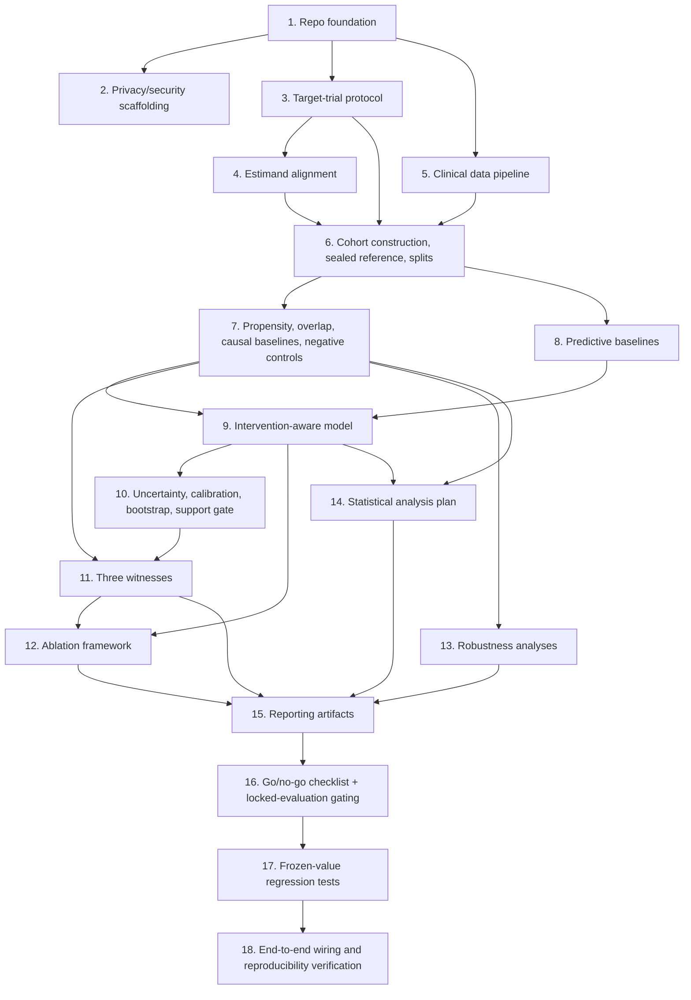

# Implementation Plan

## Overview

This plan implements the Causal Witness Patient World Model critical path on ACTG175, following the frozen order of operations and parameters in `decisions.md`. Tasks are grouped by pipeline stage and sequenced so each stage's tests exist before the next stage consumes its output. All numeric constants, thresholds, and named algorithms referenced below are frozen in `decisions.md` and must not be re-derived or re-chosen during implementation.

## Tasks

- [x] 1. Set up repository foundation and experiment infrastructure
  - Create the package structure under `src/` (`infra`, `data`, `protocols`, `cohorts`, `causal`, `models`, `uncertainty`, `witnesses`, `evaluation`, `reporting`) plus `configs/`, `scripts/`, `tests/`, `results/`, `docs/`
  - Set up `pyproject.toml` with pinned dependencies, linting (ruff/black), and `pytest` configuration
  - _Requirements: 1.1_

- [x] 1.1 Implement config loading and validation
  - Write `src/infra/config.py` with `load_config()` merging dataset contract, target-trial spec, and experiment config via Pydantic schemas; unknown keys raise errors
  - Write unit tests for valid and invalid config merges
  - _Requirements: 1.1_

- [x] 1.2 Implement deterministic seeding
  - Write `src/infra/seeding.py` with `derive_seed(master_seed, label)` using HMAC-SHA-256 derivation
  - Write unit tests: same input produces same output; different label produces different output
  - _Requirements: 1.6, 9.1(decisions Section 9)_

- [x] 1.3 Implement structured logging
  - Write `src/infra/logging_setup.py` emitting structured JSON logs including `experiment_id`, `stage`, `seed` on every record
  - _Requirements: 1.1_

- [x] 1.4 Implement the nondeterminism registry
  - Write `src/infra/nondeterminism.py` with `@mark_nondeterministic(reason)` decorator that records decorated-call invocations for later inclusion in the manifest
  - Write a unit test asserting a decorated call is recorded
  - _Requirements: 1.6_

- [x] 1.5 Implement experiment identity and the experiment registry
  - Write `src/infra/registry.py`: `experiment_id = sha256(canonical_json(resolved_config))[:16]`; `ExperimentRegistry.register()` appends to `results/registry.jsonl` and raises `DuplicateExperimentError` on collision with an existing non-empty results directory
  - Write unit tests for ID determinism (same config+seed → same ID; different seed → different ID) and for duplicate-registration rejection
  - _Requirements: 1.5, 1.6, 1.7_

- [x] 1.6 Implement artifact manifests and the privacy scanner
  - Write `src/infra/manifest.py`: `ManifestWriter` accumulating input hashes, cohort definition, feature list, treatment/outcome definitions, model config, checkpoint paths, predictions, metrics, environment versions (`pip freeze` snapshot); writes `manifest.json` per stage
  - Write `PrivacyScanner.scan(manifest)` that flags direct identifiers, quasi-identifiers, secrets, and unauthorized filesystem paths, raising `ManifestPrivacyError` on a violation and blocking the manifest write
  - Write unit tests: manifest completeness for a synthetic run; privacy scanner catches injected identifiers/secrets
  - _Requirements: 1.8, 1.9, 1.10, 1.11, 2.2, 2.3, 2.4, 2.7, 2.8_

- [x] 1.7 Implement the results-directory convention and one-command smoke experiment
  - Write `scripts/run_stage.py --stage smoke` that exercises config loading, seeding, registry registration, and manifest writing end-to-end on a tiny synthetic fixture (not real ACTG175 data)
  - Write `tests/e2e/test_smoke.py` asserting the smoke command runs and produces a valid manifest
  - _Requirements: 1.2, 1.3, 1.4_

- [x] 2. Implement clinical-data privacy and security scaffolding
  - Document the approved storage location, access rules, and permitted derived artifacts for ACTG175 in `docs/data_access.md`
  - _Requirements: 2.1_

- [x] 2.1 Implement secret handling and export scanning
  - Configure secret loading through environment variables / an approved secret store; add a pre-commit or CI check that fails on committed secrets
  - Write `scripts/scan_exports.py` performing an automated identifier and secret scan over any directory passed to it
  - Write a unit test with an injected fake identifier/secret confirming the scanner flags it
  - _Requirements: 2.4, 2.7_

- [x] 2.2 Implement minimum-cell-size enforcement for public artifacts
  - Add a `min_cell_size` check to `src/reporting/tables.py` and `src/reporting/figures.py` that suppresses or aggregates any reported cell below the configured threshold
  - Write a unit test confirming a small subgroup is suppressed in a generated table
  - _Requirements: 2.5, 2.6_

- [x] 3. Implement target-trial protocol specification (protocols module)
  - Write `src/protocols/schema.py`: `TargetTrialSpec` Pydantic model requiring population, intervention, comparator, time_zero, follow_up, outcome, censoring, estimand, analysis, causal_diagram, adjustment_set, assumptions
  - Write `configs/target_trials/main.yaml` encoding the frozen ACTG175 trial spec from `decisions.md` Sections 3-7, 13
  - Write unit tests: valid spec passes; specs missing required fields fail with field-level errors
  - _Requirements: 3.1, 3.2, 3.3, 3.4, 3.5, 3.6, 3.7_

- [x] 3.1 Implement the eligibility DSL
  - Write `src/protocols/eligibility_dsl.py` implementing And/Or/Not, thresholds, temporal windows, diagnosis/medication history operators, and explicit missing-value behavior, limited to the operators ACTG175 eligibility requires (HIV status, baseline CD4 range, age)
  - Write unit tests covering negation, logical scope, threshold boundaries, missing values, and temporal eligibility
  - _Requirements: 3.8, 3.9_

- [x] 3.2 Implement time-zero validation
  - Write `src/protocols/time_zero.py`: `validate_time_zero(timeline, spec)` checking eligibility/baseline-feature timestamps precede or coincide with assignment, and rejecting post-treatment information in baseline features
  - Write unit tests with intentionally leaked fixtures that must be rejected
  - _Requirements: 3.10, 3.11_

- [x] 3.3 Implement the composite endpoint
  - Write `src/protocols/endpoints.py`: `CompositeEndpoint` computing time to first of (≥50% CD4 decline, AIDS-defining event, death), returning event time, event indicator, censoring indicator
  - Write unit tests against hand-checked patient examples
  - _Requirements: 3.12_

- [x] 3.4 Implement the protocol-consistency checker
  - Write `src/protocols/consistency_checker.py`: `ProtocolChecker.check(cohort)` returning structured `ProtocolViolation(patient_id, rule, timestamp, evidence)` records for ineligible patients, invalid assignments, treatment-before-eligibility, outcome-before-intervention, impossible sequences, endpoint-window violations
  - Write unit tests for each violation category
  - _Requirements: 3.13_

- [x] 4. Implement estimand-alignment reporting
  - Write `src/protocols/estimand_alignment.py` generating a report comparing observational vs. randomized definitions of eligibility, treatment versions, comparator, time zero, follow-up, endpoint, effect scale, adherence strategy, censoring strategy, target population, classifying each as aligned/approximately-aligned/correctable/non-alignable
  - Encode the frozen determination from `decisions.md` Section 8 (published reference is historical corroboration, not independent validation, due to shared trial provenance) as a fixed report entry
  - Write a unit test asserting the alignment report is generated and the non-independence disclosure is present
  - _Requirements: 4.1, 4.2, 4.4, 4.5, 4.6, 4.7_

- [x] 5. Implement the clinical data pipeline (data module)
  - Write `src/data/contract.py`: `DatasetContract` Pydantic model and `assert_contract_present()` raising `MissingContractError` if absent
  - Write `configs/datasets/actg175_v3_2.yaml` encoding the frozen dataset contract from `decisions.md` Section 2
  - Write a unit test confirming the pipeline refuses to run without the contract
  - _Requirements: 5.1, 5.2_

- [x] 5.1 Implement the ACTG175 raw-data loader
  - Write `src/data/loaders/actg175.py`: `load_actg175(path) -> RawTables`, computing and verifying the frozen SHA-256 checksum, returning typed schema-validated records for demographics, treatment arm, baseline covariates, longitudinal CD4/CD8, censoring, outcomes
  - Write unit tests for checksum verification (pass and mismatch cases) and schema validation
  - _Requirements: 5.3, 5.4_

- [x] 5.2 Implement the ClinicalEvent model and reproducible sorting
  - Write `src/data/event_model.py`: frozen `ClinicalEvent` dataclass with the specified fields and a total ordering on `(patient_id, observed_at, concept_id)`
  - Write a unit test asserting sort stability/reproducibility across repeated runs
  - _Requirements: 5.5, 5.6_

- [x] 5.3 Implement concept/unit normalization
  - Write `src/data/normalization.py`: deterministic versioned concept/unit mapping (static YAML lookup) with `UnresolvedConceptFlag` raised (not dropped) for unmapped codes
  - Write unit tests for known-concept mapping determinism and unresolved-concept flagging
  - _Requirements: 5.7, 5.8_

- [x] 5.4 Implement patient timeline construction
  - Write `src/data/timelines.py`: `build_patient_timeline(events)` producing static covariates, timestamped observations, treatment events, endpoint events, censoring events, missingness mask
  - Write a unit test comparing a sampled timeline against hand-verified source records
  - _Requirements: 5.9_

- [x] 5.5 Implement leakage auditing and the CD8 double-use safeguard
  - Write `src/data/leakage_audit.py`: `LeakageAuditor.audit(timelines, adjustment_set)` detecting post-treatment baseline variables, outcome-derived features, duplicate patients across splits, indirect treatment/outcome encodings; implement the shared `assert_no_self_adjustment(outcome_field, adjustment_set)` check
  - Write synthetic leakage fixtures (week-20 CD4 in baseline; duplicated patient across dev/test; CD8 used as both outcome and covariate in the same regression) and confirm each triggers a failure
  - _Requirements: 5.10, 5.11_

- [x] 5.6 Implement missing-data handling
  - Write missingness-indicator support and, if used, fold-safe multiple imputation fit only on development/training folds
  - Write a unit test confirming imputation parameters are fit on development data only
  - _Requirements: 5.12, 5.13_

- [x] 5.7 Implement the data-quality report
  - Write `src/data/quality_report.py`: `DataQualityReport` with cohort size, missingness, treatment prevalence, endpoint prevalence, follow-up, event frequency, subgroup counts, censoring, treatment switching
  - Write a unit test asserting all required fields are populated for a synthetic cohort
  - _Requirements: 5.14_

- [x] 6. Implement cohort construction, the sealed reference, and analysis splits (cohorts module)
  - Write `src/cohorts/cohort_construction.py`: builds the complete eligible arm-0/arm-1 randomized cohort per `decisions.md` Section 4 eligibility rules, using the eligibility DSL and endpoint constructor from tasks 3.1/3.3
  - Write a unit/integration test confirming repeated construction from the same config reproduces identical cohort membership and counts
  - _Requirements: 6.1, 7.1, 7.2_

- [x] 6.1 Implement the sealed internal randomized reference
  - Write `src/cohorts/sealed_reference.py`: `RandomizedCohort`, `SealedReference` (constructible only from `RandomizedCohort`), and `LockedEvaluationToken`; `SealedReference.unseal()` requires a valid token
  - Write `src/infra/reference_guard.py`: `assert_reference_unlocked()` raising `ReferenceAccessError` when called without a valid token
  - Write a unit test confirming `unseal()` fails without a token and succeeds with one
  - _Requirements: 6.6, 4.6 (Correctness Property 1)_

- [x] 6.2 Implement patient-level stratified splitting
  - Write `src/cohorts/splitting.py`: `stratified_patient_split(cohort, fractions=(0.6,0.2,0.2), strata=[treatment_arm, primary_event_indicator, prior_art_status], seed) -> SplitCohorts`, executed strictly after the reference is sealed (task 6.1) and before any preprocessing fit
  - Write a unit test confirming no patient appears in more than one split and that strata proportions are respected
  - _Requirements: 6.2, 6.7_

- [x] 6.3 Implement development-only preprocessing fitting
  - Write `src/cohorts/preprocessing.py`: `FittedPreprocessing.fit()` accepting only a `DevelopmentSet`-typed argument; `.transform()` applies frozen parameters unchanged to any split
  - Write a unit test confirming validation/test transformation uses development-fit parameters and confirming type-level rejection of non-development input to `fit()`
  - _Requirements: 6.5, 6.6 (Correctness Property 2)_

- [x] 6.4 Implement the observationalization mechanism
  - Write `src/cohorts/selection.py`: `observationalize(patients, fitted_preprocessing, seed)` implementing the exact frozen risk score and logit formula from `decisions.md` Section 9, with module-level constants for every coefficient
  - Write `src/infra/seeding.py` integration: per-split seeds derived via `derive_seed(master_seed, split_name)`
  - Write the frozen order-of-operations pipeline (`src/cohorts/pipeline.py`) chaining: construct cohort → seal reference → split → fit preprocessing on dev → observationalize each split independently
  - Write a unit test asserting the coefficients equal the frozen values in `decisions.md`; write an integration test confirming per-split selection uses distinct seeds and produces per-split retained-ID manifests
  - _Requirements: 7.1 (decisions Section 9); Correctness Property 2_

- [x] 6.5 Implement one-time pilot recalibration support
  - Add a recalibration path in `src/cohorts/selection.py` callable only on development data, logging old/new coefficients and reason to a changelog file, with no code path allowing recalibration after a freeze flag is set
  - Write a unit test confirming recalibration is rejected once the freeze flag is set, and rejected outright on validation/test-typed input
  - _Requirements: decisions.md Section 9 (pilot recalibration)_

- [x] 6.6 Implement the cohort-flow table
  - Write `src/cohorts/cohort_flow.py`: `build_cohort_flow_table()` producing initial population → eligibility exclusions → arm assignment → censoring → analyzed population, as JSON and Mermaid source
  - Write a unit test confirming counts in the flow table sum consistently
  - _Requirements: 7.3, 15.3_

- [x] 7. Implement propensity estimation and overlap diagnostics (causal module)
  - Write `src/causal/propensity.py`: `LogisticPropensityModel` (primary) and `BoostedPropensityModel` (sensitivity, fixed XGBoost hyperparameters) implementing a shared `PropensityModel` protocol with `fit_cross_fitted(data, n_folds=5)`
  - Write an integration test confirming zero overlap between a fold's training indices and its prediction indices
  - _Requirements: 7.4, 7.5, 6.4 (Correctness Property 3)_

- [x] 7.1 Implement overlap diagnostics
  - Write `src/causal/overlap.py`: `OverlapDiagnostics.compute()` returning arm-specific propensity distributions, common support, extreme-weight counts, effective sample size, standardized mean differences, and the four frozen boolean conditions from `decisions.md` Section 12
  - Write a unit test with a synthetic well-overlapping cohort (all conditions pass) and a synthetic poorly-overlapping cohort (conditions fail)
  - _Requirements: 7.6, 7.7_

- [x] 7.2 Implement causal baselines
  - Write `src/causal/baselines.py`: unadjusted KM/Cox, covariate-adjusted Cox, PS-weighted marginal Cox, outcome regression, IPCW-IPW, IPCW-AIPW (marked `is_primary=True`)
  - Write `src/causal/weighting.py`: `clip_weights()` with the three frozen named presets (1st/99th primary; 0.5th/99.5th and 5th/95th sensitivity)
  - Write unit tests for each estimator on a synthetic dataset with a known effect
  - _Requirements: 7.8, 7.9, 7.10_

- [x] 7.3 Implement the baseline-treatment estimand narrowing check
  - Write `src/causal/msm_or_narrowing.py`: `assert_baseline_treatment_estimand_valid(cohort)` documenting the ITT narrowing decision; raises if treatment/censoring time-variation is detected that would require a marginal structural model
  - Write a unit test confirming the check passes on ACTG175's ITT structure
  - _Requirements: 7.11_

- [x] 7.4 Implement negative controls
  - Write `src/causal/negative_controls.py`: `SyntheticShamExposure.generate(patient_ids, seed)` using HMAC-SHA-256(patient_id, seed) thresholded to match observed treatment prevalence, verified independent of covariates/outcomes
  - Write `run_negative_control_exposure()` rerunning IPCW-AIPW with the sham label, classified pass/fail/uncertain per the frozen [0.90, 1.10] band and CI rule
  - Write `run_negative_control_outcome()` using baseline CD8 as pseudo-outcome with CD8 excluded from its own adjustment set via `assert_no_self_adjustment` (task 5.5), classified pass/fail/uncertain per the frozen SMD/CI rule
  - Write unit tests: sham-label generation depends only on `patient_id` and seed (signature/dependency check); both negative controls correctly classify synthetic pass/fail/uncertain fixtures
  - _Requirements: 7.12; Correctness Property 4_

- [x] 8. Implement predictive baselines (models module)
  - Write `src/models/non_neural_baseline.py`: `CoxBaseline` — Cox PH on the composite endpoint with the frozen adjustment set
  - Write unit tests confirming training converges and metrics are computed on a synthetic dataset
  - _Requirements: 8.1_

- [x] 8.1 Implement the sequence-model baseline
  - Write `src/models/sequence_baseline.py`: `SequenceGRU` with baseline-state init, CD4/CD8 sequence input, treatment as an ordinary feature, two output heads (next-state regression, discrete-time hazard)
  - Write unit tests for shape correctness and a training-loop smoke test
  - _Requirements: 8.2_

- [x] 8.2 Implement training infrastructure
  - Write `src/models/training.py`: early stopping, checkpointing, class weighting, censoring-aware loss, deterministic evaluation, seed recording
  - Write a unit test confirming checkpoint save/load round-trips model state exactly
  - _Requirements: 8.3_

- [x] 8.3 Implement factual prediction metrics
  - Write `src/evaluation/metrics.py` (factual portion): time-dependent concordance, 96-week AUROC/AUPRC, IPCW Brier score, calibration slope/intercept, CD4/CD8 MAE
  - Write unit tests against hand-computed values on a small synthetic set
  - _Requirements: 8.4, 8.5_

- [x] 9. Implement the intervention object and intervention-aware model (models module)
  - Write `src/models/intervention.py`: frozen `Intervention` dataclass with concept_id, dose, unit, route, frequency, start_time, stop_time, adherence, mechanism_ids
  - _Requirements: 9.1_

- [x] 9.1 Implement the separately-encoded intervention-aware architecture
  - Write `src/models/intervention_aware.py`: `StateEncoder`, `InterventionEncoder`, `ProtocolEncoder` as separate modules producing `z_t = [z_t^state; z_t^intervention; z_t^protocol]`; `GRUTransition` for multi-step rollout across baseline/week-20/week-96
  - Write `PlaceboInterventionEncoder`: fixed random vector matching intervention-channel width, redrawn once per seed and cached
  - Write a unit test confirming disabling a channel substitutes a fixed-width placebo/zero vector rather than shrinking the concatenation (capacity-matching check)
  - _Requirements: 9.2, 9.3, 9.8; Correctness Property 7_

- [x] 9.2 Implement factual/counterfactual branch heads
  - Add `branch_1`, `branch_0` heads producing `(event_hazard, next_cd4, next_cd8)`; tag outputs `factual`/`counterfactual` based on observed treatment
  - Write a unit test confirming exactly one branch per patient is tagged `factual`
  - _Requirements: 9.4, 9.5_

- [x] 9.3 Implement the training objective
  - Write `src/models/losses.py`: `total_loss = survival_nll + lambda_state * masked_huber(cd4_cd8) + lambda_balance * mmd(z_treated, z_control)`, with the frozen 3×3 lambda grid in `configs/experiments/lambda_grid.yaml`, selected by validation concordance only
  - Write a unit test confirming grid selection reads only validation-split data
  - _Requirements: decisions.md Section 14.3 (training objective)_

- [x] 9.4 Implement treatment-effect aggregation
  - Write `src/models/aggregation.py`: `estimate_ate()` via standardization/g-computation; `estimate_cate()` for subgroups; both label outputs `PatientLevelEstimate(kind="model_estimate")`
  - Write a unit test confirming the type has no `"observed"` variant and that ATE aggregation matches a hand-computed value on synthetic branch outputs
  - _Requirements: 9.6, 9.7; Correctness Property 5_

- [x] 9.5 Implement intervention invariance property tests
  - Write `src/models/invariance_tests.py` and `tests/property/test_invariance.py` using `hypothesis`: future treatment does not affect earlier state; unchanged treatment preserves factual output; changing treatment changes counterfactual output; irrelevant pathway-label changes do not alter predictions
  - _Requirements: 9.9_

- [x] 10. Implement uncertainty estimation, calibration, and bootstrap (uncertainty module)
  - Write `src/uncertainty/ensemble.py`: `DeepEnsemble(n_replicas=5)` wrapping any model class, returning `(mean, variance)`
  - Write a unit test confirming 5 distinct seeded replicas are trained and combined correctly
  - _Requirements: 10.1, 10.2_

- [x] 10.1 Implement calibration fitting
  - Write `src/uncertainty/calibration.py`: `Calibrator.fit(val_predictions, val_labels)` computing Brier score, calibration slope/intercept, reliability diagram data; signature enforces validation-only input
  - Write a unit test confirming fit rejects non-validation-typed input and calibration metrics match hand-computed values
  - _Requirements: 10.3, 10.4_

- [x] 10.2 Implement patient-level bootstrap
  - Write `src/uncertainty/bootstrap.py`: `patient_level_bootstrap(estimator_fn, data, n_replicates=1000, seed)` reused for treatment-effect intervals, negative-control CIs, and paired-comparison tests
  - Write a unit test confirming bootstrap CI coverage on a synthetic dataset with a known true value
  - _Requirements: 10.7_

- [x] 10.3 Implement out-of-distribution scoring
  - Write `src/uncertainty/ood.py`: propensity-extremity score (primary) and missingness-deviation score (secondary)
  - Write a unit test confirming known out-of-distribution synthetic patients score higher than in-distribution ones
  - _Requirements: 10.8_

- [x] 10.4 Implement the patient-support gate
  - Write `src/uncertainty/support_gate.py`: `PatientSupportGate.evaluate(patient)` implementing the four-part `patient_supported` condition (propensity in common support AND ensemble uncertainty ≤ validation 90th percentile AND protocol valid AND no hard violation), always populating `reasons`
  - Write unit tests for each of the four conditions failing independently, confirming `reasons` reflects the correct cause
  - _Requirements: 10.9, 10.10, 10.11_

- [x] 10.5 Implement selective-prediction metrics
  - Write `src/evaluation/metrics.py` (selective-prediction portion): retained coverage, selective risk, risk-coverage curve, AURCC, incorrect-release rate, unnecessary-abstention rate, error at matched coverage
  - Write unit tests against hand-computed values on a synthetic labeled set
  - _Requirements: 10.12_

- [x] 11. Implement the three witnesses (witnesses module)
  - Write `src/witnesses/temporal.py`: `TemporalWitness.evaluate()` checking baseline-precedes-treatment, outcome-after-time-zero, ordering preservation, no-future-leakage (reusing `time_zero.py`), and the ≤5%-worse-than-baseline longitudinal error rule; returns pass/fail/uncertain
  - Write unit tests for each check individually and for the aggregate pass/fail/uncertain classification
  - _Requirements: 11.1_

- [x] 11.1 Implement the causal witness
  - Write `src/witnesses/causal.py`: `CausalWitness.evaluate(overlap_report, balance_report, sensitivity_results, negative_control_results)` implementing the pass/fail/uncertain logic from `decisions.md` Section 16 exactly (fail on hard-requirement violation or negative-control fail; uncertain on negative-control uncertain with no hard violation; pass otherwise)
  - Write unit tests confirming the causal witness fails on insufficient overlap even when factual prediction is accurate, and confirming the three-way classification against synthetic fixtures for each branch
  - _Requirements: 11.2, 11.3, 11.4, 11.5_

- [x] 11.2 Implement the clinical witness
  - Write `src/witnesses/clinical.py`: `ClinicalWitness.evaluate(cohort)` reusing `consistency_checker.py` for eligibility, assignment validity, dose/treatment identity, event timing, endpoint construction, zero-hard-violations
  - Write unit tests for each rule category
  - _Requirements: 11.6, 11.7, 11.8_

- [x] 11.3 Implement witness aggregation and the release gate
  - Write `src/witnesses/aggregation.py`: `WitnessPolicy` enum (`ALL_REQUIRED` primary, `TWO_OF_THREE` exploratory-only, `RISK_WEIGHTED` unused); `aggregate(results, policy)`; config validation enforcing `ALL_REQUIRED` for any non-exploratory-tagged run
  - Write `src/uncertainty/release_gate.py`: `CohortReleaseGate.evaluate()` implementing `release = overlap_valid AND balance_valid AND uncertainty_valid AND all(witness == pass)`, returning machine-readable reasons on failure
  - Write unit tests: all-required policy blocks release on any single witness fail/uncertain; two-of-three policy is rejected for non-exploratory configs
  - _Requirements: 11.9; Correctness Property 6_

- [x] 11.4 Implement the audit report
  - Write `src/witnesses/audit_report.py`: `build_audit_report()` serializing protocol, population, treatment, estimate+interval, overlap diagnostics, witness outcomes, abstention reasons, violations, provenance
  - Write a unit test confirming all required fields are present in a generated report
  - _Requirements: 11.10_

- [x] 12. Implement the ablation framework (evaluation module)
  - Write `src/evaluation/ablation_matrix.py`: `ABLATIONS` list with the exact ten frozen entries from `decisions.md` Section 17, each a config diff on the base experiment config
  - Write a unit test asserting `len(ABLATIONS) == 10` and all names are unique and stable
  - _Requirements: 12.1, 12.2, 12.3, 12.4, 12.5_

- [x] 12.1 Implement ablation execution and result collection
  - Write `scripts/run_ablations.py` running all ten ablations through the same pipeline stages with identical splits, seeds, and evaluation procedures, collecting results into `results/<experiment_id>/ablations/`
  - Write an integration test confirming all ten ablations run without error on a small synthetic cohort
  - _Requirements: 12.6_

- [x] 13. Implement robustness analyses (evaluation module)
  - Write `src/evaluation/robustness.py`: `SubgroupRobustness.run(cohort, subgroup_field="prior_art_status")` as the frozen primary robustness analysis, reporting sample size, treatment counts, endpoint counts, overlap, uncertainty per subgroup
  - Write a unit test confirming small/unsupported subgroups are suppressed or marked uncertain
  - _Requirements: 13.1, 13.2, 13.3, 13.4_

- [x] 13.1 Implement sensitivity-analysis robustness variants
  - Extend `src/evaluation/robustness.py` with `SensitivityRobustness.run()` covering the eight frozen sensitivity variants (propensity model choice, weight clipping, support thresholds, missingness stress, week-20 removal, treatment/comparator reversal, endpoint-horizon shift, stronger observational-selection severity), each as a config transform reusing the existing pipeline
  - Write unit tests confirming each variant produces a distinct, correctly-labeled config
  - _Requirements: 13.5, 13.6, 13.7_

- [x] 13.2 Document out-of-scope robustness checks
  - Add an explicit limitation entry in `docs/limitations.md` stating cross-site and calendar-time-shift validation are out of scope because ACTG175 does not support them credibly
  - _Requirements: 13.8, 13.9_

- [x] 14. Implement the statistical analysis plan (evaluation module)
  - Write `src/evaluation/statistics.py`: `paired_bootstrap_test()` and `holm_correction()` hardcoded to the three frozen primary comparisons (baseline-vs-intervention-aware; intervention-aware-vs-IPCW-AIPW; gated-vs-ungated)
  - Write unit tests confirming a fourth, unprespecified comparison cannot enter the corrected family, and confirming Holm correction matches a hand-computed example
  - _Requirements: 14.1, 14.2, 14.3, 14.4, 14.5_

- [x] 14.1 Implement predictive-causal association analysis with the small-sample guard
  - Add a check in `src/evaluation/statistics.py` that refuses to report a correlation claim when fewer than a configured minimum number of independent model/seed configurations are available, emitting a descriptive-only summary instead
  - Write a unit test confirming the guard triggers below the minimum and allows reporting above it
  - _Requirements: 14.6, 14.7_

- [x] 14.2 Implement the causal-recovery metrics
  - Write `src/evaluation/metrics.py` (causal-recovery portion): estimated HR, `E_logHR = |log(HR_hat) - log(0.50)|`, effect-direction agreement, CI overlap, 96-week risk-difference error computed only against `InternalReference` (never the published reference), enforced by the function's type signature
  - Write a unit test confirming the function rejects a published-reference-typed argument
  - _Requirements: 14.8, 14.9_

- [x] 15. Implement reporting artifacts (reporting module)
  - Write `src/reporting/tables.py`: `build_main_results_table()` matching the four frozen metric groups (factual, causal recovery, selective prediction, consistency)
  - Write a unit test confirming all required columns are present
  - _Requirements: 15.1_

- [x] 15.1 Implement the principal figures
  - Write `src/reporting/figures.py`: architecture diagram, cohort-flow diagram (reusing task 6.6), treatment-effect-vs-reference plot, propensity-overlap plot, risk-coverage curve, ablation bar chart
  - Write a smoke test confirming each figure-generating function runs without error on synthetic data
  - _Requirements: 15.2, 15.3_

- [x] 15.2 Implement the model card and responsible-use documentation
  - Write `src/reporting/model_card.py`: fixed template with intended use, prohibited uses (verbatim from `decisions.md` Section 22), training population, endpoint, uncertainty behavior, known failure modes, subgroup findings
  - Write `docs/responsible_use.md` covering confounding, privacy, bias, unsupported individual recommendations, RCT-replacement misuse, uncertainty, clinical oversight, auditability
  - _Requirements: 15.4, 15.6_

- [x] 15.3 Implement the claims lint test
  - Write `tests/reporting/test_claims.py`: regex-based scan of generated tables/figures/model card for prohibited phrasing from `decisions.md` Section 22 (e.g. "replaces randomized", "real-world validation" outside permitted context)
  - _Requirements: 15.5_

- [x] 15.4 Implement the one-command reproduction entry point
  - Write `scripts/run_paper.py --trial <path> --experiment <path>` regenerating all tables and figures from saved predictions; refuses to access `reference/internal_randomized_reference.sealed.json` unless invoked with `--stage locked-evaluation` and a valid `LockedEvaluationToken`
  - Write an end-to-end test confirming the command reproduces tables/figures from a fixed synthetic prediction set without touching the sealed reference
  - _Requirements: 15.5, 15.6_

- [x] 16. Implement the go/no-go checklist and locked-evaluation gating
  - Write `scripts/check_go_no_go.py` reading a checklist config and exiting non-zero listing unmet items if any checklist item (frozen protocol, frozen causal diagram, frozen adjustment set, estimand alignment checked, reference inaccessible to model selection, leakage tests passed, splits/cross-fitting verified, thresholds frozen, target population defined, statistical procedures locked, privacy checks passed, one-command reproduction verified) is unresolved; mints a `LockedEvaluationToken` only when all items pass
  - Write a unit test confirming the script exits non-zero when any single item is unmet and mints a token only when all pass
  - _Requirements: Correctness Property 1; decisions.md Section 21 (go/no-go checklist)_

- [x] 17. Implement frozen-value regression tests
  - Write `tests/frozen/test_decisions_match.py` asserting every numeric/formula constant used in code (risk-score coefficients, logit intercept, overlap thresholds, clipping percentiles, ensemble size, bootstrap replicate count, lambda grid, negative-control bands, split fractions, stratification fields) equals its frozen value in `decisions.md`
  - _Requirements: Correctness Property 8_

- [x] 18. Wire the full pipeline end-to-end and verify reproducibility
  - Integrate all stages behind `scripts/run_stage.py --stage <name>` in the frozen execution order (construct cohort → seal reference → split → fit preprocessing → observationalize → leakage audit → causal baselines/negative controls → predictive baselines → intervention-aware model → uncertainty/gates → ablations → robustness → go/no-go → locked evaluation → reporting)
  - Run the full `pytest` suite and confirm it passes with no failures
  - Run the smoke experiment end-to-end via `scripts/run_paper.py` on synthetic data and confirm tables/figures regenerate correctly and the sealed reference remains inaccessible outside the locked-evaluation stage
  - _Requirements: 1.2, 1.3, 15.5; Correctness Properties 1-8_

## Task Dependency Graph

```json
{
  "waves": [
    {"wave": 1, "tasks": [1]},
    {"wave": 2, "tasks": [2, 3, 5]},
    {"wave": 3, "tasks": [4, 6]},
    {"wave": 4, "tasks": [7, 8]},
    {"wave": 5, "tasks": [9]},
    {"wave": 6, "tasks": [10, 12, 13]},
    {"wave": 7, "tasks": [11, 14]},
    {"wave": 8, "tasks": [15]},
    {"wave": 9, "tasks": [16]},
    {"wave": 10, "tasks": [17]},
    {"wave": 11, "tasks": [18]}
  ],
  "edges": [
    {"from": 1, "to": 2},
    {"from": 1, "to": 3},
    {"from": 1, "to": 5},
    {"from": 3, "to": 4},
    {"from": 3, "to": 6},
    {"from": 5, "to": 6},
    {"from": 4, "to": 6},
    {"from": 6, "to": 7},
    {"from": 6, "to": 8},
    {"from": 7, "to": 9},
    {"from": 8, "to": 9},
    {"from": 9, "to": 10},
    {"from": 7, "to": 11},
    {"from": 10, "to": 11},
    {"from": 9, "to": 12},
    {"from": 11, "to": 12},
    {"from": 7, "to": 13},
    {"from": 7, "to": 14},
    {"from": 9, "to": 14},
    {"from": 11, "to": 15},
    {"from": 12, "to": 15},
    {"from": 13, "to": 15},
    {"from": 14, "to": 15},
    {"from": 15, "to": 16},
    {"from": 16, "to": 17},
    {"from": 17, "to": 18}
  ]
}
```



## Notes

- Tasks 1-5 establish infrastructure and data handling and can proceed largely in parallel once task 1 is complete.
- Task 6 is the critical linchpin: it must implement the frozen split-before-observationalize order exactly as specified in `decisions.md` Section 9, since every downstream causal and model task depends on cohorts produced by this stage.
- The sealed internal reference (task 6.1) must remain inaccessible until task 16 mints a `LockedEvaluationToken`. No task between 7 and 15 should require, or attempt, to read it.
- Task 17's frozen-value regression tests should be written incrementally alongside each task that introduces a frozen constant, not deferred entirely to the end — the single task entry is a consolidation checkpoint, not the first time these assertions are written.
- Task 18 is the final integration checkpoint before any real (non-synthetic) ACTG175 run is attempted; all synthetic-data tests must pass first.
