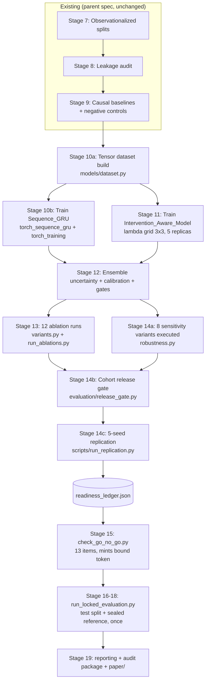

# Design Document

## Neural Experiment Pipeline

This design implements `.kiro/specs/neural-experiment-pipeline/requirements.md`. It sits on top of the completed parent spec `.kiro/specs/causal-witness-pwm/` and treats that spec's `decisions.md` as the sole source of frozen values. No number, threshold, formula, or named algorithm below is invented here; every one is read from `decisions.md` (principally Sections 8, 9, 10, 12, 14, 15, 16, 17, 18, 19, 20, 21, 25) and cited at its point of use.

The design follows the parent `design.md` section structure so the two documents can be read as one. Where the parent already describes a component, this document describes only the delta.

**One correction to requirements.md.** The Introduction's "Checklist reconciliation" paragraph states that `configs/go_no_go_checklist.yaml` carries 11 items. It carries **12**: `frozen_protocol`, `frozen_causal_diagram`, `frozen_adjustment_set`, `estimand_alignment_checked`, `reference_inaccessible_to_model_selection`, `leakage_tests_passed`, `splits_cross_fitting_verified`, `thresholds_frozen`, `target_population_defined`, `statistical_procedures_locked`, `privacy_checks_passed`, `one_command_reproduction_verified` — all currently `false`. Section 2.6 below reconciles 12 existing items plus the neural-readiness condition this spec adds, for a designed total of 13. (Requirement 13.13, Requirement 18.4)

## Overview

The parent pipeline is complete and passing 679 tests through Stage 14, with three structural gaps that make the central research claim untestable:

1. **The models are prototypes, not trained systems.** `src/models/sequence_baseline.py` and `src/models/intervention_aware.py` are pure-Python GRUs with central-difference numerical gradients. They are correct as executable specifications of the architecture but cannot be trained to convergence on 855 patients in useful time, and numerical gradients make any measured baseline-vs-intervention-aware difference an artifact of the gradient estimator rather than of representation.
2. **The experimental layer runs but does not vary.** `run_all_ablations` fits the same `CoxBaseline` for all ten arms, producing ten copies of one concordance value. `SensitivityRobustness.run()` returns descriptions and executes nothing, so `run_causal_analysis.py` hardcodes `sensitivity_stable=False` into the causal witness.
3. **The locked evaluation has no door.** `run_paper.py --stage locked-evaluation` refuses with a stale message claiming `check_go_no_go.py` does not exist (it exists and mints tokens). The sealed reference carries a single log-HR, which cannot be compared on-scale to a neural risk difference. `LockedEvaluationToken` carries only `issued_by` and `issued_at`, so it authorizes nothing in particular.

This spec closes exactly those three gaps and nothing else. The scope boundary in requirements.md is honored literally: data ingestion, cohort construction, observationalization, the six conventional estimators, witness definitions, overlap rules, and export scanning are consumed as-is.

Three design principles, extending the parent's two:

1. **Reuse over reimplementation.** Every new module wraps an existing one. The training harness derives seeds through `infra.seeding.derive_seed`, not its own HMAC. The dataset builder computes elapsed weeks through `causal.baselines._elapsed_weeks`, not its own week arithmetic (Requirement 1.3). Loss terms mirror `models/losses.py`'s already-tested pure-Python semantics. No metric is recomputed that `evaluation/metrics.py` already provides.
2. **Torch is a leaf dependency, never a trunk one.** Exactly five modules import torch (Section 2.4). Every existing code path — the six causal estimators, all three witnesses, overlap diagnostics, negative controls, export scanning, the sealed reference, and all 679 current tests — must continue to run in an environment where torch is not installed.
3. **Gates and guards are mechanical, not procedural.** Requirement 18.3 ("test split closed until every seed, ablation arm, and sensitivity variant has executed deterministically") is enforced by a readiness ledger that the token minter reads, not by a reviewer's diligence (Section 2.6, tension 7).

### Empirical honesty premise

Nothing in this design assumes the intervention-aware model wins. The most recent real-data run failed the release gate (overlap support fail, causal witness fail, temporal uncertain, aggregate release false). The pipeline must report that outcome and the parent's frozen valid negative result (`decisions.md` Section 21) unaltered. Two consequences shape the design: suppressed estimates get full audit reports with `estimate_status="suppressed"` and a null value (Requirement 12.5), and the ablation runner's job is to prove the arms are *distinct*, not that any particular arm is *better* (Requirement 7.13).

## Architecture

### 2.1 Where the new stages sit

The parent's Stage 10-16 slots are occupied by placeholders. This spec fills them without renumbering:



Two structural facts to note. The readiness ledger is written by Stages 13/14 and read by Stage 15 — it is the mechanical form of Requirement 18.3. And Stage 16 is a *separate script*, not a flag on a training script, because Requirement 13.1 demands an entry point with no code path that can fit anything.

### 2.2 Configuration and experiment identity

The parent's identity rule stands: `compute_experiment_id(resolved_config) = sha256(canonical_json(canonical_dict(resolved_config)))[:16]`. This spec extends `ExperimentConfig` with new fields rather than routing variant information around the hash (tension 3, Section 2.6). Two runs differing in any model-affecting or variant-affecting field therefore get different experiment IDs by construction, and a rerun from an unchanged `ResolvedConfig` reproduces its ID (Requirement 9.9, Requirement 6.6).

### 2.3 Directory conventions

New subtrees under the parent's `results/<experiment_id>/`:

```text
results/<experiment_id>/
├── models/
│   ├── sequence_gru/{checkpoints/replica_{0..4}.pt, training_log.json, lambda_selection.json}
│   └── intervention_aware/{checkpoints/replica_{0..4}.pt, training_log.json, lambda_selection.json}
├── predictions/
│   ├── complete_model/{val,dev}_patient_predictions.json   # reuse source for gate ablations
│   └── <variant_name>/{val}_patient_predictions.json
├── uncertainty/{ensemble_summary.json, calibration.json, risk_coverage.json}
├── ablations/{run_<name>_seed<seed>.json, ablation_table.json, collision_report.json}
├── robustness/{sensitivity/<variant_name>.json, sensitivity_stability.json, subgroup/...}
├── release_gate/{decision.json}
├── audit/{public/<claim_id>.json, protected/<claim_id>.json}
├── readiness_ledger.json
└── synthetic/<scenario_name>/...

results/replication/<replication_id>/
├── seeds/{101,202,303,404,505}/ -> symlink or recorded pointer to per-seed results/<experiment_id>/
└── replication_summary.json

results/locked_evaluation/<evaluation_id>/       # written once, atomically
├── token_verification.json
├── test_metrics.json
├── paired_bootstrap_holm.json
├── witnesses.json
├── release_gate.json
├── reference_comparison.json
└── manifest.json
```

`audit/public/` is the only audit path the export scanner is pointed at; `audit/protected/` holds numeric values for suppressed estimates and is chmod 0600 alongside `reference/` (Requirement 12.6, 12.7).

The locked-evaluation directory is written by a two-phase commit: everything is staged under `results/locked_evaluation/.staging_<evaluation_id>/` and moved with a single `os.rename` of the staging directory only after all steps succeed. That is what makes Requirement 13.10's "one indivisible commit" and 13.11's "leave everything byte-identical" implementable on a POSIX filesystem without a database.

### 2.4 Torch isolation (Requirement 5.1-5.2, principle 2)

Exactly five modules import torch:

| Module | Imports torch | Notes |
|---|---|---|
| `src/models/dataset.py` | yes | tensor construction only |
| `src/models/torch_sequence_gru.py` | yes | `nn.Module` |
| `src/models/torch_intervention_aware.py` | yes | `nn.Module` |
| `src/models/torch_training.py` | yes | optimizer, autograd, checkpoint I/O |
| `src/models/variants.py` | deferred | see below |

`variants.py` holds `ExperimentVariant` (a pure frozen dataclass with no torch types in its signature) and `build_model()`. The torch imports live *inside* `build_model`'s body, so `from models.variants import ExperimentVariant` succeeds without torch. This matters because `evaluation/ablation_matrix.py` needs `ExperimentVariant` to bridge to `AblationConfig` (tension 2) and `ablation_matrix` is imported by tests that must run torch-free.

Guarantees:

- `src/models/__init__.py` must not import any `torch_*` module or `dataset`. Enforced by `tests/unit/test_torch_isolation.py`, which runs a subprocess with a `sys.meta_path` hook that raises on `import torch`, then imports `causal.baselines`, `causal.overlap`, `causal.propensity`, `causal.negative_controls`, all three witness modules, `witnesses.aggregation`, `witnesses.audit_report`, `cohorts.pipeline`, `cohorts.sealed_reference`, `evaluation.metrics`, `evaluation.statistics`, `evaluation.ablation_matrix`, `evaluation.robustness`, `evaluation.release_gate`, `models.variants`, and `scripts.scan_exports`. Any torch import inside that subprocess fails the test.
- `pyproject.toml` gains `torch==2.5.1` and `numpy` as pinned **optional** extras under a `neural` extra, plus a `dev` extra that includes `neural`. The base install stays `pydantic==2.9.2` + `PyYAML==6.0.2`, so the existing 679 tests keep running in a base environment. Requirement 5.1-5.2 asks that the manifest *declare pinned versions of torch and numpy*; declaring them as a pinned extra satisfies that while preserving torch-free operation of the non-neural layer. numpy is currently absent from the environment and must be installed with the extra — nothing in the existing code depends on it.
- Torch-requiring tests are collected under `tests/neural/` and marked `@pytest.mark.neural`, skipped via `importorskip("torch")`.

Local machine is an Apple M2 with 8 GB and no CUDA (MPS available); training target is a remote A100 80 GB. `--device` accepts `cpu` (default) and `cuda` only, per `decisions.md` Section 25. MPS is deliberately **not** an accepted value: `torch.use_deterministic_algorithms(True)` has incomplete MPS coverage, and Requirement 5.5 requires cpu/cuda agreement within floating-point accumulation tolerance, a claim we would not be able to make for a third backend. Local validation runs on `cpu`; at hidden_size=16 and N≈380 with full-batch updates, CPU training of all 5 replicas is minutes, not hours.

### 2.5 Relationship to the pure-Python prototypes

`sequence_baseline.py`, `intervention_aware.py`, and `branch_heads.py` are **retained as the specification of record**, not superseded and not deleted. Rationale: they are the only executable, dependency-free statement of the architecture; their 3 property tests in `tests/property/test_invariance.py` are the parent spec's evidence for Requirement 9.9; and they define the exact constants (`INPUT_SIZE=3`, `LANDMARK_WEEKS=(0,20,96)`, `BASELINE_STATE_INIT_FIELDS=4`, `STATE_INPUT_DIM=4`, `INTERVENTION_INPUT_DIM=3`, `PROTOCOL_INPUT_DIM=2`) that the torch models must match.

The relationship is made mechanical, not aspirational:

- The torch modules **import their dimension constants from the prototypes** rather than redeclaring them. `torch_intervention_aware.py` does `from models.intervention_aware import STATE_INPUT_DIM, INTERVENTION_INPUT_DIM, PROTOCOL_INPUT_DIM`; `torch_sequence_gru.py` imports `LANDMARK_WEEKS` and `BASELINE_STATE_INIT_FIELDS`. A drift between prototype and production is then a `NameError` or a shape error, not a silent divergence.
- `tests/property/test_invariance.py` is refactored so its three properties are expressed once against an abstract model interface and parameterized over `[prototype, torch]` implementations, with the torch parameterization skipped when torch is absent. The prototype parameterization keeps running exactly as it does today, so those tests never regress (Correctness Property 12).
- Neither prototype is used to produce any reported number. `run_ablations.py`'s current use of `CoxBaseline` for all ten arms is replaced entirely.

### 2.6 The eight tensions, resolved

**Tension 1 — ten frozen ablation entries vs twelve executed runs (Requirement 7.1, 7.8).**
`ABLATIONS` stays at exactly ten `AblationConfig` entries and `len(ABLATIONS) == 10` stays true. The twelve runs come from *expansion at execution time*, not from list mutation. `witness_removed` already carries an `applies_to` key in its `config_diff` listing the three witnesses. A new function in `ablation_matrix.py`:

```python
def expand_ablations(ablations: Sequence[AblationConfig] = ABLATIONS) -> tuple[AblationRun, ...]:
    """Expand the 10 frozen entries into the 12 executed runs.

    Every entry expands to one run except `witness_removed`, which expands to one
    run per witness named in its config_diff["applies_to"] (3 witnesses -> 3 runs).
    Sub-run ids are f"{entry.name}::{witness}". Requirement 7.1, 7.8.
    """
```

`AblationRun` is a new frozen dataclass `{run_id: str, source_entry: str, sub_run_key: str | None, variant: ExperimentVariant, execution_mode: Literal["retrain","reuse_predictions"]}`. A frozen test asserts `len(expand_ablations()) == 12`, `len(ABLATIONS) == 10`, and that exactly three runs share `source_entry == "witness_removed"`. Nine single-run entries + three witness sub-runs = twelve (Requirement 7.1).

**Tension 2 — validated `ExperimentVariant` vs loose `config_diff` dicts (Requirement 6.1, 6.2).**
The frozen lists are not touched. A one-way bridge translates them:

```python
def variant_for_ablation(run: AblationRun) -> ExperimentVariant   # in models/variants.py
def variant_for_sensitivity(name: str) -> ExperimentVariant        # in models/variants.py
```

The bridge is a total, explicit mapping keyed by the ten frozen ablation names and eight frozen sensitivity names — a `dict[str, ExperimentVariant]` literal, not a heuristic parse of `config_diff`. A frozen test asserts the mapping's key set equals `{a.name for a in ABLATIONS}` and `{v.name for v in SENSITIVITY_VARIANTS}` respectively, so adding a frozen entry without a variant is a test failure, and the loose dicts remain the human-readable record while the dataclass becomes the machine-checked one. `config_diff` is retained and recorded in results for traceability; it is never the thing the factory reads.

**Tension 3 — `apply_variant -> ResolvedConfig` when `ExperimentConfig` has no fields for the variant knobs and `extra="forbid"` (Requirement 8.1, 8.2).**
`ExperimentConfig` today has exactly `experiment_name, seed, exploratory, witness_policy, tags`. Sensitivity variants need propensity model choice, weight clipping preset, support thresholds, missingness stress level, endpoint horizon, and selection-severity coefficients. Three options were considered:

- *Bypass the config* (pass variant knobs as function arguments): rejected — the knobs then do not enter `canonical_dict()`, so two sensitivity runs would share an `experiment_id` and `ExperimentRegistry.register` would raise `DuplicateExperimentError` on the second one, or worse, overwrite.
- *Relax `extra="forbid"`*: rejected — that is the mechanism that makes config typos loud.
- **Chosen: extend `ExperimentConfig` with an explicit, defaulted, validated sub-model.**

```python
class VariantOverrides(BaseModel):
    model_config = ConfigDict(extra="forbid", frozen=True)
    propensity_model: Literal["logistic", "boosted"] = "logistic"
    weight_clipping: Literal["primary_1_99", "narrow_0p5_99p5", "wide_5_95"] = "primary_1_99"
    support_thresholds: Literal["primary_0.10_0.90", "strict_0.20_0.80"] = "primary_0.10_0.90"
    missingness_stress: Literal["none", "increased"] = "none"
    landmark_masking: Literal["none", "week_20_removed"] = "none"
    comparator_orientation: Literal["primary", "reversed"] = "primary"
    endpoint_horizon_weeks: float = 96.0
    selection_severity: Literal["primary", "stronger"] = "primary"

class ExperimentConfig(BaseModel):   # extended
    experiment_name: str
    seed: int
    exploratory: bool = False
    witness_policy: str = "ALL_REQUIRED"
    tags: list[str] = []
    variant: VariantOverrides = VariantOverrides()   # NEW
    model_variant: ExperimentVariantSpec | None = None   # NEW, see below
```

`experiment_id` semantics are preserved rather than broken, by design: every field has a default equal to the primary/frozen setting, and `canonical_dict()` serializes defaults. Therefore **every existing config, unchanged, produces a `canonical_dict()` that now contains `variant: {all-primary values}` and `model_variant: null`** — which changes its hash. That is a one-time, deliberate, documented re-identification of all prior experiment IDs, recorded as a `decisions.md` Section 26 amendment (Requirement 18.2), and it is the honest outcome: the config space genuinely grew. The alternative — excluding new fields from the hash — would let two materially different runs collide, which is the failure `compute_experiment_id` exists to prevent. Prior result directories are not migrated; they are left in place and the amendment notes that IDs before the amendment date belong to the pre-neural config schema.

`SensitivityRunner.apply_variant(base_config, config_diff)` therefore validates each diff key against `VariantOverrides`' field set and raises `SensitivityConfigError` naming the unknown field before any execution (Requirement 8.2), then returns a fully materialized `ResolvedConfig` via `base.model_copy(deep=True)` with the validated overrides applied (Requirement 8.1).

**Tension 4 — sealed reference: one log-HR today vs three quantities plus a format version (Requirement 14.1-14.2, 14.6-14.7).**
`InternalReference` gains a `quantities` mapping and a `format_version`. `SealedReference.write_sealed_artifact` writes `format_version: 2`. `read_sealed_artifact` reads the version field *after* `assert_reference_unlocked` and before parsing the payload; on `format_version < 2` (including a missing field, treated as version 1) it raises `SealedFormatVersionError` naming the documented re-seal step (Requirement 14.7).

The migration path is a re-seal, not an in-place upgrade, because version 1 does not contain the arm-wise risks and they cannot be recovered from a log-HR:

1. Re-run Stage 3 to rebuild the complete eligible arm-0/arm-1 cohort (1054 arm-0/1 records, 855 eligible) — pre-split, pre-observationalization, per `decisions.md` Section 9 order (Requirement 14.2).
2. Call `SealedReference(cohort, extended_randomized_reference_estimator)`, which computes all three quantities in one pass.
3. Write to a *new* path `reference/internal_randomized_reference.v2.sealed.json`. The v1 artifact is left byte-identical and unread; there is no code path that upgrades it.
4. The re-seal script is `scripts/run_stage.py --stage seal-reference --reseal`, which refuses to run if a v2 artifact already exists at the target path.

The new estimator `extended_randomized_reference_estimator(cohort)` composes existing pieces: `causal.baselines.unadjusted_cox` for the log-HR (already used by `unadjusted_cox_reference_estimator`) and a Kaplan-Meier evaluation at `HORIZON_WEEKS=96.0` per arm via `cohort.by_arm(arm)` for the two arm risks; the risk difference is `risk_arm1 - risk_arm0`. This is composition of tested code, not a new estimator family.

Scale safety (Requirement 14.3-14.4): each quantity carries an explicit `scale` string matching `CausalEstimate.scale`'s vocabulary (`"log_hazard_ratio"`, `"risk"`, `"risk_difference"`). `compare_to_reference(estimate: CausalEstimate, reference: InternalReference, quantity: str)` raises `ScaleMismatchError` when `estimate.scale != reference.quantities[quantity].scale`. `evaluation/metrics.py::risk_difference_error_vs_internal_reference` already runtime-rejects non-`InternalReference` inputs; it is extended to select the `risk_difference` quantity by name and to assert its scale.

**Tension 5 — token with 2 fields vs 7 bound fields plus consumption tracking, without weakening `assert_reference_unlocked` (Requirement 13.3-13.6, 14.5).**
`assert_reference_unlocked(token)` raises unless `isinstance(token, LockedEvaluationToken)`. That check is **not** loosened, replaced, or supplemented with duck typing. Instead `LockedEvaluationToken` gains fields, all required, keeping the same class identity so the isinstance check gets strictly stronger:

```python
@dataclass(frozen=True)
class LockedEvaluationToken:
    issued_by: str
    issued_at: datetime
    resolved_config_hash: str      # NEW, all 7 required, non-empty
    dataset_checksum: str
    split_hash: str
    checkpoint_hashes: tuple[tuple[str, str], ...]   # (logical_name, sha256), sorted, non-empty
    git_commit: str
    statistical_plan_version: str
    evaluation_id: str
    def __post_init__(self):  # extends the existing empty-issued_by rejection
        ...  # raises TokenFieldError naming EVERY offending field at once
```

Because the fields are required with no defaults, no existing construction site can produce a partially-bound token — the only constructor is `_mint(...)`, which `check_go_no_go.py` calls. `_mint`'s signature is extended to take all seven; it validates each for presence and non-emptiness, checks `evaluation_id` against the consumption ledger for prior use, and names *every* offending field in one error (Requirement 13.4).

Consumption tracking lives outside the token, since the token is frozen and may be serialized: `results/locked_evaluation/consumed.jsonl`, append-only, one record per consumed `evaluation_id` with its consumption timestamp and the resulting `evaluation_id` directory. `run_locked_evaluation.py` checks this ledger *before* opening the test split or the sealed reference (Requirement 13.6). Minting also checks it, so a duplicated `evaluation_id` is refused at mint time as well.

`SealedReference.unseal(token)` and module-level `read_sealed_artifact(path, unlock_token)` both keep their existing `assert_reference_unlocked` call at the top. `unseal` additionally appends a reference-access record `{evaluation_id, accessed_at}` to `results/locked_evaluation/reference_access.jsonl`, which is what supplies the audit report's reference-access timestamp (Requirement 12.4, 14.5). The deferred import in `reference_guard.py` that avoids the import cycle stays exactly as it is.

**Tension 6 — `run_causal_analysis.py`'s own content hash vs `infra.registry.compute_experiment_id`.**
`run_causal_analysis.py` currently computes `_compute_content_experiment_id(dataset_checksum, trial_spec_version, master_seed, nc_bootstrap)` and raises `DuplicateExperimentError` itself. That is a second identity scheme. Reconciliation: `compute_experiment_id(resolved_config)` becomes the single identity function, and the content inputs `_compute_content_experiment_id` covered are moved *into* the resolved config so they are hashed there:

- `dataset_checksum` and `trial_spec_version` already live in `DatasetContractConfig` / `TargetTrialConfig`, both inside `ResolvedConfig` — so they are already in `canonical_dict()`.
- `master_seed` is `ExperimentConfig.seed` — already hashed.
- `negative_control_n_bootstrap` is the one input not represented; it is added to `ExperimentConfig` as `negative_control_n_bootstrap: int = 1000`.

`_compute_content_experiment_id` is then deleted and `run_causal_analysis` calls `ExperimentRegistry.register(resolved_config, git_commit, dirty, results_root)`, inheriting the registry's duplicate detection instead of duplicating it. Its own `DuplicateExperimentError` raise site goes away; the registry's remains. The registry's currently-`None` `RegistryEntry` placeholder fields (`trial_specification_version`, `model`, `split`, `intervention_representation`, `protocol_constraints`, `overlap_gate`, `uncertainty_gate`) are populated from `ResolvedConfig` + `ExperimentVariant` at register time, which is what they were reserved for (Requirement 6.6).

**Tension 7 — Requirement 18.3 needs a mechanical enforcement point.**
"WHILE any development-stage seed, ablation arm, or sensitivity variant remains unexecuted from its frozen configuration, keep the Test_Split closed and the Sealed_Reference_Store sealed" is a temporal condition. Conventions cannot enforce it. The mechanism is a **readiness ledger** plus a **single choke point**.

The choke point already exists in the right place: the only way to reach the test split's outcomes or the sealed reference is through a `LockedEvaluationToken`, and the only minter is `check_go_no_go.py`. So Requirement 18.3 is enforced by making the minter refuse unless the ledger is complete.

```python
# src/infra/readiness.py  (new, no torch)
@dataclass(frozen=True)
class ReadinessLedger:
    seeds_executed: tuple[int, ...]
    ablation_runs_executed: tuple[str, ...]
    sensitivity_variants_executed: tuple[str, ...]
    determinism_verified: tuple[str, ...]   # run ids re-executed and hash-matched

REQUIRED_SEEDS = (101, 202, 303, 404, 505)

def evaluate_readiness(ledger: ReadinessLedger) -> ReadinessDecision:
    """ready = set(seeds) >= REQUIRED_SEEDS
              and set(ablation_runs) >= {r.run_id for r in expand_ablations()}   # 12
              and set(sensitivity) >= {v.name for v in SENSITIVITY_VARIANTS}      # 8
              and every executed run id appears in determinism_verified.
    Returns machine-readable missing_items on not-ready. Requirement 18.3, 18.7."""
```

Each runner appends to the ledger only on successful completion, recording the run id and its result-artifact hash. The determinism entry is written by a second execution of the same `ResolvedConfig` whose artifact hashes match the first (Requirement 18.7) — this is how "executed deterministically" becomes checkable rather than asserted.

The test split has a second, independent guard for defense in depth: `infra/reference_guard.py` gains `assert_test_split_unlocked(unlock_token)`, mirroring the existing sealed-reference function and using the same `isinstance(token, LockedEvaluationToken)` check. `ObservationalizationPipelineResult.test` is not removed (existing tests depend on the attribute), but the accessor used by every runner is a new `require_test_split(pipeline_result, unlock_token)` helper that calls the guard first. Development-stage runners call nothing of the sort and thus cannot reach test outcomes (Requirement 18.6).

**Tension 8 — checklist reconciliation (12 items + neural readiness).**
`configs/go_no_go_checklist.yaml` keeps its 12 items with their exact current keys and gains one:

```yaml
neural_readiness_verified: false   # 13th item
```

Semantics: this item is not hand-set. `check_go_no_go.py` computes it from `evaluate_readiness(load_ledger(results_root))` and refuses to mint if the ledger says not-ready, listing missing seeds/arms/variants by name. The other 12 remain human-attested booleans. Any item that is unresolved, absent, or non-boolean causes refusal with every offending item named (Requirement 13.13). Total designed items: 13.

## Components and Interfaces

### 3.1 `src/models/dataset.py` — Patient_Dataset_Builder (Requirement 1)

**Why it is new and not a reimplementation.** Nothing in the repository converts `PatientRecord` to tensors; the prototypes accept plain Python lists built ad hoc in tests. This module is the single conversion point, and it delegates every semantic decision to existing code: elapsed weeks come from `causal.baselines._elapsed_weeks` (Requirement 1.3), baseline covariate ordering comes from `causal.propensity.COVARIATE_FIELDS`, landmarks come from `models.sequence_baseline.LANDMARK_WEEKS`, and preprocessing parameters come from the already-fitted `FittedPreprocessing` produced by `cohorts.pipeline` where available.

```python
LANDMARK_COUNT = 3               # = len(sequence_baseline.LANDMARK_WEEKS)
SURVIVAL_BIN_COUNT = 23          # decisions.md Section 25
BIN_WIDTH_WEEKS = 8.0
FINAL_BIN_START_WEEKS = 176.0
MISSING_PLACEHOLDER = 0.0        # single fixed finite fill, Requirement 1.5

def survival_bin_index(elapsed_weeks: float) -> int:
    """23 bins: [0,8), [8,16), ... [168,176), [176,inf). Requirement 1.2."""

@dataclass(frozen=True)
class DatasetDimensions:
    baseline_covariate_width: int
    state_width: int          # 4, from intervention_aware.STATE_INPUT_DIM
    intervention_width: int   # 3
    protocol_width: int       # 2
    landmark_count: int       # 3
    survival_bin_count: int   # 23

class PatientDatasetBuilder:
    def fit(self, dev_records: Sequence[PatientRecord]) -> "PatientDatasetBuilder": ...
    def build(self, records: Sequence[PatientRecord], split_name: str) -> TensorBatch: ...
    @property
    def dimensions(self) -> DatasetDimensions: ...   # Requirement 1.7
```

`fit` computes standardization means/SDs over Development_Split rows with unmasked entries only, and is idempotent: repeated `fit` on the same input yields identical parameters (Requirement 1.4). `build` never refits. Column-level total-missingness (the real data's week-96 CD8 is 100% missing) causes that column's fit to be skipped, mask set missing for all patients in all three splits, and the placeholder used — no error (Requirement 1.9). Rows are ordered by ascending `patient_id`, deterministically, and the identifier tuple is returned alongside the tensors (Requirement 1.6). Empty input or a duplicate `patient_id` raises `DatasetBuildError` naming which (Requirement 1.8); an absent, non-finite, or negative-elapsed event time raises `DatasetBuildError` naming the patient and the reason, emitting nothing partial (Requirement 1.10).

`dimensions` is what `build_model` reads, so no width is hard-coded in the factory (Requirement 1.7, 6.3).

### 3.2 `src/models/torch_sequence_gru.py` — Sequence_GRU (Requirement 2)

**What it wraps.** It is the torch transcription of `sequence_baseline.SequenceGRU`'s architecture: same `INPUT_SIZE=3` per-timestep input `[cd4, cd8, treatment_arm]`, same hidden width 16, same three landmarks, hidden state initialized from the 4 `BASELINE_STATE_INIT_FIELDS` covariates. It is not a reimplementation of the *architecture* — the architecture is imported as constants from the prototype — it is a replacement of the *gradient mechanism* (central differences → autograd), which is the entire point (Requirement 2.5).

```python
class TorchSequenceGRU(nn.Module):
    def __init__(self, dimensions: DatasetDimensions, hidden_size: int = 16): ...
    def forward(self, batch: TensorBatch) -> SequenceOutput:
        """SequenceOutput(state_pred: (N,3,2), hazards: (N,23))"""
```

Treatment arm enters as an ordinary column of the per-timestep input, with no separate encoder (Requirement 2.2). The baseline-covariate → hidden projection is a single `nn.Linear(BASELINE_STATE_INIT_FIELDS, 16)` followed by `tanh`, matching the prototype's init (Requirement 2.1). Hazards are a `nn.Linear(16, 23)` head reading the final hidden state; state predictions are a `nn.Linear(16, 2)` head applied at each landmark (Requirement 2.3). `eval()`-mode forward is deterministic by construction — no dropout, no batchnorm anywhere in either model (Requirement 2.6).

### 3.3 `src/models/torch_intervention_aware.py` — Intervention_Aware_Model (Requirement 3)

**What it wraps.** Same relationship: encoder structure, channel widths, and concatenation order come from `models/intervention_aware.py` (`StateEncoder`/`InterventionEncoder`/`ProtocolEncoder` as linear+tanh, `concatenate_channels`, `GRUTransition.rollout`), and the two-branch tagging convention comes from `models/branch_heads.py`'s `evaluate_both_branches` (`factual`/`counterfactual`).

```python
class TorchInterventionAwareModel(nn.Module):
    def __init__(self, dimensions: DatasetDimensions, hidden_size: int = 16,
                 intervention_mode: InterventionMode = InterventionMode.LEARNED,
                 protocol_mode: ProtocolMode = ProtocolMode.ACTIVE,
                 placebo_vector: tuple[float, ...] | None = None): ...
    def forward(self, batch: TensorBatch, arm: Literal[0, 1]) -> BranchOutput: ...
    def rollout_both_arms(self, batch: TensorBatch) -> tuple[BranchOutput, BranchOutput]:
        """Requirement 3.4, 3.6: identical non-intervention inputs across the two calls."""
```

`rollout_both_arms` builds the intervention channel input as the *only* differing tensor between the two calls; every other tensor object passed is literally the same object, which makes Requirement 3.6 checkable by identity, not just by value (Correctness Property 14). The 96-week outcome is derived from the discrete-hazard sequence by `1 - prod(1 - h_k)` over bins up to week 96, with no separate unconstrained head existing in the module (Requirement 3.5). Encoder output widths are fixed at construction regardless of `intervention_mode` / `protocol_mode`; a zeroed or placebo channel occupies the same width (Requirement 3.3, Correctness Property 13).

`InterventionMode` = `LEARNED | ZEROED | PLACEBO`; `ProtocolMode` = `ACTIVE | ZEROED`. These are what the ablation variants select.

### 3.4 `src/models/torch_training.py` — Training_Harness (Requirements 4, 5)

**What it wraps.** Loss semantics come from `models/losses.py` (`masked_huber`, `mmd`, `total_loss`, `load_lambda_grid`, `select_lambda_by_validation_concordance`) and `models/training.py` (`EarlyStopping`, `save_checkpoint`/`load_checkpoint`, `discrete_time_censored_nll`, `censoring_aware_loss`, `derive_run_seed`). The torch module supplies differentiable tensor implementations of the same three loss terms and reuses the existing scalar-level functions as the reference the unit tests compare against. Lambda selection reuses `select_lambda_by_validation_concordance` unchanged — the harness passes it validation concordance values computed by `evaluation.metrics.concordance_index`.

```python
def train_one_model(model, batches, config: TrainingConfig, seed: int,
                    device: str, manifest: ManifestWriter) -> TrainingResult
def select_lambdas(model_factory, batches, seed, device) -> LambdaSelection   # 3x3, Requirement 4.3
def train_ensemble(model_factory, batches, master_seed, device,
                   n_replicas: int = 5) -> EnsembleResult                     # Requirement 4.6
def resolve_device(requested: str) -> str                                     # Requirement 5.6
def seed_everything(seed: int) -> None                                        # Requirement 5.4
```

Frozen training configuration, read from `decisions.md` Section 25: Adam, `betas=(0.9, 0.999)`, `weight_decay=1e-4`, `lr=1e-3` fixed with no schedule, full-batch, global-norm gradient clipping at 1.0, early-stopping patience 20, `max_epochs=500`, checkpoint = the validation-loss-minimizing epoch (Requirement 4.4, 4.5). Objective is `survival_NLL + lambda_state * masked_huber(cd4/cd8) + lambda_balance * MMD(z_treated, z_control)` (Requirement 4.1, `decisions.md` 14.3); masked-missing entries contribute zero to both value and gradient, achieved by multiplying the per-element Huber term by the mask before reduction (Requirement 4.2).

The 3x3 lambda grid over `{0.1, 0.3, 1.0}²` is selected by **validation composite-endpoint concordance only** (Requirement 4.3), and every selection input — grid choice, early stopping, checkpoint epoch, uncertainty threshold — reads Development_Split and Validation_Split values exclusively (Requirement 4.7, 18.5).

Replica seeds are `derive_seed(master_seed, f"replica_{i}")`, matching `uncertainty/ensemble.py::DeepEnsemble`'s existing derivation exactly, so the harness and the ensemble agree on which seed produced which replica (Requirement 4.6).

Checkpoints are written via the existing plain-dict format — `{"model_state_dict", "optimizer_state_dict", "epoch", "seed", "val_loss"}` through `torch.save`, never a pickled model object (`decisions.md` Section 25, Requirement 4.5). A `checkpoint_sha256(path)` helper produces the hashes bound into tokens and audit reports.

`seed_everything` sets `torch.manual_seed`, `torch.cuda.manual_seed_all`, and `torch.use_deterministic_algorithms(True)` guarded by a capability check (Requirement 5.4). `resolve_device("cuda")` on a machine without `torch.cuda.is_available()` raises `DeviceUnavailableError` before any tensor is allocated and before training starts (Requirement 5.6). The device string, per-epoch loss curve, selected lambdas, selected epoch, and checkpoint hash all go into the run manifest through `ManifestWriter.set_model_config` / `add_checkpoint_path` / `add_metric` (Requirement 4.9, 5.7).

Any attempt by a training path to reach the sealed reference or test split terminates the run: the harness takes `dev` and `val` batches as separate typed parameters and has no parameter through which a test batch could arrive, and it calls neither `require_test_split` nor `unseal` (Requirement 4.8).

### 3.5 `src/models/variants.py` — Experiment_Variant + Variant_Factory (Requirement 6)

**Why new.** There is no single construction point for "the model this arm needs" today; `run_ablations.py` hardcodes one `CoxBaseline`. This module is the sole factory (Requirement 6.3) and the bridge described in tension 2.

```python
@dataclass(frozen=True)
class ExperimentVariant:
    name: str
    model_family: Literal["cox", "sequence_gru", "intervention_aware"]
    treatment_representation: Literal["absent", "ordinary_feature", "explicit_channel", "placebo_channel"]
    protocol_channel: Literal["active", "zeroed"]
    overlap_gate: bool
    uncertainty_gate: bool
    clinical_constraints: bool
    enabled_witnesses: frozenset[Literal["temporal", "causal", "clinical"]]
    causal_adjustment: bool
    balance_penalty_enabled: bool
    def __post_init__(self) -> None:
        """Raises VariantValidationError on any out-of-set value or on the two
        structurally impossible combinations:
          - model_family='sequence_gru' with treatment_representation='explicit_channel'
          - model_family='cox' with protocol_channel='active'
        Requirement 6.2."""

def build_model(variant: ExperimentVariant, dimensions: DatasetDimensions, seed: int): ...
def model_affecting_fields(variant: ExperimentVariant) -> dict[str, object]: ...
def variant_for_ablation(run: AblationRun) -> ExperimentVariant: ...
def variant_for_sensitivity(name: str) -> ExperimentVariant: ...
```

`build_model` imports torch inside its body (Section 2.4) and dispatches: `cox` → existing `CoxBaseline`; `sequence_gru` → `TorchSequenceGRU`; `intervention_aware` → `TorchInterventionAwareModel` with `intervention_mode` / `protocol_mode` / `placebo_vector` derived from the variant. All parameter initialization flows from `seed` through `seed_everything` before construction (Requirement 6.5).

`model_affecting_fields` is the explicit projection used by the collision detector and by the retrain-vs-reuse decision: `{model_family, treatment_representation, protocol_channel, balance_penalty_enabled, causal_adjustment}`. Variants differing only in gate or witness flags are reuse runs; variants differing in any model-affecting field are retrain runs (Requirement 7.10, 6.4).

Registration: after construction, `build_model`'s caller registers `{variant fields, experiment_id}` through `ExperimentRegistry`, populating the previously-`None` `RegistryEntry` fields `model`, `intervention_representation`, `protocol_constraints`, `overlap_gate`, `uncertainty_gate`, `split`, and `trial_specification_version` (Requirement 6.6).

### 3.6 `src/evaluation/ablation_matrix.py` — expansion, unchanged frozen list (Requirement 7)

Additions only: `AblationRun`, `expand_ablations()`, and the ten-key variant mapping (tension 1, tension 2). `ABLATIONS` and its ten `name=` values are untouched; `len(ABLATIONS) == 10` stays true.

Execution mode per frozen entry:

| Frozen entry | Runs | Mode | Variant delta from complete model |
|---|---|---|---|
| `no_treatment_input` | 1 | retrain | `treatment_representation="absent"`; treatment elements zero at every landmark, all other inputs identical (Req 7.2) |
| `treatment_as_ordinary_feature` | 1 | retrain | `model_family="sequence_gru"`, treatment inside the state channel, no intervention channel (Req 7.3) |
| `explicit_intervention_channel` | 1 | retrain | complete model; width-3 intervention channel, same hidden width 16 as the GRU arm (Req 7.14) |
| `intervention_channel_without_protocol` | 1 | retrain | `protocol_channel="zeroed"`; width-2 all-zero protocol input, intervention channel identical (Req 7.4) |
| `placebo_intervention_channel` | 1 | retrain | `treatment_representation="placebo_channel"`; one width-3 vector per seed (Req 7.5) |
| `predictive_accuracy_only` | 1 | retrain | `balance_penalty_enabled=False`, `causal_adjustment=False`, factual objective unchanged (Req 7.9) |
| `no_overlap_gate` | 1 | reuse | `overlap_gate=False` (Req 7.6) |
| `no_uncertainty_gate` | 1 | reuse | `uncertainty_gate=False` (Req 7.6) |
| `no_clinical_constraints` | 1 | reuse | `clinical_constraints=False`, gates and all 3 witnesses stay active (Req 7.7) |
| `witness_removed` | 3 | reuse | one run per witness in `config_diff["applies_to"]` (Req 7.8) |
| **total** | **12** | | 6 retrain, 6 reuse |

Six retrained arms is exactly the count Requirement 7.13 uses for its distinctness check ("the six retrained runs yield fewer than six distinct primary-metric values"), which confirms the split above matches the requirement's intent.

The placebo vector is drawn once per seed from `derive_seed(master_seed, "placebo_intervention_channel")`, held constant across every patient and landmark within a seed, redrawn only on seed change, and written into that run's results so a rerun at the same seed reproduces it (Requirement 7.5). This reuses `intervention_aware.PlaceboInterventionEncoder`'s semantics; the torch model takes the drawn vector as `placebo_vector` rather than drawing its own.

Reuse runs load `predictions/complete_model/val_patient_predictions.json` unmodified, perform no training, bypass only the named gate or witness, and record the count of Validation_Split patients whose decision differs from the complete model's (Requirement 7.6, 7.7, 7.8). Each reuse run verifies the source's recorded checkpoint hash against the complete model's; a missing, unreadable, or mismatched source produces an error for that run only, writes no metrics for it, and leaves other runs' results untouched (Requirement 7.15).

Metrics: the frozen primary factual metric (`decisions.md` Section 18) is computed on Validation_Split patients only, excluding every Development_Split patient used for fitting, once per frozen seed, reported per-seed plus the five-seed mean (Requirement 7.11). Each run records run id, variant fields, checkpoint hash (retrain) or reuse-source id + source checkpoint hash (reuse), evaluated split, seed, and metric values (Requirement 7.12).

**Collision detection** (Requirement 7.13) lives in `detect_variant_collisions(runs, predictions_by_run, metrics_by_run) -> CollisionReport`: at a fixed seed, any two runs whose `model_affecting_fields` differ but whose patient-level predictions agree within 1e-9 for every Validation_Split patient is a collision; so is fewer than six distinct primary-metric values across the six retrained runs. On any collision the runner writes `collision_report.json`, marks the ablation table invalid, and does not publish it. A retrained run that fails to complete training is recorded as failed with its cause, excluded from the table, and the table is marked incomplete (Requirement 7.16) — distinct from *invalid*, since incomplete is recoverable by rerunning one arm.

### 3.7 `src/evaluation/robustness.py` — Sensitivity_Runner made to execute (Requirement 8)

`SENSITIVITY_VARIANTS`' eight entries and `SubgroupRobustness` (the frozen `prior_art_status` primary subgroup analysis, already working) are untouched. `SensitivityRobustness.run()` changes from returning descriptions to executing.

```python
def apply_variant(base_config: ResolvedConfig, config_diff: Mapping[str, object]) -> ResolvedConfig
class SensitivityRobustness:
    def run(self, base_config, pipeline_inputs, master_seed) -> SensitivityStabilityResult
```

`apply_variant` validates every diff key against `VariantOverrides`' field set and raises `SensitivityConfigError` naming the unknown field before execution (Requirement 8.2), then materializes a complete `ResolvedConfig` (Requirement 8.1) — tension 3.

Per-variant execution, all eight through the same pipeline stages rather than bespoke code paths:

| Variant | Executed as |
|---|---|
| `boosted_propensity_model` | `propensity_model="boosted"`; `BoostedPropensityModel` raises `MissingDependencyError` (no xgboost) → recorded unexecuted with that reason, overall stability undetermined (Req 8.10) |
| `alternative_weight_clipping` | `weight_clipping` preset switch through `causal.weighting.clip_weights` |
| `alternative_support_thresholds` | `support_thresholds` preset; re-runs `OverlapDiagnostics.compute` |
| `increased_missingness_stress` | mask injection applied **after** splitting, seeded `derive_seed(master_seed, variant_name)` (Req 8.5) |
| `week_20_removed` | `landmark_masking="week_20_removed"`: week-20 mask set missing, timestep **retained** in the sequence (Req 8.6) |
| `treatment_comparator_reversal` | `comparator_orientation="reversed"`; reported direction re-expressed as the original contrast by negating the estimate and swapping interval bounds (Req 8.4) |
| `shifted_endpoint_horizon` | `endpoint_horizon_weeks` passed to `run_all_baselines(..., horizon_weeks=...)`, which already parameterizes it |
| `stronger_selection_severity` | `selection_severity="stronger"` reading the coefficients from `decisions.md` — **prerequisite amendment**, see below (Req 8.7) |

**Prerequisite amendments.** Two values this spec needs are not in `decisions.md` and must be recorded there with a Section 26 amendment-log entry *before the first run that depends on them* (Requirement 18.2): the stronger-observational-selection coefficients (Requirement 8.7) and the cross-seed stability criterion (Requirement 9.6, which requires direction agreement in at least 4 of 5 seeds with no required sensitivity variant contradicting the aggregate direction). A third amendment is the `experiment_id` re-identification from tension 3. All three are `decisions.md` edits, not design decisions taken here.

Output is a machine-readable `SensitivityStabilityResult` (Section 4) carrying per-variant estimate, interval, status, and an overall determination (Requirement 8.8). Every `Estimate_Runner` that evaluates the causal witness passes this in place of `run_causal_analysis.py`'s hardcoded `sensitivity_stable=False`; `CausalWitness.evaluate`'s existing `sensitivity_stable: bool` parameter receives `result.overall_stability == "stable"`, with `"undetermined"` mapping to `False` so an unexecuted variant can never read as stability (Requirement 8.9, 8.10).

### 3.8 `src/evaluation/release_gate.py` — Cohort_Release_Gate (Requirement 11)

**Why new.** The parent design named `release_gate.py` under `src/uncertainty/` but the shipped code only has `support_gate.py` (patient level). No component computes the cohort-level formula; `run_causal_analysis.py` reports the witness aggregation alone. It is placed under `evaluation/` because it consumes `OverlapReport` and witness results, both of which `evaluation` already imports, and because `uncertainty/` must stay free of witness imports.

```python
@dataclass(frozen=True)
class ReleaseDecision:
    released: bool
    overlap_valid: bool
    balance_valid: bool
    uncertainty_valid: bool
    temporal_pass: bool
    causal_pass: bool
    clinical_pass: bool
    reasons: tuple[str, ...]

def evaluate_release(overlap: OverlapReport, witness_results: Sequence[WitnessResult],
                     uncertainty_valid: bool) -> ReleaseDecision
```

`released = overlap_valid and balance_valid and uncertainty_valid and temporal=="pass" and causal=="pass" and clinical=="pass"`, a single boolean expression, exactly `decisions.md` Section 16 (Requirement 11.1). `overlap_valid` reads `OverlapReport.support_valid`; `balance_valid` reads `OverlapReport.smd_sufficient`; both come from the existing report rather than being recomputed. A causal-witness `"uncertain"` is not a pass and therefore blocks (Requirement 11.3). All six condition statuses are always returned (Requirement 11.2) and every failing condition is enumerated in `reasons` (Requirement 11.5). Every `Estimate_Runner` reports this decision rather than `AggregateDecision.passed` (Requirement 11.4). Where the `TWO_OF_THREE` policy appears in reporting it is labeled exploratory, with `ALL_REQUIRED` retained as primary (Requirement 11.6); `RISK_WEIGHTED` continues to raise `NotImplementedError` and is not reported.

### 3.9 Uncertainty_Evaluator (Requirement 10) — wiring, not new code

Every metric Requirement 10 asks for already exists in `evaluation/metrics.py`: `mean_absolute_error`, `ipcw_brier_score`, `calibration_slope_intercept`, `retained_coverage`, `selective_risk`, `risk_coverage_curve`, `aurcc`, `incorrect_release_rate`, `unnecessary_abstention_rate`, `error_at_matched_coverage`. The gap is that no runner calls them on ensemble output. So this is a thin orchestration function inside `torch_training.py`'s sibling reporting path rather than a new module:

```python
def evaluate_uncertainty(ensemble: DeepEnsemble, val_batch: TensorBatch,
                         support_gate: PatientSupportGate) -> UncertaintyReport
```

Epistemic uncertainty is `DeepEnsemble.predict`'s population variance, the frozen convention (`decisions.md` Section 15, Requirement 10.3). Calibration is fit on Validation_Split only (Requirement 10.4). Patient retention applies the frozen four-part condition through the existing `PatientSupportGate.evaluate`, whose uncertainty threshold is the validation 90th percentile of ensemble variance (`decisions.md` Section 16, Requirement 10.6). Gated-vs-ungated comparison reports error at equal retained coverage for both (Requirement 10.5) via the existing `error_at_matched_coverage`. An empty supported population yields every selective metric as `None` with reason `"empty_supported_population"`, and the loop continues to the next configuration rather than aborting (Requirement 10.7).

### 3.10 `src/witnesses/audit_report.py` — extended, and finally called (Requirement 12)

`build_audit_report` exists and is called by no runner. Two changes: its signature gains the new fields, and every `Estimate_Runner` calls it — including for suppressed estimates (Requirement 12.1, 12.2).

```python
def build_audit_report(protocol, population, treatment, estimate: BootstrapCI | None,
                       overlap: OverlapReport, witness_results, abstentions, violations,
                       provenance, *,
                       release_decision: ReleaseDecision,
                       estimate_status: Literal["released", "suppressed"],
                       dataset_checksum: str, split_hash: str, resolved_config_hash: str,
                       checkpoint_hashes: Mapping[str, str], seed: int,
                       sensitivity_variant: str | None,
                       supported_count: int, abstained_count: int,
                       locked_evaluation_id: str | None = None,
                       reference_access_timestamp: datetime | None = None) -> AuditReport
```

Any required field that is unavailable raises `AuditFieldError` naming it, rather than emitting a partial report (Requirement 12.8). Two artifacts are written per candidate estimate: `audit/public/<claim_id>.json`, where a suppressed estimate carries `estimate_status="suppressed"`, `estimate: null`, and the release reason list (Requirement 12.5), and `audit/protected/<claim_id>.json`, which retains the numeric value and is chmod 0600 (Requirement 12.6). The export scanner is run over `audit/public/` and must report every file export-safe (Requirement 12.7); the numeric-suppression rule means public audit artifacts for blocked estimates contain no estimate value to leak. Locked-evaluation estimates additionally carry the locked evaluation id and the reference-access timestamp read from `reference_access.jsonl` (Requirement 12.4).

### 3.11 `scripts/run_replication.py` — Replication_Orchestrator + Aggregator (Requirement 9)

**What it wraps.** It is a loop over the existing development-stage entry points, not a new pipeline. Per seed it calls `run_observationalization_pipeline(..., master_seed=seed)`, builds tensors, trains both models with `train_ensemble`, saves patient-level predictions, evaluates the three witnesses through their existing `evaluate` methods, evaluates `evaluate_release`, and registers a content-hashed result directory (Requirement 9.1, 9.2).

```python
def run_seed(seed: int, base_config: ResolvedConfig, results_root: Path, device: str) -> SeedResult
def aggregate(seed_results: Sequence[SeedResult], criterion: StabilityCriterion) -> ReplicationSummary
```

Per-seed directories record seed, `ResolvedConfig` hash, split hash, and every checkpoint hash (Requirement 9.3). The aggregator reports per-seed estimates with intervals, mean, median, SD, range, effect-direction agreement (via existing `metrics.effect_direction_agreement`), witness status by seed, release-gate status by seed, sensitivity stability, and factual + selective metrics by seed (Requirement 9.4). Every seed is reportable; there is no code path that selects a best or worst seed — the aggregator's only input is the full tuple and its output retains all five values in every branch (Requirement 9.5, 9.8). The stability criterion is read from `decisions.md` (prerequisite amendment, Requirement 9.6) and reported alongside the determination (Requirement 9.7). Rerunning a seed from an unchanged `ResolvedConfig` reproduces its experiment id (Requirement 9.9). On completion each seed appends to the readiness ledger.

Cost note: 5 seeds × (2 models × 5 replicas × 9 lambda combinations) is the naive count. Lambda selection is performed **once per model per seed on a single replica**, then the selected pair trains the 5 replicas — that is what `decisions.md` 14.3 describes (a selection step, not a per-replica search), giving 5 × 2 × (9 + 5) = 140 training runs at hidden_size=16, N≈380, full-batch, max 500 epochs. Feasible on CPU.

### 3.12 `scripts/run_locked_evaluation.py` — Locked_Evaluation_Runner (Requirement 13)

**Why a separate script.** Requirement 13.1 requires an entry point with *no option to fit, tune, or select*. A flag on a training script cannot satisfy that, because the fitting code would still be reachable. This script imports `load_checkpoint` and the evaluation functions and does not import `torch_training`'s optimizer paths, `select_lambdas`, `train_one_model`, `train_ensemble`, or any calibration-fitting function. A test asserts that module's import graph excludes them (Correctness Property 16).

Execution order, chosen so nothing irreversible happens before verification completes:

1. Parse args. Any option resembling fitting/tuning/selection is rejected by name with a non-zero exit, before opening anything (Requirement 13.2).
2. Load the token artifact. Check `evaluation_id` and token against `consumed.jsonl`; refuse before opening test split or sealed reference, leaving artifacts and the consumption record byte-identical (Requirement 13.6).
3. Recompute and compare every bound hash — resolved config, dataset checksum, split hash, each checkpoint — against present artifacts. Terminate non-zero on the first mismatch, naming the field, writing nothing (Requirement 13.5).
4. Verify target paths under `results/locked_evaluation/<evaluation_id>/` are unoccupied; refuse non-zero and change nothing if occupied (Requirement 13.10).
5. Open the test split through `require_test_split(pipeline_result, token)` and unseal the reference through `SealedReference.unseal(token)` / `read_sealed_artifact(path, token)`, which record the reference-access timestamp (Requirement 13.7, 14.5).
6. Evaluate the saved test assignment and compute treatment-effect recovery over that identical patient set, comparing on matching scales via `compare_to_reference` (Requirement 13.7, 14.3-14.4).
7. Run `patient_level_bootstrap` with exactly 1000 patient-level replicates paired on identical patients, then `holm_correction` across exactly the three frozen comparisons, reporting 95% intervals (Requirement 13.8, `decisions.md` Section 19).
8. Evaluate all three witnesses and `evaluate_release` over the identical test patients, recording each outcome (Requirement 13.9).
9. Build audit reports for every candidate estimate, released and suppressed (Requirement 12.1-12.4).
10. Commit: `os.rename` the staging directory into place, then append to `consumed.jsonl` (Requirement 13.10).

Any failure after step 3 deletes the staging directory, leaves token, evaluation id, and all pre-existing artifacts byte-identical, reports the failing step by name, and exits non-zero (Requirement 13.11). Checkpoints are opened read-only and their hashes are recomputed after the run to confirm they are unchanged (Requirement 13.1).

`scripts/run_paper.py --stage locked-evaluation` is changed from its stale refusal to a delegation: it invokes `run_locked_evaluation` and propagates the exit status unchanged, emitting no message about `check_go_no_go.py` being absent (Requirement 13.12). `_redact_path_for_provenance` continues to be applied to any path recorded in provenance.

### 3.13 `scripts/check_go_no_go.py` — Token_Minter, extended (Requirements 13.3-13.4, 13.13, 15.3, 15.5)

The existing script keeps its checklist reading and adds: computation of the 13th item from the readiness ledger (tension 8); collection of the seven bindable fields; git provenance resolution; and the extended `_mint` call. Refusals, all non-zero with no token artifact written and every offending item named at once:

- any checklist item unresolved, absent, or non-boolean (Requirement 13.13)
- readiness ledger not ready — missing seeds, arms, or variants named (Requirement 18.4)
- any bindable field absent, empty, or duplicated (Requirement 13.4)
- `evaluation_id` already in `consumed.jsonl`
- working tree dirty, with the uncommitted paths listed (Requirement 15.3)
- git commit unavailable (Requirement 15.5)

### 3.14 `src/evaluation/synthetic_benchmark.py` — Synthetic_Benchmark (Requirement 16)

**What it wraps.** `scripts/_synthetic_fixtures.py` already builds synthetic `PatientRecord`/timeline fixtures for tests. This module extends that generator with a known ground-truth counterfactual effect and scenario knobs, and emits records satisfying the same data contract, so the identical pipeline consumes them (Requirement 16.3). It is not a second pipeline.

```python
SCENARIOS = ("limited_overlap", "unmeasured_confounding", "increased_missingness")

@dataclass(frozen=True)
class SyntheticScenario:
    name: str
    n_patients: int
    true_risk_difference: float      # ground truth, Requirement 16.1
    overlap_severity: float
    unmeasured_confounding_strength: float
    missingness_rate: float

def generate(scenario: SyntheticScenario, seed: int) -> SyntheticCohort
```

Generation is fully seeded through `derive_seed(seed, scenario.name)`, so a fixed seed reproduces identical cohorts (Requirement 16.4). Reporting labels synthetic results as failure-mode diagnostics and the real-data result as the primary empirical result (Requirement 16.5), and reports recovery error against the known ground truth alongside the release decision the gate produced for that scenario (Requirement 16.6).

This is also the component that supplies what the real data cannot: on ACTG175 the true counterfactual effect is unknown, so recovery error is only measurable against the sealed randomized reference, once. The benchmark gives unlimited, cheap, ground-truthed evaluation for development and for the gate's failure-mode claims.

### 3.15 `scripts/run_real_data_reporting.py` and `scripts/run_paper.py` (Requirements 17, 19, 20)

`build_experiment_json`, `UNSUPPORTED_METRIC_REASONS`, and `_SUPPRESSED_WHEN_RELEASE_GATE_FAILS` already implement suppression of causal columns when the gate fails. Changes are additive:

- The five headline comparisons (Requirement 17.1-17.5) become named entries in the results table: GRU vs intervention-aware, intervention-aware vs IPCW-AIPW, gated vs ungated, intervention encoder vs capacity-matched placebo, complete vs no-protocol and vs no-treatment-input. The first three are the frozen Holm family; the last two are reported without correction and labeled as such (Requirement 17.6).
- Every comparison reports evaluated split, seed set, and interval alongside the point difference (Requirement 17.7).
- Blocked primary estimate → report the blocked outcome, every failing condition, and supported/abstained counts (Requirement 19.1). Factual improvement without recovery improvement → report as the frozen valid negative result (`decisions.md` Section 21, Requirement 19.2). Every executed ablation arm, sensitivity variant, and seed is reported, including contradicting ones (Requirement 19.3). Claims restricted to `decisions.md` Section 22's permitted set (Requirement 19.4); estimates lacking a passing release decision have their numeric value excluded from public artifacts with suppression reasons retained (Requirement 19.5).
- `run_paper.py`'s `--stage locked-evaluation` delegates (Section 3.12).

### 3.16 `paper/` — Manuscript_Package (Requirement 20)

```text
paper/
├── iclr2027_conference.sty, iclr2027_conference.bst, fancyhdr.sty, natbib.sty
├── main.tex                  # \usepackage{iclr2027_conference}  (submission = anonymous)
├── sections/*.tex
├── generated/                # written by run_paper.py from saved artifacts, never hand-edited
│   ├── table_main_results.tex, table_ablations.tex, table_sensitivity.tex,
│   ├── table_replication.tex, figure_*.pdf
│   └── numbers.tex           # \newcommand per reported number
├── ai_assistance_statement.tex
└── Makefile                  # `make submission` (anonymous) / `make camera-ready`
```

Nine-page main-text limit with references and appendices outside it (Requirement 20.2). The `submission` target builds with the anonymous option and excludes author names, affiliations, acknowledgements, and identifying repository links (Requirement 20.3). The AI-assistance statement is a required included file (Requirement 20.4). Venue is changed to ICLR 2027 main track in both `pyproject.toml`'s description (currently "NeurIPS 2026 WMHS submission") and the manuscript (Requirement 20.5). Every reported number is drawn from `generated/numbers.tex`, produced by the one-command reproduction entry point from saved artifacts, so no number is typed into LaTeX by hand (Requirement 20.6). A figure or table reporting a suppressed estimate renders the suppression status in place of the value, using the same `estimate_status` field the audit reports carry (Requirement 20.7).

Note on Requirement 15.1: the project is **not currently a git repository**. Initializing it at the project root with the existing ignore rules (raw patient data and generated artifacts excluded) is a prerequisite for Requirements 15.2-15.5 and for minting any token.

## Data Models

### 4.1 `TensorBatch` (Requirement 1.1, 1.2, 1.5)

`N` = patients in the split (real sizes: dev-retained ~379-383, val ~126, test ~127). All float tensors are `torch.float32`; index and mask tensors are as noted. Row `i` of every tensor refers to `patient_ids[i]`.

```python
@dataclass(frozen=True)
class TensorBatch:
    split_name: str                     # "dev" | "val" | "test"
    patient_ids: tuple[str, ...]        # ascending, len N (Req 1.6)
    baseline: Tensor                    # (N, baseline_covariate_width) float32
    state_init: Tensor                  # (N, 4) float32, BASELINE_STATE_INIT_FIELDS
    cd4: Tensor                         # (N, 3) float32, landmarks 0/20/96 in order
    cd8: Tensor                         # (N, 3) float32
    cd4_mask: Tensor                    # (N, 3) bool, True = observed
    cd8_mask: Tensor                    # (N, 3) bool, True = observed
    treatment_arm: Tensor               # (N,) float32, values 0.0 or 1.0
    protocol: Tensor                    # (N, 2) float32, protocol channel width
    intervention: Tensor                # (N, 3) float32, intervention channel width
    bin_index: Tensor                   # (N,) int64, 0..22 inclusive (Req 1.2)
    censoring_mask: Tensor              # (N,) bool, True = censored before assigned bin start
    dimensions: DatasetDimensions
```

Bin definition (23 bins, `decisions.md` Section 25): `[0,8), [8,16), ..., [168,176)` gives 22 half-open 8-week bins covering weeks 0-176, plus `[176, inf)` as index 22. Any elapsed time at or beyond 176 weeks maps to 22. Elapsed weeks come from `causal.baselines._elapsed_weeks` (Requirement 1.3).

Masks are `True = observed`, `False = missing`. Every masked-missing entry in `cd4`/`cd8` holds exactly `MISSING_PLACEHOLDER = 0.0` — one fixed finite value, identical for every missing entry and every build, so the tensors contain no NaN or inf (Requirement 1.5). Zero is chosen because it is the additive identity for the mask-multiplied Huber term, making the zero-gradient guarantee exact rather than approximate. Real-data consequence: week-96 CD8 is 100% missing, so `cd8_mask[:, 2]` is `False` for every patient in all three splits, `cd8[:, 2]` is all zeros, and no preprocessing parameter is fitted for that column (Requirement 1.9).

`censoring_mask[i]` is set for exactly those patients whose `endpoint_result.censoring_indicator` is set **and** whose censoring time falls before the start of the assigned bin (Requirement 1.2).

### 4.2 `ExperimentVariant` — exact fields and allowed values (Requirement 6.1, 6.2)

| Field | Type | Allowed values |
|---|---|---|
| `name` | `str` | non-empty |
| `model_family` | `Literal` | `cox`, `sequence_gru`, `intervention_aware` |
| `treatment_representation` | `Literal` | `absent`, `ordinary_feature`, `explicit_channel`, `placebo_channel` |
| `protocol_channel` | `Literal` | `active`, `zeroed` |
| `overlap_gate` | `bool` | `True`, `False` |
| `uncertainty_gate` | `bool` | `True`, `False` |
| `clinical_constraints` | `bool` | `True`, `False` |
| `enabled_witnesses` | `frozenset` | subset of `{temporal, causal, clinical}` |
| `causal_adjustment` | `bool` | `True`, `False` |
| `balance_penalty_enabled` | `bool` | `True`, `False` |

The complete model is `ExperimentVariant(name="complete", model_family="intervention_aware", treatment_representation="explicit_channel", protocol_channel="active", overlap_gate=True, uncertainty_gate=True, clinical_constraints=True, enabled_witnesses=frozenset({"temporal","causal","clinical"}), causal_adjustment=True, balance_penalty_enabled=True)`. Out-of-set values, and the two structurally impossible combinations named in Section 3.5, raise `VariantValidationError` at construction (Requirement 6.2).

### 4.3 `SensitivityStabilityResult` (Requirement 8.8)

```python
@dataclass(frozen=True)
class SensitivityVariantOutcome:
    name: str
    status: Literal["executed", "unexecuted"]
    estimate: float | None
    ci_low: float | None
    ci_high: float | None
    scale: str | None                       # matches CausalEstimate.scale vocabulary
    diagnostic_status: Literal["pass", "fail", "uncertain", "undetermined"]
    direction: Literal["positive", "negative", "null", "undetermined"]
    failure_reason: str | None              # required when status == "unexecuted"
    resolved_config_hash: str | None

@dataclass(frozen=True)
class SensitivityStabilityResult:
    variant_outcomes: tuple[SensitivityVariantOutcome, ...]   # exactly 8, frozen order
    overall_stability: Literal["stable", "unstable", "undetermined"]
    unexecuted_variants: tuple[str, ...]
    criterion_description: str
```

Any `unexecuted` variant forces `overall_stability = "undetermined"` (Requirement 8.10), and `CausalWitness.evaluate` receives `sensitivity_stable = (overall_stability == "stable")`, so undetermined never reads as stable (Requirement 8.9).

### 4.4 `ReplicationSummary` (Requirement 9.4, 9.7, 9.8)

```python
@dataclass(frozen=True)
class SeedResult:
    seed: int
    experiment_id: str
    resolved_config_hash: str
    split_hash: str
    checkpoint_hashes: tuple[tuple[str, str], ...]
    primary_estimate: float | None
    ci_low: float | None
    ci_high: float | None
    scale: str
    witness_status: tuple[tuple[str, str], ...]      # (witness, pass|fail|uncertain)
    release_decision: ReleaseDecision
    factual_metrics: Mapping[str, float | None]
    selective_metrics: Mapping[str, float | None]

@dataclass(frozen=True)
class ReplicationSummary:
    seed_results: tuple[SeedResult, ...]             # exactly 5, all retained always
    mean: float | None
    median: float | None
    std_dev: float | None
    value_range: tuple[float, float] | None
    direction_agreement_count: int                   # 0..5
    stability_criterion: str                         # read from decisions.md, reported
    stability_determination: Literal["stable", "directionally_unstable", "undetermined"]
    sensitivity_stability: SensitivityStabilityResult
```

`seed_results` is retained in full in every branch, including `directionally_unstable` (Requirement 9.8), and no field selects a subset of seeds (Requirement 9.5).

### 4.5 Extended `InternalReference` (Requirement 14.1, 14.6)

```python
SEALED_FORMAT_VERSION = 2

@dataclass(frozen=True)
class ReferenceQuantity:
    value: float
    scale: Literal["log_hazard_ratio", "risk", "risk_difference"]
    horizon_weeks: float | None

@dataclass(frozen=True)
class InternalReference:
    value: Any                                        # retained: v1 log-HR, unchanged semantics
    cohort_size: int
    computed_at: datetime
    metadata: dict
    format_version: int = SEALED_FORMAT_VERSION       # NEW
    quantities: Mapping[str, ReferenceQuantity] = field(default_factory=dict)   # NEW
```

`quantities` keys, all three computed on the complete pre-split, pre-observationalization eligible arm-0/1 cohort (Requirement 14.2): `log_hazard_ratio` (scale `log_hazard_ratio`, horizon `None`), `risk_arm0` and `risk_arm1` (scale `risk`, horizon 96.0), `risk_difference` (scale `risk_difference`, horizon 96.0, value `risk_arm1 - risk_arm0`).

`value` keeps its existing meaning so v1 consumers and existing tests are unaffected; new consumers read `quantities`. A loaded artifact with `format_version < 2` or no version field raises `SealedFormatVersionError` naming the re-seal step (Requirement 14.7).

### 4.6 Extended `LockedEvaluationToken` (Requirement 13.3)

Fields as listed in Section 2.6 tension 5: the original `issued_by` and `issued_at` plus `resolved_config_hash`, `dataset_checksum`, `split_hash`, `checkpoint_hashes` (a sorted tuple of `(logical_name, sha256)` pairs, non-empty), `git_commit`, `statistical_plan_version`, `evaluation_id`. All required, all validated non-empty in `__post_init__`, which extends the existing empty-`issued_by` rejection and reports every offending field in a single `TokenFieldError`. Class identity and the frozen dataclass decorator are unchanged, so `assert_reference_unlocked`'s `isinstance` check is strictly strengthened, never weakened.

### 4.7 Audit-report additions (Requirement 12.3, 12.4)

`AuditReport.to_dict()` gains: `estimate_status` (`released` | `suppressed`), `release_decision` (the six condition booleans plus `released`), `release_reasons`, `dataset_checksum`, `split_hash`, `resolved_config_hash`, `checkpoint_hashes`, `seed`, `sensitivity_variant`, `supported_count`, `abstained_count`, and — for locked-evaluation estimates only — `locked_evaluation_id` and `reference_access_timestamp`. In the public artifact, `estimate` is `null` whenever `estimate_status == "suppressed"`.

## Error Handling

Continuing the parent's distinction: causal and statistical outcomes (no overlap, witness fail, release blocked, empty supported population) are **data**, because they are results the paper must report. Engineering and protocol violations (leakage, premature reference access, token misuse, variant collision) are **exceptions**, because they mean a bug or a broken protocol.

| Failure mode | Handling |
|---|---|
| torch not installed but a neural path is invoked | `MissingDependencyError` naming the `neural` extra and the pinned version; raised at `build_model` / dataset-build entry, not at module import, so torch-free paths are unaffected (Req 5.1-5.2) |
| `--device cuda` requested, no CUDA available | `DeviceUnavailableError` from `resolve_device`, reported and terminated before any tensor allocation and before training starts (Req 5.6) |
| Sealed-reference access before authorization | `ReferenceAccessError` from the existing `assert_reference_unlocked`, raised before the file is opened in `read_sealed_artifact` and at the call boundary in `unseal` (Req 18.6) |
| Test-split access during development | `ReferenceAccessError` from the new `assert_test_split_unlocked` via `require_test_split`; the run terminates (Req 4.8, 18.6) |
| Variant collision (identical predictions or <6 distinct retrained metrics) | `collision_report.json` written, ablation table marked **invalid** and not published; `VariantCollisionError` raised naming the colliding runs (Req 7.13) |
| Reuse-source checkpoint hash mismatch, or source missing/unreadable | `ReusePredictionSourceError` naming the missing or mismatched source; no metrics written for that run; results already written for other runs left unchanged (Req 7.15) |
| Retrained run fails to complete training | Recorded as failed with the naming cause, excluded from the table, table marked **incomplete** (recoverable, unlike invalid) (Req 7.16) |
| Sensitivity variant execution failure (e.g. `boosted_propensity_model` → `MissingDependencyError`, no xgboost) | Variant recorded `status="unexecuted"` with `failure_reason`; overall stability forced to `undetermined`; remaining variants still execute (Req 8.10) |
| Config diff names a field absent from the base config | `SensitivityConfigError` naming the field, raised before execution (Req 8.2) |
| Token field missing, empty, or duplicated at mint | `TokenFieldError` naming **every** offending field at once; non-zero exit; no token artifact written (Req 13.4) |
| Evaluation id or token already consumed | Refused before opening test split or sealed reference; non-zero exit; every artifact and the consumption record left byte-identical (Req 13.6) |
| Bound hash mismatch at locked-eval start | Terminate non-zero on the **first** mismatch, naming the field; no result artifact written (Req 13.5) |
| Locked-eval target path already occupied | Refuse non-zero, change nothing (Req 13.10) |
| Partial locked-eval failure after verification | Staging directory deleted; token, evaluation id, and all pre-existing artifacts byte-identical; error names the failing step; non-zero exit (Req 13.11) |
| Old-format sealed artifact loaded | `SealedFormatVersionError` naming the documented re-seal step; raised after authorization, before payload parsing (Req 14.7) |
| Scale mismatch in a reference comparison | `ScaleMismatchError` from `compare_to_reference` (Req 14.4) |
| Dirty working tree at mint | Minting declined, uncommitted paths listed, non-zero exit, no token written (Req 15.3) |
| Git commit unavailable | Provenance records the unavailable state explicitly; minting declined (Req 15.5) |
| Readiness ledger incomplete at mint | Minting declined; missing seeds, ablation runs, and sensitivity variants named (Req 18.3, 18.4) |
| Empty supported population | **Not an exception.** Every selective metric reported as `None` with reason `"empty_supported_population"`; evaluation of remaining configurations continues (Req 10.7) |
| Week-96 CD8 fully missing (real-data fact) | **Not an exception.** Column mask set missing across all splits, no preprocessing fitted for it, placeholder filled, build completes; the column contributes zero to the state loss (Req 1.9) |
| Release gate blocks the estimate | **Not an exception.** `ReleaseDecision(released=False, reasons=[...])`; suppressed audit artifact with null value; reported as a finding (Req 11.5, 12.5, 19.1) |
| Empty patient list or duplicate `patient_id` in a dataset build | `DatasetBuildError` naming whether input was empty or which id was duplicated; no tensors emitted (Req 1.8) |
| Absent, non-finite, or negative-elapsed event time | `DatasetBuildError` naming the patient and reason; no partial batch (Req 1.10) |
| Required audit field unavailable | `AuditFieldError` naming the field; no partial report emitted (Req 12.8) |
| Go/no-go item unresolved, absent, or non-boolean | Minting declined, every such item named, non-zero exit, no token artifact (Req 13.13) |

## Correctness Properties

*A property is a characteristic or behavior that should hold true across all valid executions of a system — essentially, a formal statement about what the system should do. Properties serve as the bridge between human-readable specifications and machine-verifiable correctness guarantees.*

The parent design states Properties 1-8 (sealed-reference isolation, observationalization independence, cross-fitting non-leakage, negative-control non-tautology, model-estimate labeling, unanimous witness release, capacity-matched ablation, frozen-value consistency). Those remain in force and are not restated. Numbering continues from 9.

### Property 9: Test-split isolation under the strengthened token

*For any* object that is not an instance of `LockedEvaluationToken`, including objects that expose identical attribute names and values, both `assert_reference_unlocked` and the new `assert_test_split_unlocked` raise `ReferenceAccessError`, and no development-stage code path reaches Test_Split outcomes or the sealed reference without such an instance. Extending the token from two to nine required fields strengthens this guarantee, because no partially-bound token can be constructed.

**Validates: Requirements 4.8, 13.3, 18.6**

### Property 10: Readiness gates the only door

*For any* readiness ledger missing at least one of the five frozen seeds, the twelve expanded ablation runs, or the eight frozen sensitivity variants, `evaluate_readiness` returns not-ready with the missing items named, and the Token_Minter declines to mint; readiness is true only when all three sets are complete and every executed run appears in the determinism-verified set.

**Validates: Requirements 18.3, 18.4**

### Property 11: Ablation arms are genuinely distinct

*For any* pair of runs at the same seed whose `model_affecting_fields` differ, their Validation_Split patient-level predictions differ by more than 1e-9 for at least one patient, and the six retrained runs yield six distinct primary-metric values; when either conjunct fails, the collision detector names the colliding runs and the ablation table is marked invalid rather than published.

**Validates: Requirements 6.4, 7.13**

### Property 12: Prototype-parity of the intervention invariances

*For any* randomized synthetic patient state, the three intervention-invariance properties of `tests/property/test_invariance.py` (a future treatment does not affect an earlier state; unchanged treatment preserves the factual output; changing treatment changes the counterfactual output) hold identically for the pure-Python prototypes and for the torch models, and the prototype parameterization continues to pass in an environment without torch.

**Validates: Requirements 3.4, 3.6**

### Property 13: Capacity-matched channel width invariance

*For any* combination of `InterventionMode` and `ProtocolMode`, the concatenated representation `[z_state; z_intervention; z_protocol]` has the same width (4 + 3 + 2) as the complete model's, so a zeroed or placebo channel changes information content and never capacity.

**Validates: Requirements 3.3, 7.4, 7.5**

### Property 14: Counterfactual rollouts differ only in the intervention channel

*For any* patient batch, the arm-0 and arm-1 rollouts receive element-wise identical baseline, state, protocol, and mask tensors — verified by object identity, not merely by value — and differ only in the intervention-channel input; and *for any* ablated batch, the ablated batch differs from the complete model's batch in exactly the named channel and in no other tensor.

**Validates: Requirements 3.6, 7.2, 7.4**

### Property 15: Masked-missing observations are inert

*For any* batch and *any* value substituted into a masked-missing CD4/CD8 position, the total loss value is unchanged and the gradient with respect to that position is exactly zero; every emitted observation tensor contains only finite values, with every missing position holding the single fixed placeholder.

**Validates: Requirements 1.5, 4.2**

### Property 16: Suppressed estimates carry no numeric value into public artifacts

*For any* candidate estimate whose `ReleaseDecision.released` is false, the public audit artifact has `estimate_status="suppressed"`, a null estimate, and a non-empty reason list; the estimate's numeric value appears nowhere in the serialized text of any public artifact; the value is retained only in the protected artifact; and the export scanner reports every public audit artifact export-safe.

**Validates: Requirements 12.5, 12.6, 12.7, 19.5**

### Property 17: Determinism from a frozen configuration

*For any* frozen `ResolvedConfig` and seed, two executions produce identical artifact hashes; two seeded model constructions produce bitwise-identical initial parameters; two eval-mode forward passes on the same batch produce bitwise-identical outputs; and `compute_experiment_id` returns the same identifier, while any single-field change to the resolved config changes it.

**Validates: Requirements 2.6, 5.4, 6.5, 9.9, 18.7**

### Property 18: Bin assignment is total, ordered, and delegated

*For any* finite non-negative elapsed-week value the assigned survival bin index lies in 0..22 inclusive, is non-decreasing in elapsed weeks, and equals 22 exactly when elapsed weeks is at or beyond 176; and *for any* `PatientRecord` the elapsed-week value used for assignment equals `causal.baselines._elapsed_weeks` applied to that same record.

**Validates: Requirements 1.2, 1.3**

### Property 19: Batch structure and ordering are consistent and deterministic

*For any* non-empty list of unique `PatientRecord` objects, every emitted tensor has N rows with the frozen trailing widths, row index i of every tensor refers to `patient_ids[i]`, the reported `DatasetDimensions` equal the corresponding trailing dimensions, patient identifiers are in ascending order, and two builds from the same records in any input order produce identical identifier sequences and identical tensors.

**Validates: Requirements 1.1, 1.6, 1.7**

### Property 20: Preprocessing is fitted once, on development data only

*For any* Development_Split input, fitting twice yields identical parameter values, and building Validation_Split or Test_Split batches leaves those parameters unchanged; parameters are computed from unmasked development entries only.

**Validates: Requirements 1.4, 18.5**

### Property 21: Release is the full six-condition conjunction

*For any* combination of overlap validity, balance validity, uncertainty validity, and the three witness statuses, release is granted exactly when all six conditions hold — a causal-witness `uncertain` blocks — and the returned reason list enumerates exactly the failing conditions, no more and no fewer.

**Validates: Requirements 11.1, 11.2, 11.3, 11.5**

### Property 22: Unexecuted sensitivity never reads as stability

*For any* set of eight sensitivity-variant outcomes containing at least one variant with `status="unexecuted"`, the overall stability determination is `undetermined` and the boolean supplied to `CausalWitness.evaluate` is false.

**Validates: Requirements 8.8, 8.9, 8.10**

### Property 23: Comparator reversal is an involution that preserves the original contrast

*For any* estimate and interval, applying the treatment-and-comparator reversal twice returns the original estimate and interval, and applying it once negates the point estimate and swaps the interval bounds, so the reported direction always refers to the original treatment contrast.

**Validates: Requirements 8.4**

### Property 24: Scale-matched reference comparison

*For any* pair of an estimate scale and a sealed-reference quantity scale, `compare_to_reference` succeeds exactly when the two scales are equal and raises `ScaleMismatchError` otherwise; in particular a risk-difference estimate is never compared against a log-hazard-ratio reference.

**Validates: Requirements 14.3, 14.4**

### Property 25: Old-format sealed artifacts are refused

*For any* sealed artifact whose recorded format version is absent or below 2, loading raises `SealedFormatVersionError` naming the documented re-seal step, and loading succeeds only at version 2 or above.

**Validates: Requirements 14.6, 14.7**

### Property 26: Minting names every offender

*For any* non-empty subset of the token's bound fields made absent, empty, or duplicated, and *for any* non-empty subset of checklist items made unresolved, absent, or non-boolean, the Token_Minter declines, names exactly that subset, exits non-zero, and writes no token artifact.

**Validates: Requirements 13.4, 13.13, 15.3, 15.5**

### Property 27: Locked evaluation is atomic

*For any* step after successful token verification, injecting a failure at that step leaves the results tree byte-identical, the token and evaluation identifier unconsumed, and no partial artifact present; a consumed evaluation identifier is refused before the test split or sealed reference is opened; and result artifacts are written only to unoccupied paths.

**Validates: Requirements 13.6, 13.10, 13.11**

### Property 28: Reuse ablations do not alter predictions

*For any* saved complete-model prediction set, a gate-bypass, constraint-disable, or witness-removal run reproduces those predictions byte-identically, performs no training, and reports a differing-decision count equal to the independently computed count of Validation_Split patients whose decision changed.

**Validates: Requirements 7.6, 7.7, 7.8**

### Property 29: Validation-only ablation metrics

*For any* split assignment, the patient identifiers over which an ablation's primary factual metric is computed are drawn from the Validation_Split and are disjoint from the Development_Split identifiers used for fitting.

**Validates: Requirements 7.11**

### Property 30: Synthetic cohorts are contract-valid, ground-truthed, and reproducible

*For any* scenario parameters and seed, the generated cohort satisfies the same data contract the real cohort satisfies (accepted by the existing eligibility, endpoint, and contract validators), its realized treatment effect matches its declared ground truth within sampling tolerance, increasing a failure-mode severity knob monotonically worsens the corresponding diagnostic, and two generations at the same seed are identical while different seeds differ.

**Validates: Requirements 16.1, 16.2, 16.3, 16.4**

## Testing Strategy

Both approaches are used and are complementary: property tests establish the universal guarantees above; unit and integration tests pin concrete structures, error messages, and wiring. Property-based testing applies here because the core of this spec is pure-function behavior — tensor construction, bin assignment, boolean gate formulas, loss masking, hash determinism, token validation — over large input spaces. It is deliberately *not* applied to the manuscript build, the git/dependency configuration, the cuda/cpu agreement claim, or the single real locked evaluation, all of which are covered by smoke or integration tests instead.

Library: `hypothesis` (already a dev dependency, already used in `tests/property/test_invariance.py`). Each property test runs a minimum of 100 iterations and carries a comment tagging its design property, in the form `# Feature: neural-experiment-pipeline, Property {number}: {property text}`. Each design property is implemented by exactly one property test.

### Constraint: no GPU, and the test split stays closed

Every test below runs on CPU, at tiny scale, and against synthetic or development/validation data only. Two mechanisms make that structural rather than aspirational:

- **No test mints a real token.** Tests that need to exercise a token-gated path construct a `LockedEvaluationToken` directly with synthetic hashes over a synthetic cohort in a `tmp_path` results root. Because the guard is an `isinstance` check, a synthetic token opens a synthetic sealed artifact — never the real one. There is no real dataset path in any test fixture.
- **The one test that touches the real locked-evaluation path is skipped by default,** behind the parent spec's existing `--run-locked-evaluation-test` flag, mirroring production gating.

### Tensor units — shapes, masks, bins (Requirement 1)

`tests/neural/test_dataset.py`. Property 19 (structure/alignment/determinism) and Property 18 (bin totality, monotonicity, delegation equality) are generated over `hypothesis` strategies that build 1-50 `PatientRecord` objects with randomized elapsed times, randomized missingness patterns including fully-missing columns, and shuffled input order. Boundary values 0.0, 7.999, 8.0, 175.999, 176.0, and 1e6 are added as explicit `hypothesis` examples so the open final bin is always exercised. Property 20 covers fit-once/fit-idempotent. Unit tests pin the error paths: empty input, injected duplicate id, and absent/NaN/inf/negative-elapsed event times, each asserting the message names the offending patient or id and that no batch object was produced. One targeted test asserts the real-data condition — a fully missing week-96 CD8 column yields an all-`False` mask across all three splits, no fitted parameter for that column, placeholder fill, and no exception.

### Gradient flow and loss correctness (Requirements 2.5, 4.1, 4.2)

`tests/neural/test_gradients.py`. A gradient-flow unit test asserts that after `loss.backward()` every parameter of both torch models has a non-`None`, finite, non-all-zero `.grad` — this simultaneously proves autograd is in use and that no submodule is detached from the graph. Property 15 (masked-missing inertness) perturbs masked positions with arbitrary generated values and asserts the loss value is unchanged and the gradient at those positions is exactly `0.0`, not merely small. The three-term objective is validated model-based: for generated inputs, the torch total loss equals `models/losses.py`'s already-tested pure-Python `total_loss` within `1e-6`, using the existing implementation as the oracle rather than restating the formula in the test.

### Determinism (Requirements 2.6, 5.4, 6.5, 9.9, 18.7)

`tests/neural/test_determinism.py` implements Property 17 as one test with four conjuncts over generated seeds and tiny configs: two seeded constructions give bitwise-identical parameters; two eval-mode forwards give bitwise-identical outputs; `compute_experiment_id` agrees on two computations and changes under any single-field mutation; and a tiny end-to-end run executed twice in separate `tmp_path` roots yields identical artifact hashes. The last conjunct is what Requirement 18.7 asks for and what the readiness ledger's determinism entry records in production.

### Torch isolation (Section 2.4)

`tests/unit/test_torch_isolation.py` runs a subprocess with a `sys.meta_path` finder that raises on `import torch`, then imports the full non-neural surface listed in Section 2.4. This test runs in the base environment and is the mechanical guarantee that the existing 679 tests stay torch-free. A second assertion checks that `src/models/__init__.py` imports no `torch_*` module and no `dataset` module.

### CPU end-to-end smoke (Requirements 4.9, 5.7, 9.1-9.3, 8.3, 13.7-13.9)

`tests/neural/test_smoke_cpu.py` runs the whole development-stage path on a ~40-patient synthetic cohort from `synthetic_benchmark.generate`: dataset build → 2 models × 2 replicas × a 2-combination lambda subset → ensemble → uncertainty report → 12 ablation runs → 8 sensitivity variants → release gate → audit reports → readiness ledger. Scale reductions (replica count, lambda subset, `max_epochs`) are supplied through a `TrainingConfig` override that exists only for tests; the production values are asserted separately by the frozen-value test, so shrinking them here cannot silently change production. Runtime target is under two minutes on the M2.

A companion `test_locked_evaluation_rehearsal.py` runs `run_locked_evaluation` end-to-end against that synthetic cohort under a directly-constructed synthetic token, asserting the identical patient id set flows through recovery, the paired bootstrap, the witnesses, and the gate, and implementing Property 27 by parameterizing a failure injection over every post-verification step and asserting the tree hash and consumption ledger are unchanged each time.

### Reuse of the existing invariance properties against the torch models (Property 12)

`tests/property/test_invariance.py` is refactored so its three properties are written once against a minimal protocol (`rollout_both_arms`-shaped) and parameterized over `["prototype", "torch"]`, with the torch case wrapped in `pytest.importorskip("torch")`. The prototype case's behavior and assertions are unchanged, so those tests cannot regress. This is the only place where the prototypes and the production models are held to the same statement, which is precisely why the prototypes are retained.

### Variant collision detection (Property 11, Requirements 6.4, 7.13)

`tests/neural/test_variant_collision.py`. The detector is tested in both directions over generated prediction sets: deliberately identical prediction sets for two model-affecting-different runs must be flagged with both run names; independently generated sets must not be flagged. A second test constructs five identical retrained metric values and asserts the fewer-than-six-distinct-values branch fires and the table is marked invalid. A third, at tiny scale, builds all 12 variants through `build_model` on a fixed batch and asserts pairwise output differences exceed 1e-9 wherever `model_affecting_fields` differ — this catches a mis-wired variant at construction time rather than after 140 training runs.

### Token and guard refusal (Properties 9, 26, Requirements 13.3-13.4, 13.13, 18.6)

`tests/unit/test_token_and_guards.py`, torch-free. Property 9 generates arbitrary non-token objects, including a look-alike dataclass carrying every field name with valid-looking values, and asserts both guards raise `ReferenceAccessError` for every one — the look-alike case is what proves the `isinstance` check was not softened into duck typing. Property 26 generates non-empty offending subsets of the nine bound fields and of the thirteen checklist items and asserts refusal names exactly that subset, exits non-zero, and writes no token file. Dirty-tree and unavailable-commit refusals are unit tests with a stubbed git resolver.

### Readiness ledger (Property 10, Requirement 18.3)

`tests/unit/test_readiness.py`, torch-free. Generated ledgers with random missing subsets of the 5 seeds, 12 runs, and 8 variants; assert not-ready with the missing items named, and ready only on completeness plus determinism verification. A companion test asserts `check_go_no_go.py` refuses when the ledger says not-ready even with all 12 human-attested items `true` — the case that makes the 13th item non-bypassable.

### Suppression and export safety (Property 16, Requirements 12.5-12.7, 19.5)

`tests/unit/test_suppression.py`, torch-free. For generated unreleased estimates with randomized numeric values, the test serializes the public artifact to text and asserts the numeric value's string form appears nowhere in it, that `estimate` is null and reasons are non-empty, that the protected artifact retains the value, and that `scan_exports.scan_directory` over the public directory returns zero violations. Using the real scanner as the oracle means a future scanner rule change is automatically applied to audit artifacts.

### Frozen-value regression (Property 8 extended, Requirements 18.1, 18.2)

`tests/frozen/test_decisions_match.py` gains assertions for every constant this spec introduces or consumes: seeds `(101,202,303,404,505)`; `hidden_size=16` for both models; encoder widths 4/3/2; `SURVIVAL_BIN_COUNT=23`, `BIN_WIDTH_WEEKS=8.0`, `FINAL_BIN_START_WEEKS=176.0`; Adam betas, weight decay, lr, clip norm, patience, max epochs; the 3×3 lambda grid values; ensemble size 5; bootstrap replicates 1000; the three Holm comparison names; `len(ABLATIONS)==10`, `len(expand_ablations())==12`, `len(SENSITIVITY_VARIANTS)==8`; the 13 checklist keys; `SEALED_FORMAT_VERSION=2`. Assertions for the two prerequisite amendments (stronger-selection coefficients, cross-seed stability criterion) are written now and **fail until the amendments exist**, which is the intended forcing function for Requirement 18.2.

### What cannot be tested locally, and how it is handled

- **Requirement 5.5 (cpu/cuda agreement within tolerance)** requires CUDA hardware the local M2 does not have. It is an integration test guarded by `torch.cuda.is_available()`, skipped locally, executed once on the A100 host, with its output recorded in the run manifest. The design does not claim local verification of it.
- **The real locked evaluation** is executed once, not tested. Its correctness rests on Property 27's synthetic rehearsal plus the hash verification of step 3.
- **The real data's ground-truth counterfactual effect is unknown**, so recovery error against truth is not measurable on ACTG175 at all — only against the sealed randomized reference, once. This is exactly the gap `synthetic_benchmark.py` fills: Property 30 gives unlimited, cheap, ground-truthed cohorts where the true risk difference is declared by construction, so recovery error, the gate's behavior under limited overlap, unmeasured confounding, and increased missingness, and the claim that abstention improves reliability at matched coverage are all measurable before the single real test is spent. Synthetic results are reported as failure-mode diagnostics; the real-data result remains the primary empirical result (Requirement 16.5).

### Manuscript checks (Requirement 20)

`tests/reporting/test_manuscript.py`, smoke-level: the `submission` target builds; main text is at most nine pages; no author name, affiliation, acknowledgement, or identifying repository link string appears in the submission PDF's text layer; the AI-assistance statement is present; the venue string is ICLR 2027 main track in both the manuscript and `pyproject.toml`; every macro in `generated/numbers.tex` is traceable to a saved artifact; and any entry whose source artifact carries `estimate_status="suppressed"` renders the status rather than a number. The parent spec's `tests/reporting/test_claims.py` prohibited-phrasing scan is extended over the new generated tables.

## Deferred (not designed here)

Left to implementation discretion so `tasks.md` need not guess, and so that no choice below can silently become a frozen value without an amendment:

1. **Internal tensor layout and iteration mechanics.** Whether `TensorBatch` is materialized once per split or produced by a `Dataset`/`DataLoader` pair is unconstrained, because training is full-batch — batching machinery has no observable effect. The dataclass field names and shapes in Section 4.1 are fixed; how they are stored is not.
2. **Exact `nn.Module` internals.** Layer ordering within an encoder, whether `GRUTransition` uses `nn.GRUCell` or an explicit gate implementation, and parameter-initialization scheme (beyond being seed-determined) are implementation choices, constrained only by the imported width constants and Properties 13, 14, and 17.
3. **Checkpoint file naming and directory sharding.** Section 2.3 fixes the tree shape; exact filenames within `checkpoints/` are free, since hashes not paths are what tokens bind.
4. **Hash algorithm for `split_hash` and artifact hashes.** SHA-256 is the obvious choice by consistency with `compute_experiment_id`, but the canonicalization detail (which fields, in what order) is left to implementation, subject only to determinism (Property 17).
5. **Synthetic-benchmark data-generating process.** Requirement 16 fixes the interface, the three scenario families, ground-truth availability, contract validity, and seed reproducibility. The functional form of the outcome model, the confounding mechanism, and the default cohort size are implementation choices, constrained by Property 30. Because these values affect no reported real-data number, they need no `decisions.md` amendment.
6. **Bootstrap and Holm implementation reuse boundaries.** `patient_level_bootstrap` and `holm_correction` exist; whether the locked-evaluation runner calls them directly or through a thin pairing adapter is unconstrained, provided the replicate count is 1000, pairing is on identical patients, and the family is exactly the three frozen comparisons.
7. **Manuscript section structure and figure styling.** Only the constraints in Requirement 20 and Section 3.16 apply.
8. **Logging verbosity and progress reporting during training.** Unconstrained, provided nothing patient-identifying is logged (the parent's privacy scanner governs artifacts, not stdout, so this is a code-review matter).
9. **How the readiness ledger is stored.** A single JSON file is assumed in Section 2.3; an append-only JSONL would serve equally. The interface in `infra/readiness.py` is fixed; the storage format is not.
10. **Whether the v1 sealed artifact is eventually archived or deleted.** The design requires it be left byte-identical and unread; disposition after a successful v2 re-seal is an operational decision.

Three items are explicitly **not** deferred and must be recorded in `decisions.md` Section 26 before the code that depends on them runs (Requirement 18.2): the stronger-observational-selection coefficients, the cross-seed stability criterion, and the `experiment_id` re-identification caused by extending `ExperimentConfig`.
