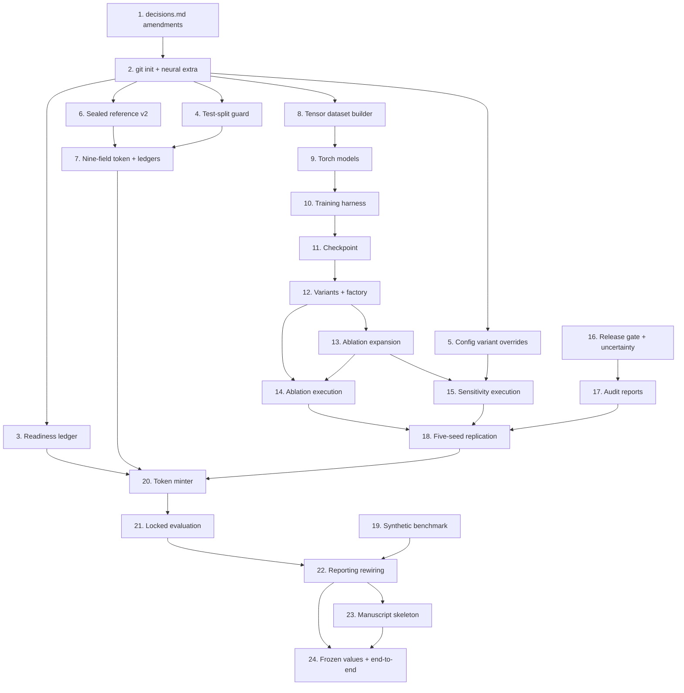

# Implementation Plan

## Overview

This plan implements `.kiro/specs/neural-experiment-pipeline/requirements.md` following `design.md`. It sits on top of the completed parent spec `.kiro/specs/causal-witness-pwm/`, whose `decisions.md` remains the sole source of frozen values. No numeric constant, threshold, formula, or named algorithm below is re-derived here.

Sequencing is dependency-driven and has three hard ordering constraints. First, the three `decisions.md` Section 26 amendments come before any code that depends on them (Requirement 18.2). Second, torch stays a leaf dependency: every task below must leave the existing 679 tests runnable in an environment where torch is not installed (`design.md` Section 2.4). Third, no task between 3 and 19 may open the Test_Split or the sealed reference — the readiness ledger and the strengthened token are the only doors, and they open last (Requirement 18.3).

Task numbering continues the parent plan's conventions: numbered groups, `- [ ]` checkboxes, sub-bullets naming concrete files, and a `_Requirements:_` line citing this spec's requirement numbers. Sub-tasks marked `*` are optional under deadline pressure and are not implemented by default.

## Tasks

- [x] 1. Record the three prerequisite `decisions.md` Section 26 amendments
  - All three are edits to `.kiro/specs/causal-witness-pwm/decisions.md`; no pipeline code that depends on these values may run before the corresponding amendment entry exists
  - _Requirements: 18.1, 18.2_

- [x] 1.1 Freeze the stronger-observational-selection coefficients
  - Add a Section 26 amendment entry to `.kiro/specs/causal-witness-pwm/decisions.md` recording every risk-score coefficient and logit intercept for `selection_severity="stronger"`, in the same form Section 9 uses for the primary coefficients, with the rationale for the chosen severity
  - Add module-level constants `STRONGER_SELECTION_COEFFICIENTS` alongside the existing primary coefficients in `src/cohorts/selection.py` and route them through the existing `observationalize()` severity path
  - Extend `tests/frozen/test_decisions_match.py` with assertions that the new constants equal the values recorded in the amendment
  - _Requirements: 8.7, 18.1, 18.2_

- [x] 1.2 Freeze the cross-seed stability criterion
  - Add a Section 26 amendment entry recording the criterion: effect-direction agreement in at least 4 of the 5 frozen seeds together with no required sensitivity variant contradicting the aggregate direction
  - Express it as a frozen `StabilityCriterion` dataclass and a module-level `CROSS_SEED_STABILITY_CRITERION` constant in `scripts/run_replication.py` (created in task 18), with a human-readable `criterion_description` string that the aggregator reports verbatim
  - Extend `tests/frozen/test_decisions_match.py` with an assertion that the constant matches the amendment text (this assertion fails until task 1.2 lands, which is the intended forcing function)
  - _Requirements: 9.6, 9.7, 18.1, 18.2_

- [x] 1.3 Record the `experiment_id` re-identification amendment
  - Add a Section 26 amendment entry stating that extending `ExperimentConfig` with `variant`, `model_variant`, and `negative_control_n_bootstrap` changes `canonical_dict()` and therefore re-identifies every previously computed `experiment_id`; record that prior result directories are left in place unmigrated and that identifiers minted before the amendment date belong to the pre-neural config schema
  - Record the rejected alternatives (bypassing the config, relaxing `extra="forbid"`) and why hash-inclusion is the honest outcome, per `design.md` Section 2.6 tension 3
  - _Requirements: 9.9, 18.1, 18.2_

- [ ] 2. Initialize the repository and declare the neural dependency extra
  - Run `git init` at the project root, confirm `.gitignore` already excludes `data/raw/`, `results/`, `reference/`, `.venv/`, and caches, and create the initial commit from the existing tracked source tree
  - Verify with `git status --porcelain` that no raw patient data, sealed artifact, or generated result path appears as tracked or untracked-but-stageable content
  - Write `tests/unit/test_repository_provenance.py` asserting the ignore rules exclude `data/raw`, `results`, and `reference` paths
  - _Requirements: 15.1_

- [-] 2.1 Declare pinned torch/numpy as an optional `neural` extra and retarget the venue
  - Edit `pyproject.toml`: add `[project.optional-dependencies] neural = ["torch==2.5.1", "numpy==<pinned>"]` and a `dev` extra that includes `neural`; leave the base install at the existing pinned `pydantic`/`PyYAML` so the current suite runs torch-free
  - Change the project description venue string from the parent's NeurIPS 2026 WMHS line to `ICLR 2027 main track`
  - Register the `neural` pytest marker in `pyproject.toml` and add `tests/neural/` as the collection root for torch-requiring tests
  - Write `tests/unit/test_dependency_manifest.py` asserting the pinned torch version string, the presence of numpy in the extra, that neither appears in the base dependency list, and that the venue string reads ICLR 2027 main track
  - _Requirements: 5.1, 5.2, 20.5_

- [~] 2.2 Enforce torch isolation mechanically
  - Write `tests/unit/test_torch_isolation.py` spawning a subprocess with a `sys.meta_path` finder that raises on `import torch`, then importing `causal.baselines`, `causal.overlap`, `causal.propensity`, `causal.negative_controls`, all three witness modules, `witnesses.aggregation`, `witnesses.audit_report`, `cohorts.pipeline`, `cohorts.sealed_reference`, `evaluation.metrics`, `evaluation.statistics`, `evaluation.ablation_matrix`, `evaluation.robustness`, `evaluation.release_gate`, `models.variants`, `infra.readiness`, and `scripts.scan_exports`
  - Add a second assertion that `src/models/__init__.py` imports no `torch_*` module and not `models.dataset`
  - _Requirements: 5.1, 5.2_

- [~] 2.3 Record git provenance in every manifest
  - Extend `src/infra/manifest.py`'s `ManifestWriter` with a git-commit resolver recording the commit identifier and the working-tree cleanliness state on every manifest write, and recording an explicit `git_commit_unavailable` state rather than omitting the field when resolution fails
  - Bind each written checkpoint path and result directory to the recorded commit identifier in the manifest
  - Write unit tests with a stubbed resolver for the clean, dirty, and unavailable cases, asserting the recorded state and that the artifact-to-commit binding is present
  - _Requirements: 15.2, 15.4, 15.5, 5.7_

- [~] 2.4 Fix the 21 Ruff violations and repair the secrets checker
  - Run `python -m ruff check src/ scripts/ tests/ --fix` to clear the 8 auto-fixable violations (4 `UP037` quoted-annotation, 2 `B905` zip-without-explicit-strict, 1 `I001` unsorted-imports, 1 `F401` unused-import), then hand-fix the remaining 13 (12 `E501` line-too-long, 1 `UP038` non-pep604-isinstance); the E501 sites are concentrated in `tests/unit/test_timelines.py`, `tests/unit/test_metrics.py`, and `scripts/` argparse help strings
  - Confirm `python -m ruff check src/ scripts/ tests/` reports zero violations and that the full pytest suite still passes with the same test count
  - Repair `scripts/check_no_secrets.py`: it currently invokes `git diff --cached --name-only --diff-filter=ACMR`, which fails with "unknown option `cached`" when no repository exists, exiting 1 with a usage dump. After task 2's `git init` the command resolves, but add an explicit pre-flight check that reports a clear "not a git repository" message instead of surfacing raw git usage output, and keep the non-zero exit so the checker continues to fail safe rather than silently passing
  - Write `tests/unit/test_check_no_secrets.py` asserting the pre-flight path reports the clear message and exits non-zero when run outside a repository, and that a staged file containing a synthetic credential-shaped string is flagged
  - _Requirements: 15.1_

- [~] 2.5 Make the twelve go/no-go items mechanically checkable where possible
  - For each of the twelve existing human-attested items in `configs/go_no_go_checklist.yaml`, add a verifier function in a new `src/infra/checklist_verifiers.py` that returns `verified | unverifiable | failed` with evidence: `frozen_protocol` / `frozen_causal_diagram` / `frozen_adjustment_set` / `target_population_defined` / `statistical_procedures_locked` are checkable against `decisions.md` and `configs/target_trials/main.yaml`; `leakage_tests_passed` / `splits_cross_fitting_verified` / `privacy_checks_passed` / `one_command_reproduction_verified` are checkable by invoking the existing test selections and `scan_exports`; `estimand_alignment_checked` / `reference_inaccessible_to_model_selection` / `thresholds_frozen` are attestations that remain `unverifiable` by machine and must stay human-set
  - Have `scripts/check_go_no_go.py` report each item's verifier result alongside its attested boolean and refuse to mint when a machine-verifiable item is attested `true` but its verifier returns `failed`, so an attestation cannot contradict evidence
  - Write unit tests for each verifier's three outcomes and a test asserting the contradiction case (attested true, verifier failed) blocks minting with the item named
  - _Requirements: 13.13, 18.4_

- [~] 3. Implement the readiness ledger
  - Write `src/infra/readiness.py` (no torch): frozen `ReadinessLedger(seeds_executed, ablation_runs_executed, sensitivity_variants_executed, determinism_verified)`, `REQUIRED_SEEDS = (101, 202, 303, 404, 505)`, `ReadinessDecision(ready, missing_items)`, `evaluate_readiness(ledger)`, plus `load_ledger(results_root)` and `append_ledger_entry(results_root, kind, run_id, artifact_hash)` writing `results/<experiment_id>/readiness_ledger.json`
  - Readiness holds only when the executed seed set covers `REQUIRED_SEEDS`, the executed ablation-run set covers the twelve expanded run ids, the executed sensitivity set covers the eight frozen variant names, and every executed run id also appears in `determinism_verified`; otherwise `missing_items` names each missing seed, run, and variant
  - Import the required ablation-run and sensitivity-variant sets lazily from `evaluation.ablation_matrix` / `evaluation.robustness` so the module stays torch-free and importable before task 13 lands
  - Write `tests/unit/test_readiness.py` implementing Property 10 with `hypothesis` over ledgers holding random missing subsets of the 5 seeds, 12 runs, and 8 variants, asserting not-ready with exactly those items named, and ready only on completeness plus determinism verification
  - _Requirements: 18.3, 18.4, 18.7_

- [~] 4. Extend the reference guard with test-split isolation
  - Add `assert_test_split_unlocked(unlock_token)` to `src/infra/reference_guard.py`, mirroring `assert_reference_unlocked` and using the same `isinstance(token, LockedEvaluationToken)` check, raising `ReferenceAccessError` otherwise; keep the existing deferred import that avoids the `cohorts.sealed_reference` cycle exactly as it is
  - Add `require_test_split(pipeline_result, unlock_token)` as the only accessor any runner uses to reach `ObservationalizationPipelineResult.test`; leave the `.test` attribute itself in place so existing tests keep passing
  - Write `tests/unit/test_token_and_guards.py` implementing Property 9 with `hypothesis`-generated non-token objects, including a look-alike dataclass carrying every token field name with valid-looking values, asserting both guards raise `ReferenceAccessError` for every one
  - Add a test asserting `require_test_split` refuses before touching the result object and that no development-stage module in `src/` references `.test` directly
  - _Requirements: 4.8, 18.6_

- [ ] 5. Extend `ExperimentConfig` with validated variant overrides
  - Add `VariantOverrides` to `src/infra/config.py` (`extra="forbid"`, frozen) with the eight defaulted fields of `design.md` Section 2.6 tension 3: `propensity_model`, `weight_clipping`, `support_thresholds`, `missingness_stress`, `landmark_masking`, `comparator_orientation`, `endpoint_horizon_weeks`, `selection_severity`
  - Add `ExperimentVariantSpec` as the pydantic mirror of `ExperimentVariant`'s fields, and extend `ExperimentConfig` with `variant: VariantOverrides = VariantOverrides()`, `model_variant: ExperimentVariantSpec | None = None`, and `negative_control_n_bootstrap: int = 1000`
  - Write unit tests confirming every new field defaults to its primary/frozen setting, that an out-of-set literal or unknown key raises a validation error, and that `canonical_dict()` serializes the defaults so two runs differing in any override get different `experiment_id` values
  - _Requirements: 8.1, 8.2, 9.9, 18.1_

- [~] 5.1 Reconcile `run_causal_analysis.py` onto the single identity function
  - Delete `_compute_content_experiment_id` and its local `DuplicateExperimentError` raise site from `scripts/run_causal_analysis.py`; call `ExperimentRegistry.register(resolved_config, git_commit, dirty, results_root)` and inherit the registry's duplicate detection
  - Confirm the inputs the deleted function covered are hashed through `ResolvedConfig`: dataset checksum and trial-spec version via the existing contract/trial configs, master seed via `ExperimentConfig.seed`, and bootstrap count via the new `negative_control_n_bootstrap`
  - Write a unit test asserting two runs differing only in `negative_control_n_bootstrap` produce different experiment ids and that a repeat run of an unchanged config is refused by the registry
  - _Requirements: 9.9, 18.1_

- [~] 5.2 Re-verify the existing suite against the re-identified experiment ids
  - Run the full `pytest` suite and triage every failure caused by the `canonical_dict()` change: frozen-value tests pinning literal experiment-id strings, registry fixtures, and any result-path assertion built from an id
  - Update those expectations to the newly computed identifiers, keeping the assertion style (recompute-and-compare, not hand-copied hashes) so a future config change fails loudly again
  - Confirm the suite returns to a full pass with the same test count as before the change, and that no test was deleted or skipped to achieve it
  - _Requirements: 9.9, 18.1, 18.7_

- [ ] 6. Extend the sealed reference to carry risk-scale quantities
  - Extend `src/cohorts/sealed_reference.py`: `SEALED_FORMAT_VERSION = 2`, frozen `ReferenceQuantity(value, scale, horizon_weeks)`, and `InternalReference` gaining `format_version` and a `quantities` mapping while `value` keeps its existing v1 log-HR semantics
  - Write `extended_randomized_reference_estimator(cohort)` composing `causal.baselines.unadjusted_cox` for `log_hazard_ratio` and per-arm Kaplan-Meier evaluation at `HORIZON_WEEKS=96.0` via `cohort.by_arm(arm)` for `risk_arm0` / `risk_arm1`, with `risk_difference = risk_arm1 - risk_arm0`; all three computed on the complete pre-split, pre-observationalization eligible arm-0/arm-1 cohort
  - Write `write_sealed_artifact` recording `format_version: 2`, and `read_sealed_artifact` reading the version field after `assert_reference_unlocked` and before payload parsing, raising `SealedFormatVersionError` naming the documented re-seal step on a missing version or version below 2
  - Write unit tests implementing Property 25 over generated artifacts with absent/0/1/2/3 version fields, plus a test asserting the three quantities are computed pre-split and pre-observationalization and that `value` is byte-identical to what the v1 estimator produced
  - _Requirements: 14.1, 14.2, 14.6, 14.7_

- [~] 6.1 Implement scale-matched reference comparison
  - Add `compare_to_reference(estimate, reference, quantity)` to `src/cohorts/sealed_reference.py` raising `ScaleMismatchError` unless `estimate.scale` equals `reference.quantities[quantity].scale`, using `CausalEstimate.scale`'s existing vocabulary
  - Extend `evaluation/metrics.py::risk_difference_error_vs_internal_reference` to select the `risk_difference` quantity by name and assert its scale, keeping its existing runtime rejection of non-`InternalReference` inputs
  - Write `tests/property/test_reference_scales.py` implementing Property 24 over generated scale pairs, with an explicit case asserting a risk-difference estimate against a log-hazard-ratio reference raises
  - _Requirements: 14.3, 14.4_

- [~] 6.2 Implement the v2 re-seal path
  - Add `--stage seal-reference --reseal` to `scripts/run_stage.py`: rebuild the complete eligible arm-0/arm-1 cohort, construct `SealedReference(cohort, extended_randomized_reference_estimator)`, and write `reference/internal_randomized_reference.v2.sealed.json`, refusing with a non-zero exit if a v2 artifact already exists at the target path
  - Leave the v1 artifact byte-identical and unread; provide no code path that upgrades it in place
  - Write an integration test on a synthetic cohort in `tmp_path` asserting the v2 artifact is written with three quantities and a version field, that a second invocation refuses, and that a pre-existing v1 file's bytes are unchanged
  - _Requirements: 14.2, 14.6, 14.7_

- [ ] 7. Strengthen `LockedEvaluationToken` to nine bound fields
  - Extend the frozen `LockedEvaluationToken` in `src/cohorts/sealed_reference.py` with `resolved_config_hash`, `dataset_checksum`, `split_hash`, `checkpoint_hashes` (sorted non-empty tuple of `(logical_name, sha256)` pairs), `git_commit`, `statistical_plan_version`, and `evaluation_id`, all required with no defaults, keeping the class identity and frozen decorator unchanged so `assert_reference_unlocked`'s `isinstance` check is strictly strengthened
  - Extend `__post_init__` to raise a single `TokenFieldError` naming *every* absent or empty field at once, subsuming the existing empty-`issued_by` rejection
  - Extend `_mint(...)` to take all seven new fields, validate presence and non-emptiness, and check `evaluation_id` against the consumption ledger
  - Write unit tests asserting no partially bound token can be constructed, that a multi-field violation names all offenders in one error, and that the existing sealed-reference guard tests still pass unchanged
  - _Requirements: 13.3, 13.4_

- [~] 7.1 Add the consumption and reference-access ledgers
  - Write append-only `results/locked_evaluation/consumed.jsonl` handling (one record per consumed `evaluation_id` with consumption timestamp and result directory) and a `is_consumed(evaluation_id, results_root)` reader used by both the minter and the locked-evaluation runner
  - Have `SealedReference.unseal(token)` and module-level `read_sealed_artifact(path, unlock_token)` append `{evaluation_id, accessed_at}` to `results/locked_evaluation/reference_access.jsonl` after their existing `assert_reference_unlocked` call, and expose a reader that supplies the audit report's reference-access timestamp
  - Write unit tests over a `tmp_path` results root confirming a duplicated `evaluation_id` is refused, that refusal happens before any sealed file is opened, and that an access record is appended exactly once per successful unseal
  - _Requirements: 13.6, 14.5, 12.4_

- [~] 7.2 Diagnose the overlap-support failure and the SMD measurement basis
  - Measured on the real cohort at seed 20240101 with dev-retained n=378 and 5-fold cross-fitted logistic propensity: `arm_counts` {arm1: 205, arm0: 173} passes the 100-per-arm floor and `ess_by_arm` {arm1: 187.1, arm0: 148.6} passes the 100.0 ESS floor, but `smd_sufficient = False` on six covariates above the 0.10 `MAX_ABS_SMD` threshold — baseline_cd4 -0.4846, karnofsky_score -0.2444, age 0.2235, symptomatic_status 0.1513, hemophilia -0.1439, baseline_cd8 -0.1195 — so `support_valid = False`, the causal witness fails, and the release gate is blocked. These numbers are inputs to this task, not quantities to re-derive
  - Establish empirically whether `causal/overlap.py::_smd` measures RAW (unweighted) covariate balance or IPW-ADJUSTED balance, and record the finding. `decisions.md` Section 12's frozen condition reads "every **adjusted** baseline covariate has absolute standardized mean difference < 0.10"; the observationalization mechanism of Section 9 *deliberately* selects on baseline_cd4, karnofsky_score, age, symptomatic_status, prior-OI, and prior-ART, so large raw SMDs are the benchmark working as designed, whereas large *post-weighting* SMDs would indicate adjustment failure. Compute both raw and stabilized-IPW-weighted SMDs for all six offending covariates using the existing `causal/weighting.py` weights and report them side by side
  - Do not change the frozen 0.10 threshold or the four frozen conditions. If the finding is that the wrong quantity is being measured, record it as a proposed `decisions.md` Section 26 amendment with both sets of numbers as evidence, and leave the code unchanged pending that amendment
  - Write `tests/diagnostics/test_overlap_diagnosis.py` producing a committed diagnostic artifact `results/diagnostics/overlap_smd_raw_vs_weighted.json` carrying both SMD sets, the six offending covariates, and the four condition booleans, so the finding is reproducible rather than narrative
  - _Requirements: 10.6, 11.1, 11.2, 18.1, 18.2_

- [~] 7.3 Diagnose the positivity-warning and negative-control-outcome failures
  - Investigate the `no_unresolved_positivity_warning` condition, which fails on exactly 1 patient of 378 (0.26%) falling outside the primary `[0.10, 0.90]` common-support band. `causal/overlap.py` documents `extreme_weight_count` as a deliberate *proxy* for the true post-clipping weight distribution. Report that single patient's propensity, whether it falls outside the sensitivity band `[0.05, 0.95]` as well, and what the condition would yield under the documented trimming that `causal/weighting.py` already implements
  - Investigate the negative-control-outcome `uncertain` classification: report the adjusted standardized mean difference for baseline CD8, its bootstrap CI, which of the two frozen branches (`abs(smd) >= 0.10` with a CI containing zero) produced `uncertain`, and whether the classification is stable across the five frozen seeds and across bootstrap replicate counts of 200 and 1000
  - Record both findings in `results/diagnostics/positivity_and_negative_control.json`, and state plainly for each whether it is a genuine diagnostic signal about the cohort, an artifact of a documented proxy, or a defect — with the evidence for that verdict
  - Do not adjust any frozen threshold, band, or classification rule to make either condition pass
  - _Requirements: 8.3, 10.6, 11.1, 11.3, 18.1_

- [ ] 8. Implement the tensor dataset builder
  - Write `src/models/dataset.py`: `LANDMARK_COUNT = 3`, `SURVIVAL_BIN_COUNT = 23`, `BIN_WIDTH_WEEKS = 8.0`, `FINAL_BIN_START_WEEKS = 176.0`, `MISSING_PLACEHOLDER = 0.0`, `survival_bin_index(elapsed_weeks)`, frozen `DatasetDimensions`, frozen `TensorBatch` with the exact fields and shapes of `design.md` Section 4.1, and `PatientDatasetBuilder.fit/build/dimensions`
  - Delegate every semantic decision: elapsed weeks via `causal.baselines._elapsed_weeks`, baseline covariate ordering via `causal.propensity.COVARIATE_FIELDS`, landmarks via `models.sequence_baseline.LANDMARK_WEEKS`, channel widths via `models.intervention_aware.STATE_INPUT_DIM` / `INTERVENTION_INPUT_DIM` / `PROTOCOL_INPUT_DIM`
  - Fit standardization parameters on Development_Split unmasked entries only, idempotently; `build` never refits and applies frozen parameters to validation and test rows unchanged
  - Set masks `True = observed`, fill every missing entry with `MISSING_PLACEHOLDER`, emit no non-finite values, and order rows by ascending `patient_id`
  - _Requirements: 1.1, 1.2, 1.3, 1.4, 1.5, 1.6, 1.7, 18.5_

- [~] 8.1 Write dataset property tests
  - Write `tests/neural/test_dataset.py` implementing Property 19 (N rows, frozen trailing widths, row-to-`patient_ids` alignment, reported `DatasetDimensions` equal to the trailing dimensions, ascending ids, identical tensors from shuffled input order) over `hypothesis` strategies building 1-50 `PatientRecord` objects
  - Implement Property 18 (bin index in 0..22, non-decreasing in elapsed weeks, equal to 22 exactly at or beyond 176 weeks, and equal to `causal.baselines._elapsed_weeks` applied to the same record) with explicit `hypothesis` examples at 0.0, 7.999, 8.0, 175.999, 176.0, and 1e6
  - Implement Property 20 (fit twice yields identical parameters; building validation or test batches leaves them unchanged; parameters use unmasked development entries only)
  - _Requirements: 1.2, 1.3, 1.4, 1.6, 1.7, 18.5_

- [~] 8.2 Write dataset error-path and fully-missing-column tests
  - Unit-test `DatasetBuildError` for empty input and for an injected duplicate `patient_id`, asserting the message says which and that no `TensorBatch` object was produced
  - Unit-test `DatasetBuildError` for absent, NaN, inf, and negative-elapsed event times, asserting the message names the offending patient and the reason and that nothing partial is emitted
  - Add the real-data condition test: a fully missing week-96 CD8 column yields an all-`False` `cd8_mask[:, 2]` across dev, val, and test, no fitted parameter for that column, placeholder fill, and no exception
  - _Requirements: 1.8, 1.9, 1.10, 1.5_

- [ ] 9. Implement the production torch models
  - Both modules import their dimension constants from the pure-Python prototypes rather than redeclaring them, so prototype/production drift is an import or shape error rather than a silent divergence; the prototypes stay in place as the specification of record and produce no reported number
  - _Requirements: 2.1, 3.1_

- [~] 9.1 Implement `TorchSequenceGRU`
  - Write `src/models/torch_sequence_gru.py`: `TorchSequenceGRU(nn.Module)` importing `LANDMARK_WEEKS` and `BASELINE_STATE_INIT_FIELDS` from `models.sequence_baseline`, initializing the hidden state through `nn.Linear(BASELINE_STATE_INIT_FIELDS, 16)` + `tanh`, consuming `[cd4, cd8, treatment_arm]` per landmark with treatment as an ordinary input column and no separate encoder, and emitting `SequenceOutput(state_pred=(N,3,2), hazards=(N,23))` from a `nn.Linear(16, 2)` per-landmark head and a `nn.Linear(16, 23)` hazard head
  - Use the frozen hidden width 16 and include no dropout or batchnorm anywhere, so `eval()`-mode forward is deterministic by construction
  - Write `tests/neural/test_torch_sequence_gru.py` asserting output shapes, that two `eval()`-mode forwards on identical inputs are bitwise identical, and that the hidden width and landmark count come from the imported constants
  - _Requirements: 2.1, 2.2, 2.3, 2.4, 2.6_

- [~] 9.2 Implement `TorchInterventionAwareModel`
  - Write `src/models/torch_intervention_aware.py`: separate state/intervention/protocol encoders, a GRU state-transition module, treatment-specific hazard heads, and a CD4/CD8 state head, with widths imported from `models.intervention_aware` (`STATE_INPUT_DIM=4`, `INTERVENTION_INPUT_DIM=3`, `PROTOCOL_INPUT_DIM=2`) and hidden width 16
  - Add `InterventionMode = LEARNED | ZEROED | PLACEBO` and `ProtocolMode = ACTIVE | ZEROED`, with encoder output widths fixed at construction regardless of mode so a zeroed or placebo channel occupies the same width
  - Implement `forward(batch, arm)` and `rollout_both_arms(batch)` where the intervention-channel input is the only differing tensor between the two calls and every other tensor passed is literally the same object
  - Derive the 96-week outcome from the discrete-hazard sequence as `1 - prod(1 - h_k)` over bins up to week 96, with no separate unconstrained outcome head existing in the module
  - _Requirements: 3.1, 3.2, 3.3, 3.4, 3.5, 3.6_

- [~] 9.3 Write channel-width and rollout-identity property tests
  - Write `tests/neural/test_intervention_channels.py` implementing Property 13: for every `InterventionMode` × `ProtocolMode` combination the concatenated representation width equals the complete model's 4 + 3 + 2
  - Implement Property 14: for generated batches, the arm-0 and arm-1 rollouts receive baseline, state, protocol, and mask tensors identical by object identity and differ only in the intervention-channel input; and an ablated batch differs from the complete batch in exactly the named channel and no other tensor
  - _Requirements: 3.3, 3.4, 3.6_

- [~] 9.4 Parameterize the existing invariance properties over prototype and torch
  - Refactor `tests/property/test_invariance.py` so its three properties are expressed once against a minimal `rollout_both_arms`-shaped protocol and parameterized over `["prototype", "torch"]`, with the torch case behind `pytest.importorskip("torch")`
  - Keep the prototype parameterization's behavior and assertions unchanged so those tests cannot regress and still pass in a torch-free environment (Property 12)
  - _Requirements: 3.4, 3.6_

- [ ] 10. Implement the training harness
  - Write `src/models/torch_training.py` with `train_one_model`, `select_lambdas`, `train_ensemble`, `resolve_device`, `seed_everything`, and `checkpoint_sha256`, reusing `models/losses.py` (`masked_huber`, `mmd`, `total_loss`, `load_lambda_grid`, `select_lambda_by_validation_concordance`) and `models/training.py` (`EarlyStopping`, `save_checkpoint`/`load_checkpoint`, `discrete_time_censored_nll`, `derive_run_seed`) rather than restating them
  - Optimize `survival_NLL + lambda_state * masked_huber(cd4/cd8) + lambda_balance * MMD(z_treated, z_control)`, multiplying the per-element Huber term by the mask before reduction so masked-missing entries contribute zero to both value and gradient
  - Apply the frozen training configuration read from `decisions.md` Section 25: Adam with `betas=(0.9, 0.999)`, `weight_decay=1e-4`, `lr=1e-3` with no schedule, full-batch, global-norm clipping at 1.0, patience 20, `max_epochs=500`, checkpoint at the validation-loss-minimizing epoch written in the plain-dict format
  - Take `dev` and `val` batches as separate typed parameters, provide no parameter through which a test batch could arrive, and call neither `require_test_split` nor `unseal`
  - _Requirements: 4.1, 4.2, 4.4, 4.5, 4.7, 4.8, 18.5_

- [~] 10.1 Implement lambda selection and ensemble construction
  - Implement `select_lambdas` evaluating the frozen 3×3 grid over `{0.1, 0.3, 1.0}²` from `configs/experiments/lambda_grid.yaml`, selecting by validation composite-endpoint concordance only through the existing `select_lambda_by_validation_concordance` fed by `evaluation.metrics.concordance_index`
  - Implement `train_ensemble` training five replicas with sub-seeds `derive_seed(master_seed, f"replica_{i}")`, matching `uncertainty/ensemble.py::DeepEnsemble`'s derivation exactly; perform lambda selection once per model per seed on a single replica, then train the five replicas at the selected pair
  - Write unit tests confirming selection reads validation-split values only, that the grid has exactly nine combinations, and that the five replica seeds equal the `DeepEnsemble` derivation for the same master seed
  - _Requirements: 4.3, 4.6, 4.7, 18.5_

- [~] 10.2 Implement device resolution, seeding, and manifest recording
  - Implement `resolve_device(requested)` accepting `cpu` (default) and `cuda` only, raising `DeviceUnavailableError` naming the unavailable device before any tensor allocation when CUDA is absent, and rejecting every other value including `mps`
  - Implement `seed_everything(seed)` setting `torch.manual_seed`, `torch.cuda.manual_seed_all`, and `torch.use_deterministic_algorithms(True)` behind a capability check
  - Record the per-epoch loss curve, selected lambdas, selected epoch, device, and checkpoint hash into the run manifest through `ManifestWriter.set_model_config` / `add_checkpoint_path` / `add_metric`
  - Write unit tests for the device-unavailable and unsupported-device paths, and a test asserting all five manifest fields are populated after a two-epoch run
  - _Requirements: 5.3, 5.4, 5.6, 5.7, 4.9_

- [~] 10.3 Write gradient, masking, and determinism tests
  - Write `tests/neural/test_gradients.py` asserting that after `loss.backward()` every parameter of both torch models has a non-`None`, finite, non-all-zero `.grad`, and that the torch total loss equals `models/losses.py`'s pure-Python `total_loss` within `1e-6` using the existing implementation as the oracle
  - Implement Property 15 in the same file: perturbing masked-missing CD4/CD8 positions with arbitrary generated values leaves the loss value unchanged and the gradient at those positions exactly `0.0`
  - Write `tests/neural/test_determinism.py` implementing Property 17's four conjuncts: two seeded constructions give bitwise-identical parameters, two `eval()` forwards give bitwise-identical outputs, `compute_experiment_id` is stable and changes under any single-field mutation, and a tiny end-to-end run repeated in two `tmp_path` roots yields identical artifact hashes
  - Add a CUDA/CPU agreement integration test guarded by `torch.cuda.is_available()`, skipped locally and executed once on the A100 host, with its output recorded in the run manifest
  - _Requirements: 2.5, 2.6, 4.2, 5.4, 5.5, 18.7_

- [~] 11. Checkpoint - ensure all tests pass in both environments
  - Run the full suite in the base (torch-free) environment and confirm the pre-existing tests plus the new torch-free tests pass with no skips beyond the `neural`-marked ones
  - Run the full suite with the `neural` extra installed and confirm the torch tests pass on CPU
  - Ensure all tests pass, ask the user if questions arise

- [ ] 12. Implement the experiment variant dataclass and model factory
  - Write `src/models/variants.py` with the frozen `ExperimentVariant` carrying `name`, `model_family`, `treatment_representation`, `protocol_channel`, `overlap_gate`, `uncertainty_gate`, `clinical_constraints`, `enabled_witnesses`, `causal_adjustment`, and `balance_penalty_enabled`, with the allowed value sets of `design.md` Section 4.2
  - Raise `VariantValidationError` in `__post_init__` on any out-of-set value and on the two structurally impossible combinations (`sequence_gru` with `explicit_channel`; `cox` with an active protocol channel)
  - Define the `complete` variant constant exactly as `design.md` Section 4.2 specifies
  - Write unit tests over every field's out-of-set value and both impossible combinations, plus a test asserting the module imports without torch
  - _Requirements: 6.1, 6.2_

- [~] 12.1 Implement `build_model` and the model-affecting projection
  - Implement `build_model(variant, dimensions, seed)` as the single construction entry point, with torch imported inside the function body, dispatching `cox` → `CoxBaseline`, `sequence_gru` → `TorchSequenceGRU`, `intervention_aware` → `TorchInterventionAwareModel` with `intervention_mode` / `protocol_mode` / `placebo_vector` derived from the variant, reading every width from `DatasetDimensions` with no hard-coded value
  - Call `seed_everything(seed)` before construction so parameter initialization is seed-determined; raise `MissingDependencyError` naming the `neural` extra and the pinned torch version when torch is absent, at call time rather than at module import
  - Implement `model_affecting_fields(variant)` projecting `{model_family, treatment_representation, protocol_channel, balance_penalty_enabled, causal_adjustment}`, which drives both collision detection and the retrain-vs-reuse decision
  - Write unit tests asserting two variants differing in any model-affecting field yield models differing in architecture or input content, that identical seeds give bitwise-identical initial parameters, and that `MissingDependencyError` is raised in the torch-free subprocess
  - _Requirements: 6.3, 6.4, 6.5_

- [~] 12.2 Populate the registry entry from the resolved config and variant
  - Populate the previously-`None` `RegistryEntry` fields in `src/infra/registry.py` — `trial_specification_version`, `model`, `split`, `intervention_representation`, `protocol_constraints`, `overlap_gate`, `uncertainty_gate` — from `ResolvedConfig` plus `ExperimentVariant` at register time, and record the variant fields alongside the content-hashed experiment identifier
  - Write a unit test asserting no `RegistryEntry` field is `None` after registering a constructed variant and that the recorded identifier equals `compute_experiment_id(resolved_config)`
  - _Requirements: 6.6_

- [~] 13. Expand the ablation matrix into twelve runs and bridge it to variants
  - Add to `src/evaluation/ablation_matrix.py`: frozen `AblationRun(run_id, source_entry, sub_run_key, variant, execution_mode)` and `expand_ablations(ablations=ABLATIONS)` expanding each entry to one run except `witness_removed`, which expands to one run per witness named in its `config_diff["applies_to"]`, with sub-run ids `f"{entry.name}::{witness}"`; leave `ABLATIONS` and its ten `name=` values untouched
  - Add `variant_for_ablation(run)` and `variant_for_sensitivity(name)` to `src/models/variants.py` as total explicit `dict[str, ExperimentVariant]` literal mappings keyed by the ten frozen ablation names and eight frozen sensitivity names, with the per-entry variant deltas and execution modes of `design.md` Section 3.6; retain `config_diff` as the recorded human-readable form, never the thing the factory reads
  - Write frozen tests asserting `len(ABLATIONS) == 10`, `len(expand_ablations()) == 12`, exactly three runs with `source_entry == "witness_removed"`, six `retrain` and six `reuse_predictions` modes, and that the mapping key sets equal `{a.name for a in ABLATIONS}` and `{v.name for v in SENSITIVITY_VARIANTS}`
  - Add a test asserting `evaluate_readiness`'s required ablation-run set equals `{r.run_id for r in expand_ablations()}`
  - _Requirements: 7.1, 7.8, 6.1, 18.3_

- [ ] 14. Execute the six retrained ablation arms
  - Rewrite `scripts/run_ablations.py` to build every arm through `build_model(variant_for_ablation(run), dimensions, seed)`, replacing the current single `CoxBaseline` fitted for all ten arms, and to retrain each model-affecting arm from initialization under the frozen training configuration once for each of the seeds 101, 202, 303, 404, 505
  - Hold every treatment input element at zero at every landmark for the no-treatment-input arm while leaving all non-treatment inputs identical; supply an all-zero width-2 protocol channel for the no-protocol arm while leaving the intervention channel identical; build the treatment-as-ordinary-feature arm from `TorchSequenceGRU` and the explicit-intervention-channel arm from `TorchInterventionAwareModel` at the same hidden width 16
  - Draw the placebo vector once per seed from `derive_seed(master_seed, "placebo_intervention_channel")`, hold it constant across every patient and landmark within the seed, pass it to the model as `placebo_vector`, and write it into that run's results so a rerun at the same seed reproduces it
  - Set the balance penalty weight to zero and disable causal adjustment for the predictive-accuracy-alone arm while leaving the factual objective unchanged
  - Record a run as failed with its naming cause when training does not complete, exclude it from the table, and mark the table incomplete
  - Write integration tests on a ~40-patient synthetic cohort asserting each arm's input tensors differ from the complete model's in exactly the named channel, that the placebo vector is reproduced at a fixed seed and redrawn on seed change, and that a training failure marks the table incomplete rather than invalid
  - _Requirements: 7.2, 7.3, 7.4, 7.5, 7.9, 7.10, 7.14, 7.16_

- [~] 14.1 Execute the six prediction-reuse ablation arms
  - Load `predictions/complete_model/val_patient_predictions.json` unmodified for the no-overlap-gate, no-uncertainty-gate, no-clinical-constraints, and three witness-removed runs; perform no training, bypass only the named gate, constraint, or witness, and record the count of Validation_Split patients whose decision or verdict differs from the complete model's
  - Verify each reuse source's recorded checkpoint hash against the complete model's, raising `ReusePredictionSourceError` naming a missing, unreadable, or mismatched source, writing no metrics for that run and leaving results already written for other runs unchanged
  - Write tests implementing Property 28 (reused predictions reproduced byte-identically, no training performed, differing-decision count equal to an independently computed count) plus unit tests for the missing, unreadable, and hash-mismatched source paths
  - _Requirements: 7.6, 7.7, 7.8, 7.15_

- [~] 14.2 Compute and record validation-only ablation metrics
  - Compute the frozen primary factual metric of `decisions.md` Section 18 on Validation_Split patients only, excluding every Development_Split patient used for fitting, reporting one value per frozen seed plus the five-seed mean
  - Record per run: run id, `ExperimentVariant` fields, checkpoint hash for a retrained run or reuse-source id plus source checkpoint hash for a reuse run, evaluated split name, seed, and metric values, into `results/<experiment_id>/ablations/run_<name>_seed<seed>.json` and the aggregated `ablation_table.json`
  - Write a test implementing Property 29 asserting the metric's patient id set is drawn from the Validation_Split and is disjoint from the Development_Split fitting ids
  - _Requirements: 7.11, 7.12_

- [~] 14.3 Implement variant-collision detection
  - Write `detect_variant_collisions(runs, predictions_by_run, metrics_by_run) -> CollisionReport` in `src/evaluation/ablation_matrix.py`: at a fixed seed, flag any two runs whose `model_affecting_fields` differ but whose Validation_Split patient-level predictions agree within 1e-9 for every patient, and flag fewer than six distinct primary-metric values across the six retrained runs
  - On any collision write `results/<experiment_id>/ablations/collision_report.json`, raise `VariantCollisionError` naming the colliding runs, mark the ablation table invalid, and do not publish it
  - Write `tests/neural/test_variant_collision.py` implementing Property 11: deliberately identical prediction sets for two model-affecting-different runs are flagged with both run names; independently generated sets are not; five identical retrained metric values fire the fewer-than-six-distinct branch; and all twelve variants built through `build_model` on one fixed batch produce pairwise output differences above 1e-9 wherever `model_affecting_fields` differ
  - Append each successfully completed run id and its result-artifact hash to the readiness ledger
  - _Requirements: 6.4, 7.13, 18.3_

- [ ] 15. Execute the eight sensitivity variants
  - Implement `apply_variant(base_config, config_diff)` in `src/evaluation/robustness.py` validating every diff key against `VariantOverrides`' field set and raising `SensitivityConfigError` naming the unknown field before any execution, then returning a fully materialized `ResolvedConfig` via `base.model_copy(deep=True)` with the validated overrides applied
  - Change `SensitivityRobustness.run()` from returning descriptions to executing all eight frozen variants through the same pipeline stages: boosted propensity, alternative weight clipping through `causal.weighting.clip_weights`, alternative support thresholds re-running `OverlapDiagnostics.compute`, increased missingness injected after splitting under `derive_seed(master_seed, variant_name)`, week-20 mask set missing with the timestep retained, comparator reversal, shifted endpoint horizon passed to `run_all_baselines(..., horizon_weeks=...)`, and stronger selection severity reading the amended coefficients from task 1.1
  - Leave `SENSITIVITY_VARIANTS`' eight entries and the working `SubgroupRobustness` primary subgroup analysis untouched
  - Write unit tests for `SensitivityConfigError` on an unknown field, for the post-split seeded missingness injection, and for week-20 masking retaining the timestep
  - _Requirements: 8.1, 8.2, 8.3, 8.5, 8.6, 8.7_

- [~] 15.1 Emit the machine-readable stability result and wire the causal witness
  - Implement frozen `SensitivityVariantOutcome` and `SensitivityStabilityResult` exactly as `design.md` Section 4.3 specifies, written to `results/<experiment_id>/robustness/sensitivity_stability.json` with per-variant estimate, interval, scale, diagnostic status, direction, failure reason, and resolved-config hash, plus an overall determination and the criterion description
  - Record a variant that fails to execute as `status="unexecuted"` with its `failure_reason` (for example `boosted_propensity_model` raising `MissingDependencyError` for absent xgboost), continue executing the remaining variants, and force `overall_stability="undetermined"`
  - Re-express the reversal variant's reported direction as the original treatment contrast by negating the point estimate and swapping the interval bounds
  - Replace the hardcoded `sensitivity_stable=False` in `scripts/run_causal_analysis.py` with `result.overall_stability == "stable"`, so `undetermined` maps to `False` and can never read as stability
  - Write `tests/unit/test_sensitivity_stability.py` implementing Property 22 (any unexecuted variant forces undetermined and a false witness input) and Property 23 (reversal is an involution that negates the estimate and swaps the bounds), plus a test asserting no runner passes a literal stability boolean
  - Append each executed variant name to the readiness ledger
  - _Requirements: 8.4, 8.8, 8.9, 8.10, 18.3_

- [ ] 16. Implement the cohort release gate
  - Write `src/evaluation/release_gate.py` with frozen `ReleaseDecision(released, overlap_valid, balance_valid, uncertainty_valid, temporal_pass, causal_pass, clinical_pass, reasons)` and `evaluate_release(overlap, witness_results, uncertainty_valid)` computing release as the single six-way conjunction of `decisions.md` Section 16, reading `overlap_valid` from `OverlapReport.support_valid` and `balance_valid` from `OverlapReport.smd_sufficient` rather than recomputing them
  - Treat a causal-witness `uncertain` as not a pass and therefore blocking; always return all six condition statuses; enumerate every failing condition in `reasons`
  - Have every estimate runner report this decision rather than `AggregateDecision.passed` alone, label the `TWO_OF_THREE` policy exploratory wherever it appears in reporting with `ALL_REQUIRED` retained as primary, and leave `RISK_WEIGHTED` raising `NotImplementedError` and unreported
  - Write `tests/property/test_release_gate.py` implementing Property 21 over all generated combinations of the three booleans and three witness statuses, asserting release exactly when all six hold and that `reasons` enumerates exactly the failing conditions, no more and no fewer
  - _Requirements: 11.1, 11.2, 11.3, 11.4, 11.5, 11.6_

- [~] 16.1 Wire ensemble uncertainty and selective-prediction evaluation
  - Implement `evaluate_uncertainty(ensemble, val_batch, support_gate) -> UncertaintyReport` calling the existing `evaluation/metrics.py` functions on ensemble output — `mean_absolute_error`, `ipcw_brier_score`, `calibration_slope_intercept`, `retained_coverage`, `selective_risk`, `risk_coverage_curve`, `aurcc`, `incorrect_release_rate`, `unnecessary_abstention_rate`, `error_at_matched_coverage` — and writing `results/<experiment_id>/uncertainty/{ensemble_summary,calibration,risk_coverage}.json`
  - Derive epistemic uncertainty from `DeepEnsemble.predict`'s population variance, fit calibration on the Validation_Split only, and apply the frozen four-part retention condition through the existing `PatientSupportGate.evaluate` with its validation 90th-percentile uncertainty threshold
  - Report error at equal retained coverage for both the gated and ungated configurations
  - Report every selective metric as `None` with reason `"empty_supported_population"` when the supported population is empty and continue to the next configuration rather than aborting
  - Write unit tests for the empty-supported-population path, for validation-only calibration fitting, and for the matched-coverage comparison producing a value for both configurations
  - _Requirements: 10.1, 10.2, 10.3, 10.4, 10.5, 10.6, 10.7_

- [ ] 17. Extend the audit report and call it for every candidate estimate
  - Extend `src/witnesses/audit_report.py::build_audit_report` with the keyword fields of `design.md` Section 3.10: `release_decision`, `estimate_status`, `dataset_checksum`, `split_hash`, `resolved_config_hash`, `checkpoint_hashes`, `seed`, `sensitivity_variant`, `supported_count`, `abstained_count`, and the locked-evaluation-only `locked_evaluation_id` and `reference_access_timestamp`
  - Extend `AuditReport.to_dict()` with those fields plus `release_reasons` and the six condition booleans, raising `AuditFieldError` naming any unavailable required field rather than emitting a partial report
  - Write unit tests asserting every required field is present in a generated report and that each individually missing field raises `AuditFieldError` naming it
  - _Requirements: 12.3, 12.4, 12.8_

- [~] 17.1 Write public and protected audit artifacts with suppression
  - Write `results/<experiment_id>/audit/public/<claim_id>.json` with `estimate_status="suppressed"`, `estimate: null`, and the release reason list whenever the gate blocks, and `audit/protected/<claim_id>.json` retaining the numeric value at chmod 0600 alongside `reference/`
  - Point `scripts/scan_exports.py` at `audit/public/` in the export path and require zero violations
  - Write `tests/unit/test_suppression.py` implementing Property 16 with `hypothesis`-generated unreleased estimates: the numeric value's string form appears nowhere in the serialized public artifact text, `estimate` is null with non-empty reasons, the protected artifact retains the value, and `scan_exports.scan_directory` over the public directory returns zero violations using the real scanner as the oracle
  - _Requirements: 12.5, 12.6, 12.7, 19.5_

- [~] 17.2 Call the audit builder from every estimate runner
  - Add `build_audit_report` calls to `scripts/run_causal_analysis.py`, `scripts/run_ablations.py`, the sensitivity runner, `scripts/run_replication.py`, and `scripts/run_locked_evaluation.py`, for suppressed candidate estimates as well as released ones
  - Write an integration test asserting that a synthetic run producing K candidate estimates writes exactly K public and K protected audit artifacts, including for gate-blocked estimates
  - _Requirements: 12.1, 12.2_

- [ ] 18. Implement five-seed replication
  - Write `scripts/run_replication.py::run_seed(seed, base_config, results_root, device)` looping the existing development-stage entry points per seed: `run_observationalization_pipeline(..., master_seed=seed)`, dataset build, `train_ensemble` for both models, patient-level prediction saving, the three witnesses' existing `evaluate` methods, `evaluate_release`, and a content-hashed result directory registered through `ExperimentRegistry`
  - Record seed, `ResolvedConfig` hash, split hash, and every checkpoint hash in each per-seed directory under `results/replication/<replication_id>/seeds/<seed>/`
  - Write frozen `SeedResult` exactly as `design.md` Section 4.4 specifies
  - Write an integration test on a synthetic cohort asserting a rerun of one seed from an unchanged `ResolvedConfig` reproduces the same experiment id and the same artifact hashes
  - _Requirements: 9.1, 9.2, 9.3, 9.9, 18.7_

- [~] 18.1 Implement cross-seed aggregation under the frozen criterion
  - Implement `aggregate(seed_results, criterion)` returning frozen `ReplicationSummary` with per-seed estimates and intervals, mean, median, standard deviation, range, direction-agreement count via the existing `metrics.effect_direction_agreement`, witness status by seed, release-gate status by seed, sensitivity stability, and factual plus selective metrics by seed, written to `replication_summary.json`
  - Apply the amended cross-seed stability criterion from task 1.2 and report it verbatim alongside the determination; retain all five `SeedResult` values in every branch including `directionally_unstable`, with no code path that selects a best or worst seed
  - Write unit tests asserting the full five-seed tuple survives every branch, that a 3-of-5 direction split yields `directionally_unstable` with all values retained, that a contradicting required sensitivity variant blocks `stable`, and that no function signature accepts a seed subset
  - _Requirements: 9.4, 9.5, 9.6, 9.7, 9.8_

- [~] 18.2 Record determinism verification in the readiness ledger
  - Append each completed seed, and each re-execution of the same `ResolvedConfig` whose artifact hashes match the first, to the readiness ledger's `seeds_executed` and `determinism_verified` sets
  - Write an integration test asserting the ledger reaches ready only after all five seeds, all twelve ablation runs, and all eight sensitivity variants are present *and* each appears in `determinism_verified`
  - _Requirements: 18.3, 18.7_

- [ ] 19. Implement the controlled semi-synthetic benchmark
  - Optional group: Requirement 16 supplies failure-mode diagnostics, not the primary empirical result, so every sub-task below is marked `*` and may be skipped under deadline pressure per `design.md` Section 3.14
  - _Requirements: 16.1, 16.2, 16.3, 16.4_

- [ ]* 19.1 Implement scenario generation with known ground truth
  - Write `src/evaluation/synthetic_benchmark.py` extending `scripts/_synthetic_fixtures.py`'s generator: `SCENARIOS = ("limited_overlap", "unmeasured_confounding", "increased_missingness")`, frozen `SyntheticScenario(name, n_patients, true_risk_difference, overlap_severity, unmeasured_confounding_strength, missingness_rate)`, and `generate(scenario, seed) -> SyntheticCohort` seeded through `derive_seed(seed, scenario.name)`
  - Emit records satisfying the same data contract the real cohort satisfies so the identical pipeline consumes them, with no second pipeline
  - Write `tests/property/test_synthetic_benchmark.py` implementing Property 30: generated cohorts are accepted by the existing eligibility, endpoint, and contract validators; the realized effect matches the declared ground truth within sampling tolerance; increasing a severity knob monotonically worsens the corresponding diagnostic; and two generations at the same seed are identical while different seeds differ
  - _Requirements: 16.1, 16.2, 16.3, 16.4_

- [ ]* 19.2 Report benchmark recovery error and gate outcome
  - Add a synthetic-results section to `scripts/run_real_data_reporting.py` labeling every synthetic result a failure-mode diagnostic and the real-data result the primary empirical result, reporting recovery error against the declared ground truth alongside the `ReleaseDecision` the gate produced for that scenario
  - Write a smoke test asserting the synthetic section carries the diagnostic label, the ground-truth recovery error, and the release decision for each of the three scenarios
  - _Requirements: 16.5, 16.6_

- [~] 20. Extend the token minter with readiness, provenance, and nine-field binding
  - Add `neural_readiness_verified: false` as the thirteenth item to `configs/go_no_go_checklist.yaml`, keeping the existing twelve keys unchanged
  - Extend `scripts/check_go_no_go.py` to compute the thirteenth item from `evaluate_readiness(load_ledger(results_root))` rather than reading it as a human-attested boolean, and to refuse minting with the missing seeds, ablation runs, and sensitivity variants named when the ledger is not ready
  - Collect the seven bindable fields, resolve git provenance, and call the extended `_mint`; refuse with a non-zero exit and no token artifact written, naming every offender at once, for: any checklist item unresolved, absent, or non-boolean; any bindable field absent, empty, or duplicated; an `evaluation_id` already in `consumed.jsonl`; a dirty working tree with the uncommitted paths listed; and an unavailable git commit
  - Write `tests/unit/test_go_no_go.py` implementing Property 26 over `hypothesis`-generated non-empty offending subsets of the nine bound fields and the thirteen checklist items, asserting refusal names exactly that subset, exits non-zero, and writes no token file; add the case that the script refuses when the ledger says not-ready even with all twelve human-attested items `true`
  - _Requirements: 13.4, 13.13, 15.3, 15.5, 18.3, 18.4_

- [ ] 21. Implement the locked-evaluation runner
  - Write `scripts/run_locked_evaluation.py` importing `load_checkpoint` and the evaluation functions and importing none of `torch_training`'s optimizer paths, `select_lambdas`, `train_one_model`, `train_ensemble`, or any calibration-fitting function
  - Reject by name, with a non-zero exit before opening anything, any invocation option resembling fitting, tuning, or selection
  - Load the token artifact, check the `evaluation_id` and token against `consumed.jsonl` and refuse before opening the test split or sealed reference, then recompute and compare every bound hash — resolved config, dataset checksum, split hash, each checkpoint — terminating non-zero on the first mismatch naming the field and writing nothing, then verify the target paths under `results/locked_evaluation/<evaluation_id>/` are unoccupied
  - Write a test asserting the module's import graph excludes every fitting entry point, and unit tests for the rejected-option, consumed-id, hash-mismatch, and occupied-path refusals asserting each leaves the results tree byte-identical
  - _Requirements: 13.1, 13.2, 13.5, 13.6, 13.10_

- [~] 21.1 Implement the evaluation steps under a verified token
  - Open the test split through `require_test_split(pipeline_result, token)` and unseal the reference through `SealedReference.unseal(token)` / `read_sealed_artifact(path, token)`, recording the reference-access timestamp
  - Compute treatment-effect recovery over the identical test patient set, comparing against sealed-reference quantities through `compare_to_reference` so a scale mismatch raises
  - Run `patient_level_bootstrap` with exactly 1000 patient-level replicates paired on identical patients, then `holm_correction` across exactly the three frozen comparisons (baseline GRU vs intervention-aware; intervention-aware vs IPCW-AIPW; complete gated vs ungated), reporting 95% intervals
  - Evaluate all three witnesses and `evaluate_release` over the identical test patients, recording each outcome, then build audit reports for every candidate estimate, released and suppressed
  - Recompute each loaded checkpoint's hash after the run and assert it is unchanged
  - _Requirements: 13.7, 13.8, 13.9, 13.1, 14.3, 14.4, 14.5_

- [~] 21.2 Implement the atomic commit and rehearse it end to end
  - Stage every artifact under `results/locked_evaluation/.staging_<evaluation_id>/` and commit with a single `os.rename` of the staging directory, then append to `consumed.jsonl`; on any failure after hash verification, delete the staging directory, leave the token, evaluation id, and all pre-existing artifacts byte-identical, report the failing step by name, and exit non-zero
  - Write `tests/neural/test_locked_evaluation_rehearsal.py` running the runner end-to-end against a ~40-patient synthetic cohort under a directly constructed synthetic token in a `tmp_path` results root, asserting the identical patient id set flows through recovery, the paired bootstrap, the witnesses, and the gate
  - Implement Property 27 in that file by parameterizing a failure injection over every post-verification step and asserting the results-tree hash and the consumption ledger are unchanged each time
  - Keep the one test that would touch the real locked-evaluation path behind the parent spec's existing `--run-locked-evaluation-test` flag, skipped by default
  - _Requirements: 13.10, 13.11_

- [ ] 22. Rewire the reporting entry points
  - Change `scripts/run_paper.py --stage locked-evaluation` from its stale refusal to a delegation that invokes `run_locked_evaluation` and propagates the exit status unchanged, emitting no message about `check_go_no_go.py` being absent, and keep `_redact_path_for_provenance` applied to every path recorded in provenance
  - Write an end-to-end test asserting the delegation propagates a non-zero exit unchanged and that the stale message string appears nowhere in the codebase
  - _Requirements: 13.12_

- [~] 22.1 Report the five headline comparisons
  - Add named entries to `src/reporting/tables.py` and `scripts/run_real_data_reporting.py`'s `build_experiment_json` for GRU vs intervention-aware, intervention-aware vs IPCW-AIPW, gated vs ungated, intervention encoder vs capacity-matched placebo, and complete vs no-protocol and vs no-treatment-input
  - Apply paired bootstrap on identical patients and Holm correction to the first three as the frozen family; report the last two without correction and label them as uncorrected
  - Report the evaluated split, the seed set, and the interval alongside every point difference
  - Write unit tests asserting all five comparisons are present, that only the three frozen ones enter the corrected family, and that split, seed set, and interval are populated for each
  - _Requirements: 17.1, 17.2, 17.3, 17.4, 17.5, 17.6, 17.7_

- [~] 22.2 Report blocked, negative, and contradicting results honestly
  - Report the blocked outcome, every failing condition, and the supported and abstained counts when the gate blocks the primary estimate, reusing the existing `UNSUPPORTED_METRIC_REASONS` and `_SUPPRESSED_WHEN_RELEASE_GATE_FAILS` suppression machinery
  - Report factual improvement without recovery improvement as the frozen valid negative result of `decisions.md` Section 21, and report every executed ablation arm, sensitivity variant, and seed including those contradicting the intervention-aware model's advantage
  - Exclude the numeric value of any estimate lacking a passing release decision from public artifacts while retaining the suppression reasons, and extend `tests/reporting/test_claims.py`'s prohibited-phrasing scan over the new generated tables
  - Write tests asserting a blocked run's report carries all failing conditions plus both population counts, that the frozen negative result is emitted for the dissociation case, and that every executed arm appears in the report
  - _Requirements: 19.1, 19.2, 19.3, 19.4, 19.5_

- [ ] 23. Create the ICLR 2027 manuscript package skeleton
  - Optional group: limited to the LaTeX skeleton, the build entry point, and the metadata/venue changes; authoring prose is out of scope for a coding agent, so every sub-task below is marked `*`
  - _Requirements: 20.1, 20.2, 20.3, 20.4, 20.5, 20.6, 20.7_

- [ ]* 23.1 Create the `paper/` skeleton and build targets
  - Create `paper/` with the official ICLR 2027 style files, `main.tex` using the anonymous submission option, `sections/*.tex` stubs, `generated/` as the write target for tables, figures, and `numbers.tex`, `ai_assistance_statement.tex`, and a `Makefile` with `submission` (anonymous) and `camera-ready` targets
  - Constrain main text to nine pages with references and appendices outside the limit, exclude author names, affiliations, acknowledgements, and identifying repository links from the `submission` build, and include the AI-assistance statement as a required input
  - _Requirements: 20.1, 20.2, 20.3, 20.4_

- [ ]* 23.2 Generate every reported number from saved artifacts
  - Extend `scripts/run_paper.py` to write `paper/generated/numbers.tex` as one `\newcommand` per reported number, plus `table_main_results.tex`, `table_ablations.tex`, `table_sensitivity.tex`, `table_replication.tex`, and the figure PDFs, all from saved result artifacts and never hand-edited
  - Render the suppression status in place of the value for any entry whose source artifact carries `estimate_status="suppressed"`
  - Write `tests/reporting/test_manuscript.py` asserting the `submission` target builds, main text is at most nine pages, no author name, affiliation, acknowledgement, or identifying repository link appears in the submission PDF text layer, the AI-assistance statement is present, the venue string reads ICLR 2027 main track in both the manuscript and `pyproject.toml`, every macro in `numbers.tex` traces to a saved artifact, and a suppressed source renders the status rather than a number
  - _Requirements: 20.5, 20.6, 20.7_

- [~] 24. Consolidate frozen-value regression tests and verify the pipeline end to end
  - Extend `tests/frozen/test_decisions_match.py` with every constant this spec introduces or consumes: seeds `(101,202,303,404,505)`; `hidden_size=16` for both models; encoder widths 4/3/2; `SURVIVAL_BIN_COUNT=23`, `BIN_WIDTH_WEEKS=8.0`, `FINAL_BIN_START_WEEKS=176.0`; Adam betas, weight decay, learning rate, clip norm, patience, max epochs; the 3×3 lambda grid values; ensemble size 5; 1000 bootstrap replicates; the three Holm comparison names; `len(ABLATIONS)==10`, `len(expand_ablations())==12`, `len(SENSITIVITY_VARIANTS)==8`; the 13 checklist keys; `SEALED_FORMAT_VERSION=2`; and both amended values from tasks 1.1 and 1.2
  - Write `tests/neural/test_smoke_cpu.py` running the whole development-stage path on a ~40-patient synthetic cohort: dataset build → 2 models × 2 replicas × a 2-combination lambda subset → ensemble → uncertainty report → 12 ablation runs → 8 sensitivity variants → release gate → audit reports → readiness ledger, with the scale reductions supplied through a test-only `TrainingConfig` override while the frozen-value test asserts the production values separately
  - Wire the new stages behind `scripts/run_stage.py` in the frozen order (dataset build → train GRU → train intervention-aware → uncertainty and gates → ablations → sensitivities → release gate → replication → go/no-go → locked evaluation → reporting)
  - Run the full `pytest` suite in the base torch-free environment and again with the `neural` extra, confirming no failures, that the pre-existing test count is preserved, and that the sealed reference and Test_Split remain unreachable outside the locked-evaluation stage
  - _Requirements: 18.1, 18.2, 18.3, 18.6, 18.7_

## Task Dependency Graph

```json
{
  "waves": [
    {"wave": 1, "tasks": [1]},
    {"wave": 2, "tasks": [2]},
    {"wave": 3, "tasks": [3, 4, 5, 6, 8]},
    {"wave": 4, "tasks": [7, 9]},
    {"wave": 5, "tasks": [10]},
    {"wave": 6, "tasks": [11]},
    {"wave": 7, "tasks": [12, 16]},
    {"wave": 8, "tasks": [13, 17]},
    {"wave": 9, "tasks": [14, 15]},
    {"wave": 10, "tasks": [18, 19]},
    {"wave": 11, "tasks": [20]},
    {"wave": 12, "tasks": [21]},
    {"wave": 13, "tasks": [22, 23]},
    {"wave": 14, "tasks": [24]}
  ],
  "edges": [
    {"from": 1, "to": 2},
    {"from": 2, "to": 3},
    {"from": 2, "to": 4},
    {"from": 2, "to": 5},
    {"from": 2, "to": 6},
    {"from": 2, "to": 8},
    {"from": 6, "to": 7},
    {"from": 4, "to": 7},
    {"from": 8, "to": 9},
    {"from": 9, "to": 10},
    {"from": 10, "to": 11},
    {"from": 11, "to": 12},
    {"from": 12, "to": 13},
    {"from": 13, "to": 14},
    {"from": 13, "to": 15},
    {"from": 5, "to": 15},
    {"from": 12, "to": 14},
    {"from": 16, "to": 17},
    {"from": 14, "to": 18},
    {"from": 15, "to": 18},
    {"from": 17, "to": 18},
    {"from": 3, "to": 20},
    {"from": 18, "to": 20},
    {"from": 7, "to": 20},
    {"from": 20, "to": 21},
    {"from": 21, "to": 22},
    {"from": 19, "to": 22},
    {"from": 22, "to": 23},
    {"from": 22, "to": 24},
    {"from": 23, "to": 24}
  ]
}
```



## Notes

- Task 1 is a hard gate, not paperwork. Requirement 18.2 forbids any code from depending on an unfrozen value, so the stronger-selection coefficients must exist in `decisions.md` before task 15 executes a sensitivity run, and the cross-seed criterion before task 18 aggregates. The frozen-value assertions written in 1.1 and 1.2 deliberately fail until the amendments land.
- Task 5.2 is the riskiest step in the plan. Extending `ExperimentConfig` changes `canonical_dict()` and therefore re-identifies every prior `experiment_id`. Expect frozen-value and registry tests to break; the fix is to update expectations, never to exclude the new fields from the hash, since hash-inclusion is what prevents two materially different runs from colliding.
- Torch-free operation is a per-task obligation, not a final check. Every task that adds a module must leave `tests/unit/test_torch_isolation.py` passing, which is why `variants.py` imports torch inside `build_model`'s body and `readiness.py` imports the ablation and sensitivity sets lazily.
- Tasks 3, 4, 7, 14.3, 15.1, 17.1, 20, and 21 are the guard-rail tasks. They are the reason the design exists: readiness gating, token refusal, variant-collision detection, unexecuted-sensitivity handling, suppressed-estimate artifact shape, and old-format sealed-artifact rejection. None of them is optional, and each has an adversarial test (look-alike token object, identical predictions, missing ledger entries, injected post-verification failure) rather than only a happy-path one.
- No task between 3 and 20 may open the Test_Split or the sealed reference. Every test that exercises a token-gated path constructs a `LockedEvaluationToken` directly with synthetic hashes over a synthetic cohort in a `tmp_path` root; because the guard is an `isinstance` check, a synthetic token opens only a synthetic artifact.
- Requirement 5.5 (cpu/cuda agreement) cannot be verified on the local M2. Its test is written in task 10.3 and skipped behind `torch.cuda.is_available()`, to be executed once on the A100 host with its output recorded in the run manifest. The design makes no claim of local verification.
- Tasks 19 and 23 are the cut line under deadline pressure. Dropping them costs the failure-mode diagnostics (Requirement 16) and the manuscript build automation (Requirement 20) but leaves the primary empirical result, the release gate, and the locked evaluation intact.
- The dependency graph tracks top-level groups only, so tasks 2.4, 2.5, 7.2, and 7.3 inherit their parent group's wave — 2.4 and 2.5 run in wave 2 with task 2, and 7.2 and 7.3 in wave 4 with task 7 — rather than adding graph nodes. The JSON and the mermaid diagram are unchanged.
- Task 7.2 and 7.3 are diagnostic, not corrective, and they are deliberately placed before the neural work. The release gate is currently blocked by `support_valid=False` (six covariates above the 0.10 SMD threshold, and one patient of 378 outside the common-support band), which means every downstream estimate is suppressed regardless of model quality. If the finding is that the frozen condition measures raw rather than IPW-adjusted balance, that is a `decisions.md` amendment with evidence, not a threshold to relax. If the finding is that the cohort genuinely lacks support after adjustment, that is the paper's abstention result and should be reported as such under Requirement 19.
- Neither diagnostic task may change a frozen threshold, band, or classification rule. Their only outputs are committed evidence artifacts and, where warranted, a proposed Section 26 amendment carrying both the before and after numbers.
- Task 2.5 cannot make all twelve checklist items machine-verifiable. Three (`estimand_alignment_checked`, `reference_inaccessible_to_model_selection`, `thresholds_frozen`) are genuine human attestations and stay that way; the value of the task is that an attestation can no longer silently contradict available evidence.
