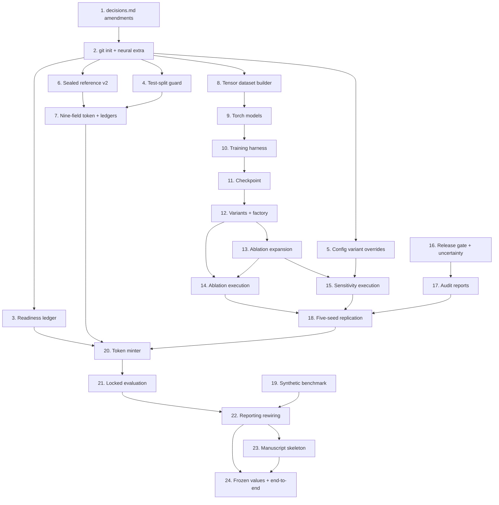

# Implementation Plan

## Overview

This plan implements `.kiro/specs/neural-experiment-pipeline/requirements.md` following `design.md`. It sits on top of the completed parent spec `.kiro/specs/causal-witness-pwm/`, whose `decisions.md` remains the sole source of frozen values. No numeric constant, threshold, formula, or named algorithm below is re-derived here.

Sequencing is dependency-driven and has three hard ordering constraints. First, the three `decisions.md` Section 26 amendments come before any code that depends on them (Requirement 18.2). Second, torch stays a leaf dependency: every task below must leave the existing 679 tests runnable in an environment where torch is not installed (`design.md` Section 2.4). Third, no task between 3 and 19 may open the Test_Split or the sealed reference — the readiness ledger and the strengthened token are the only doors, and they open last (Requirement 18.3).

Task numbering continues the parent plan's conventions: numbered groups, `- [ ]` checkboxes, sub-bullets naming concrete files, and a `_Requirements:_` line citing this spec's requirement numbers. Sub-tasks marked `*` are optional under deadline pressure and are not implemented by default.

## Tasks

- [x] 1. Record the three prerequisite `decisions.md` Section 26 amendments
  - All three are edits to `.kiro/specs/causal-witness-pwm/decisions.md`; no pipeline code that depends on these values may run before the corresponding amendment entry exists
  - _Requirements: 18.1, 18.2_

- [x] 1.1 Freeze the stronger-observational-selection coefficients
  - Add a Section 26 amendment entry to `.kiro/specs/causal-witness-pwm/decisions.md` recording every risk-score coefficient and logit intercept for `selection_severity="stronger"`, in the same form Section 9 uses for the primary coefficients, with the rationale for the chosen severity
  - Add module-level constants `STRONGER_SELECTION_COEFFICIENTS` alongside the existing primary coefficients in `src/cohorts/selection.py` and route them through the existing `observationalize()` severity path
  - Extend `tests/frozen/test_decisions_match.py` with assertions that the new constants equal the values recorded in the amendment
  - _Requirements: 8.7, 18.1, 18.2_

- [x] 1.2 Freeze the cross-seed stability criterion
  - Add a Section 26 amendment entry recording the criterion: effect-direction agreement in at least 4 of the 5 frozen seeds together with no required sensitivity variant contradicting the aggregate direction
  - Express it as a frozen `StabilityCriterion` dataclass and a module-level `CROSS_SEED_STABILITY_CRITERION` constant in `scripts/run_replication.py` (created in task 18), with a human-readable `criterion_description` string that the aggregator reports verbatim
  - Extend `tests/frozen/test_decisions_match.py` with an assertion that the constant matches the amendment text (this assertion fails until task 1.2 lands, which is the intended forcing function)
  - _Requirements: 9.6, 9.7, 18.1, 18.2_

- [x] 1.3 Record the `experiment_id` re-identification amendment
  - Add a Section 26 amendment entry stating that extending `ExperimentConfig` with `variant`, `model_variant`, and `negative_control_n_bootstrap` changes `canonical_dict()` and therefore re-identifies every previously computed `experiment_id`; record that prior result directories are left in place unmigrated and that identifiers minted before the amendment date belong to the pre-neural config schema
  - Record the rejected alternatives (bypassing the config, relaxing `extra="forbid"`) and why hash-inclusion is the honest outcome, per `design.md` Section 2.6 tension 3
  - _Requirements: 9.9, 18.1, 18.2_

- [x] 2. Initialize the repository and declare the neural dependency extra
  - Run `git init` at the project root, confirm `.gitignore` already excludes `data/raw/`, `results/`, `reference/`, `.venv/`, and caches, and create the initial commit from the existing tracked source tree
  - Verify with `git status --porcelain` that no raw patient data, sealed artifact, or generated result path appears as tracked or untracked-but-stageable content
  - Write `tests/unit/test_repository_provenance.py` asserting the ignore rules exclude `data/raw`, `results`, and `reference` paths
  - _Requirements: 15.1_

- [x] 2.1 Declare pinned torch/numpy as an optional `neural` extra and retarget the venue
  - Edit `pyproject.toml`: add `[project.optional-dependencies] neural = ["torch==2.4.1", "numpy==<pinned>"]` and a `dev` extra that includes `neural`; leave the base install at the existing pinned `pydantic`/`PyYAML` so the current suite runs torch-free
  - Change the project description venue string from the parent's NeurIPS 2026 WMHS line to `ICLR 2027 main track`
  - Register the `neural` pytest marker in `pyproject.toml` and add `tests/neural/` as the collection root for torch-requiring tests
  - Write `tests/unit/test_dependency_manifest.py` asserting the pinned torch version string, the presence of numpy in the extra, that neither appears in the base dependency list, and that the venue string reads ICLR 2027 main track
  - _Requirements: 5.1, 5.2, 20.5_
  - Note (2026-09-30): torch pin changed from 2.5.1 to 2.4.1 to match the SADL project environment that produces reported results (Requirement 5.2); numpy stays 1.26.4

- [x] 2.2 Enforce torch isolation mechanically
  - Write `tests/unit/test_torch_isolation.py` spawning a subprocess with a `sys.meta_path` finder that raises on `import torch`, then importing `causal.baselines`, `causal.overlap`, `causal.propensity`, `causal.negative_controls`, all three witness modules, `witnesses.aggregation`, `witnesses.audit_report`, `cohorts.pipeline`, `cohorts.sealed_reference`, `evaluation.metrics`, `evaluation.statistics`, `evaluation.ablation_matrix`, `evaluation.robustness`, `evaluation.release_gate`, `models.variants`, `infra.readiness`, and `scripts.scan_exports`
  - Add a second assertion that `src/models/__init__.py` imports no `torch_*` module and not `models.dataset`
  - _Requirements: 5.1, 5.2_

- [x] 2.3 Record git provenance in every manifest
  - Extend `src/infra/manifest.py`'s `ManifestWriter` with a git-commit resolver recording the commit identifier and the working-tree cleanliness state on every manifest write, and recording an explicit `git_commit_unavailable` state rather than omitting the field when resolution fails
  - Bind each written checkpoint path and result directory to the recorded commit identifier in the manifest
  - Write unit tests with a stubbed resolver for the clean, dirty, and unavailable cases, asserting the recorded state and that the artifact-to-commit binding is present
  - _Requirements: 15.2, 15.4, 15.5, 5.7_

- [x] 2.4 Fix the 21 Ruff violations and repair the secrets checker
  - Run `python -m ruff check src/ scripts/ tests/ --fix` to clear the 8 auto-fixable violations (4 `UP037` quoted-annotation, 2 `B905` zip-without-explicit-strict, 1 `I001` unsorted-imports, 1 `F401` unused-import), then hand-fix the remaining 13 (12 `E501` line-too-long, 1 `UP038` non-pep604-isinstance); the E501 sites are concentrated in `tests/unit/test_timelines.py`, `tests/unit/test_metrics.py`, and `scripts/` argparse help strings
  - Confirm `python -m ruff check src/ scripts/ tests/` reports zero violations and that the full pytest suite still passes with the same test count
  - Repair `scripts/check_no_secrets.py`: it currently invokes `git diff --cached --name-only --diff-filter=ACMR`, which fails with "unknown option `cached`" when no repository exists, exiting 1 with a usage dump. After task 2's `git init` the command resolves, but add an explicit pre-flight check that reports a clear "not a git repository" message instead of surfacing raw git usage output, and keep the non-zero exit so the checker continues to fail safe rather than silently passing
  - Write `tests/unit/test_check_no_secrets.py` asserting the pre-flight path reports the clear message and exits non-zero when run outside a repository, and that a staged file containing a synthetic credential-shaped string is flagged
  - _Requirements: 15.1_

- [x] 2.5 Make the twelve go/no-go items mechanically checkable where possible
  - For each of the twelve existing human-attested items in `configs/go_no_go_checklist.yaml`, add a verifier function in a new `src/infra/checklist_verifiers.py` that returns `verified | unverifiable | failed` with evidence: `frozen_protocol` / `frozen_causal_diagram` / `frozen_adjustment_set` / `target_population_defined` / `statistical_procedures_locked` are checkable against `decisions.md` and `configs/target_trials/main.yaml`; `leakage_tests_passed` / `splits_cross_fitting_verified` / `privacy_checks_passed` / `one_command_reproduction_verified` are checkable by invoking the existing test selections and `scan_exports`; `estimand_alignment_checked` / `reference_inaccessible_to_model_selection` / `thresholds_frozen` are attestations that remain `unverifiable` by machine and must stay human-set
  - Have `scripts/check_go_no_go.py` report each item's verifier result alongside its attested boolean and refuse to mint when a machine-verifiable item is attested `true` but its verifier returns `failed`, so an attestation cannot contradict evidence
  - Write unit tests for each verifier's three outcomes and a test asserting the contradiction case (attested true, verifier failed) blocks minting with the item named
  - _Requirements: 13.13, 18.4_

- [x] 3. Implement the readiness ledger
  - Write `src/infra/readiness.py` (no torch): frozen `ReadinessLedger(seeds_executed, ablation_runs_executed, sensitivity_variants_executed, determinism_verified)`, `REQUIRED_SEEDS = (101, 202, 303, 404, 505)`, `ReadinessDecision(ready, missing_items)`, `evaluate_readiness(ledger)`, plus `load_ledger(results_root)` and `append_ledger_entry(results_root, kind, run_id, artifact_hash)` writing `results/<experiment_id>/readiness_ledger.json`
  - Readiness holds only when the executed seed set covers `REQUIRED_SEEDS`, the executed ablation-run set covers the twelve expanded run ids, the executed sensitivity set covers the eight frozen variant names, and every executed run id also appears in `determinism_verified`; otherwise `missing_items` names each missing seed, run, and variant
  - Import the required ablation-run and sensitivity-variant sets lazily from `evaluation.ablation_matrix` / `evaluation.robustness` so the module stays torch-free and importable before task 13 lands
  - Write `tests/unit/test_readiness.py` implementing Property 10 with `hypothesis` over ledgers holding random missing subsets of the 5 seeds, 12 runs, and 8 variants, asserting not-ready with exactly those items named, and ready only on completeness plus determinism verification
  - _Requirements: 18.3, 18.4, 18.7_

- [x] 4. Extend the reference guard with test-split isolation
  - Add `assert_test_split_unlocked(unlock_token)` to `src/infra/reference_guard.py`, mirroring `assert_reference_unlocked` and using the same `isinstance(token, LockedEvaluationToken)` check, raising `ReferenceAccessError` otherwise; keep the existing deferred import that avoids the `cohorts.sealed_reference` cycle exactly as it is
  - Add `require_test_split(pipeline_result, unlock_token)` as the only accessor any runner uses to reach `ObservationalizationPipelineResult.test`; leave the `.test` attribute itself in place so existing tests keep passing
  - Write `tests/unit/test_token_and_guards.py` implementing Property 9 with `hypothesis`-generated non-token objects, including a look-alike dataclass carrying every token field name with valid-looking values, asserting both guards raise `ReferenceAccessError` for every one
  - Add a test asserting `require_test_split` refuses before touching the result object and that no development-stage module in `src/` references `.test` directly
  - _Requirements: 4.8, 18.6_

- [x] 5. Extend `ExperimentConfig` with validated variant overrides
  - Add `VariantOverrides` to `src/infra/config.py` (`extra="forbid"`, frozen) with the eight defaulted fields of `design.md` Section 2.6 tension 3: `propensity_model`, `weight_clipping`, `support_thresholds`, `missingness_stress`, `landmark_masking`, `comparator_orientation`, `endpoint_horizon_weeks`, `selection_severity`
  - Add `ExperimentVariantSpec` as the pydantic mirror of `ExperimentVariant`'s fields, and extend `ExperimentConfig` with `variant: VariantOverrides = VariantOverrides()`, `model_variant: ExperimentVariantSpec | None = None`, and `negative_control_n_bootstrap: int = 1000`
  - Write unit tests confirming every new field defaults to its primary/frozen setting, that an out-of-set literal or unknown key raises a validation error, and that `canonical_dict()` serializes the defaults so two runs differing in any override get different `experiment_id` values
  - _Requirements: 8.1, 8.2, 9.9, 18.1_

- [x] 5.1 Reconcile `run_causal_analysis.py` onto the single identity function
  - Delete `_compute_content_experiment_id` and its local `DuplicateExperimentError` raise site from `scripts/run_causal_analysis.py`; call `ExperimentRegistry.register(resolved_config, git_commit, dirty, results_root)` and inherit the registry's duplicate detection
  - Confirm the inputs the deleted function covered are hashed through `ResolvedConfig`: dataset checksum and trial-spec version via the existing contract/trial configs, master seed via `ExperimentConfig.seed`, and bootstrap count via the new `negative_control_n_bootstrap`
  - Write a unit test asserting two runs differing only in `negative_control_n_bootstrap` produce different experiment ids and that a repeat run of an unchanged config is refused by the registry
  - _Requirements: 9.9, 18.1_

- [x] 5.2 Re-verify the existing suite against the re-identified experiment ids
  - Run the full `pytest` suite and triage every failure caused by the `canonical_dict()` change: frozen-value tests pinning literal experiment-id strings, registry fixtures, and any result-path assertion built from an id
  - Update those expectations to the newly computed identifiers, keeping the assertion style (recompute-and-compare, not hand-copied hashes) so a future config change fails loudly again
  - Confirm the suite returns to a full pass with the same test count as before the change, and that no test was deleted or skipped to achieve it
  - _Requirements: 9.9, 18.1, 18.7_

- [x] 6. Extend the sealed reference to carry risk-scale quantities
  - Extend `src/cohorts/sealed_reference.py`: `SEALED_FORMAT_VERSION = 2`, frozen `ReferenceQuantity(value, scale, horizon_weeks)`, and `InternalReference` gaining `format_version` and a `quantities` mapping while `value` keeps its existing v1 log-HR semantics
  - Write `extended_randomized_reference_estimator(cohort)` composing `causal.baselines.unadjusted_cox` for `log_hazard_ratio` and per-arm Kaplan-Meier evaluation at `HORIZON_WEEKS=96.0` via `cohort.by_arm(arm)` for `risk_arm0` / `risk_arm1`, with `risk_difference = risk_arm1 - risk_arm0`; all three computed on the complete pre-split, pre-observationalization eligible arm-0/arm-1 cohort
  - Write `write_sealed_artifact` recording `format_version: 2`, and `read_sealed_artifact` reading the version field after `assert_reference_unlocked` and before payload parsing, raising `SealedFormatVersionError` naming the documented re-seal step on a missing version or version below 2
  - Write unit tests implementing Property 25 over generated artifacts with absent/0/1/2/3 version fields, plus a test asserting the three quantities are computed pre-split and pre-observationalization and that `value` is byte-identical to what the v1 estimator produced
  - _Requirements: 14.1, 14.2, 14.6, 14.7_

- [x] 6.1 Implement scale-matched reference comparison
  - Add `compare_to_reference(estimate, reference, quantity)` to `src/cohorts/sealed_reference.py` raising `ScaleMismatchError` unless `estimate.scale` equals `reference.quantities[quantity].scale`, using `CausalEstimate.scale`'s existing vocabulary
  - Extend `evaluation/metrics.py::risk_difference_error_vs_internal_reference` to select the `risk_difference` quantity by name and assert its scale, keeping its existing runtime rejection of non-`InternalReference` inputs
  - Write `tests/property/test_reference_scales.py` implementing Property 24 over generated scale pairs, with an explicit case asserting a risk-difference estimate against a log-hazard-ratio reference raises
  - _Requirements: 14.3, 14.4_

- [x] 6.2 Implement the v2 re-seal path
  - Add `--stage seal-reference --reseal` to `scripts/run_stage.py`: rebuild the complete eligible arm-0/arm-1 cohort, construct `SealedReference(cohort, extended_randomized_reference_estimator)`, and write `reference/internal_randomized_reference.v2.sealed.json`, refusing with a non-zero exit if a v2 artifact already exists at the target path
  - Leave the v1 artifact byte-identical and unread; provide no code path that upgrades it in place
  - Write an integration test on a synthetic cohort in `tmp_path` asserting the v2 artifact is written with three quantities and a version field, that a second invocation refuses, and that a pre-existing v1 file's bytes are unchanged
  - _Requirements: 14.2, 14.6, 14.7_

- [x] 7. Strengthen `LockedEvaluationToken` to nine bound fields
  - Extend the frozen `LockedEvaluationToken` in `src/cohorts/sealed_reference.py` with `resolved_config_hash`, `dataset_checksum`, `split_hash`, `checkpoint_hashes` (sorted non-empty tuple of `(logical_name, sha256)` pairs), `git_commit`, `statistical_plan_version`, and `evaluation_id`, all required with no defaults, keeping the class identity and frozen decorator unchanged so `assert_reference_unlocked`'s `isinstance` check is strictly strengthened
  - Extend `__post_init__` to raise a single `TokenFieldError` naming *every* absent or empty field at once, subsuming the existing empty-`issued_by` rejection
  - Extend `_mint(...)` to take all seven new fields, validate presence and non-emptiness, and check `evaluation_id` against the consumption ledger
  - Write unit tests asserting no partially bound token can be constructed, that a multi-field violation names all offenders in one error, and that the existing sealed-reference guard tests still pass unchanged
  - _Requirements: 13.3, 13.4_

- [x] 7.1 Add the consumption and reference-access ledgers
  - Write append-only `results/locked_evaluation/consumed.jsonl` handling (one record per consumed `evaluation_id` with consumption timestamp and result directory) and a `is_consumed(evaluation_id, results_root)` reader used by both the minter and the locked-evaluation runner
  - Have `SealedReference.unseal(token)` and module-level `read_sealed_artifact(path, unlock_token)` append `{evaluation_id, accessed_at}` to `results/locked_evaluation/reference_access.jsonl` after their existing `assert_reference_unlocked` call, and expose a reader that supplies the audit report's reference-access timestamp
  - Write unit tests over a `tmp_path` results root confirming a duplicated `evaluation_id` is refused, that refusal happens before any sealed file is opened, and that an access record is appended exactly once per successful unseal
  - _Requirements: 13.6, 14.5, 12.4_

- [x] 7.2 Diagnose the overlap-support failure and the SMD measurement basis
  - Measured on the real cohort at seed 20240101 with dev-retained n=378 and 5-fold cross-fitted logistic propensity: `arm_counts` {arm1: 205, arm0: 173} passes the 100-per-arm floor and `ess_by_arm` {arm1: 187.1, arm0: 148.6} passes the 100.0 ESS floor, but `smd_sufficient = False` on six covariates above the 0.10 `MAX_ABS_SMD` threshold — baseline_cd4 -0.4846, karnofsky_score -0.2444, age 0.2235, symptomatic_status 0.1513, hemophilia -0.1439, baseline_cd8 -0.1195 — so `support_valid = False`, the causal witness fails, and the release gate is blocked. These numbers are inputs to this task, not quantities to re-derive
  - Establish empirically whether `causal/overlap.py::_smd` measures RAW (unweighted) covariate balance or IPW-ADJUSTED balance, and record the finding. `decisions.md` Section 12's frozen condition reads "every **adjusted** baseline covariate has absolute standardized mean difference < 0.10"; the observationalization mechanism of Section 9 *deliberately* selects on baseline_cd4, karnofsky_score, age, symptomatic_status, prior-OI, and prior-ART, so large raw SMDs are the benchmark working as designed, whereas large *post-weighting* SMDs would indicate adjustment failure. Compute both raw and stabilized-IPW-weighted SMDs for all six offending covariates using the existing `causal/weighting.py` weights and report them side by side
  - Do not change the frozen 0.10 threshold or the four frozen conditions. If the finding is that the wrong quantity is being measured, record it as a proposed `decisions.md` Section 26 amendment with both sets of numbers as evidence, and leave the code unchanged pending that amendment
  - Write `tests/diagnostics/test_overlap_diagnosis.py` producing a committed diagnostic artifact `results/diagnostics/overlap_smd_raw_vs_weighted.json` carrying both SMD sets, the six offending covariates, and the four condition booleans, so the finding is reproducible rather than narrative
  - Note: the figures quoted above (n=378, arms 205/173, ESS 187.1/148.6, `extreme_weight_count=1`, and the six raw SMDs) come from passing seed 20240101 un-derived, a non-canonical path. The committed `scripts/run_causal_analysis.py` derives seeds via `derive_seed`, giving canonical dev-retained n=383, arms {1: 201, 0: 182}, ESS {1: 187.23, 0: 161.00}, `extreme_weight_count=0`, and raw SMDs above 0.10 on five covariates: baseline_cd4 -0.3744, karnofsky_score -0.3123, symptomatic_status +0.2966, age +0.1906, baseline_cd8 -0.1363 (hemophilia +0.0425 no longer fails). See `proposed-decisions-section-26-amendment-smd-basis.md` sections A, B and "The n discrepancy (resolved)"
  - _Requirements: 10.6, 11.1, 11.2, 18.1, 18.2_

- [x] 7.3 Diagnose the positivity-warning and negative-control-outcome failures
  - Investigate the `no_unresolved_positivity_warning` condition, which fails on exactly 1 patient of 378 (0.26%) falling outside the primary `[0.10, 0.90]` common-support band. `causal/overlap.py` documents `extreme_weight_count` as a deliberate *proxy* for the true post-clipping weight distribution. Report that single patient's propensity, whether it falls outside the sensitivity band `[0.05, 0.95]` as well, and what the condition would yield under the documented trimming that `causal/weighting.py` already implements
  - Investigate the negative-control-outcome `uncertain` classification: report the adjusted standardized mean difference for baseline CD8, its bootstrap CI, which of the two frozen branches (`abs(smd) >= 0.10` with a CI containing zero) produced `uncertain`, and whether the classification is stable across the five frozen seeds and across bootstrap replicate counts of 200 and 1000
  - Record both findings in `results/diagnostics/positivity_and_negative_control.json`, and state plainly for each whether it is a genuine diagnostic signal about the cohort, an artifact of a documented proxy, or a defect — with the evidence for that verdict
  - Do not adjust any frozen threshold, band, or classification rule to make either condition pass
  - Note: the single out-of-band patient of 378 exists only on the un-derived seed path. On the canonical `derive_seed` path n=383 and `extreme_weight_count=0`, so the `no_unresolved_positivity_warning` finding should be re-evaluated on the canonical cohort. `results/diagnostics/positivity_and_negative_control.json` reports both paths (`canonical_seed_path` and `underived_seed_path`); on the canonical path it records 0 patients out of band and the condition passing
  - _Requirements: 8.3, 10.6, 11.1, 11.3, 18.1_

- [x] 7.4 Apply the approved Section 26 SMD-basis amendment to `decisions.md`
  - Append one row to the Section 26 amendment-log table in `.kiro/specs/causal-witness-pwm/decisions.md`, following the existing row convention (Date / Section / Prior value / New value / Reason). Take the text from "Approved amendment text" in `.kiro/specs/neural-experiment-pipeline/proposed-decisions-section-26-amendment-smd-basis.md` (items 1-4), with the date set to the application date
  - Reference the evidence file and `results/diagnostics/overlap_smd_raw_vs_weighted.json` in the Reason cell, and record that Section 13 is being conformed to, not changed, and that Section 11.3 is kept exactly
  - Make no other change to `decisions.md`: not Section 12's body text, not Section 13's list, not Section 11.3, and no threshold, band, or condition
  - Update the proposal file's status header from "approved in direction" to "applied", naming the amendment date. Keep the evidence record intact
  - If `tests/frozen/test_decisions_match.py` pins the amendment-log row count or content, extend it to cover the new row
  - _Requirements: 18.1, 18.2_

- [x] 7.5 Conform the propensity model to the Section 13 adjustment set
  - Extend `causal.propensity.COVARIATE_FIELDS` in `src/causal/propensity.py` from the current six Section 9 inputs to the full 13-covariate Section 13 set: age; weight; sex; race/ethnicity; hemophilia; homosexual activity; intravenous drug-use history; Karnofsky score; prior opportunistic infection; symptomatic status; baseline CD4; baseline CD8; prior antiretroviral exposure and duration. Do not change `cohorts/selection.py` or Section 9's six risk-score inputs
  - Define one explicit mapping from each Section 13 name to its stored concept id(s) and encoding, and share it with `causal/overlap.py`. The names differ from the stored keys (`weight` vs `weight_kg`, `intravenous_drug_use_history` vs `iv_drug_use_history`, `prior_antiretroviral_exposure_and_duration` vs `prior_art_exposure_days` / `prior_antiretroviral_exposure_duration`; see the evidence file's "Name mismatch" table), so do not rely on name equality
  - Specify each encoding in the module docstring and in this task's completion record: `sex` (`"M"`/`"F"` string), `race_ethnicity` (free string; state the category set and the reference level, and how an unseen development-fold category is handled), `intravenous_drug_use_history` and the other booleans, `weight` (continuous, z-scored), and `prior_antiretroviral_exposure_and_duration` (must encode exposure *and* duration, e.g. an indicator plus a standardized duration; the current binary `prior_art` alone does not conform). State the missing-value rule for each field
  - Fit every standardization parameter and category set on development folds only, through the existing `_fit_standardization` path, so cross-fitting stays leakage-safe. Confirm the existing leakage audit (`data/leakage_audit.py`, parent Requirement 5.10) and its tests still pass, and that no excluded post-baseline field from Section 13 enters the feature vector
  - Keep Section 11.3 exactly. `run_negative_control_outcome` currently regresses `baseline_cd8` on treatment plus `spec.adjustment_set` minus CD8 and reads no propensity score, so confirm and test that it is unaffected by this change. If any negative-control-outcome path uses a propensity-based quantity, give it a separate propensity fit that excludes `baseline_cd8`, and assert with `assert_no_self_adjustment` that CD8 is absent from that fit
  - Width consequence: `src/models/dataset.py` takes `TensorBatch.baseline` columns and `DatasetDimensions.baseline_covariate_width` from `COVARIATE_FIELDS`, so the width changes from 6 to the encoded column count. Update any test or fixture that pins width 6 or hand-builds a baseline tensor or `DatasetDimensions` (check `tests/neural/`), and correct the `src/models/torch_intervention_aware.py` docstring that says `baseline_cd8` is not in `COVARIATE_FIELDS`. The Section 25 encoder widths 4/3/2 and hidden width 16 are unchanged
  - Other consumers change with it: `adjusted_cox` in `src/causal/baselines.py` and `models.non_neural_baseline.COEFFICIENT_NAMES`. Update tests that pin their coefficient lists or counts. Do not update tests that pin conventional estimate values to new numbers without recording the before and after values
  - Write unit tests for each encoding (including the unseen-category and missing-value rules), for dev-fold-only fitting, and for the unchanged negative-control-outcome covariate list. Then run the full suite in both the torch-free and `neural` environments
  - _Requirements: 1.1, 1.4, 1.7, 11.3, 18.1, 18.2, 18.5_

- [x] 7.7 Implement converged, deterministic Newton-type solvers with convergence diagnostics
  - Evidence: `.agents/tasks/propensity-convergence-investigation/findings.md`. Every in-house fit is fixed-budget gradient descent with no tolerance. On the canonical dev cohort the propensity fit is unconverged (gradient norm ~1e-2), and the Cox fits are shrunk ~40-50% toward the null (`unadjusted_cox` log-HR -0.377 shipped vs -0.641 converged)
  - Write `src/causal/solvers.py` (pure Python, no new dependency, torch-free): `fit_logistic_newton` (IRLS on binary cross-entropy), `fit_linear_exact` (least squares by one Newton/normal-equation solve), and `fit_cox_newton` (Newton-Raphson on the weighted Breslow partial log-likelihood, reproducing `causal.baselines._fit_cox`'s objective, tie handling, weights, and `_ETA_CLIP` exactly)
  - Frozen rule, as module constants: zero initialization; step-halving (up to 30 halvings) whenever the objective does not improve; stop when max |step| < `SOLVER_TOLERANCE = 1e-8`; hard cap `SOLVER_MAX_ITERATIONS = 100`. A fit that hits the cap, produces a non-finite coefficient, or meets a singular Hessian returns `converged = False`; it is never silently treated as converged
  - Every solver returns its coefficients plus a frozen `ConvergenceDiagnostic(optimizer, iterations, final_max_abs_step, final_gradient_norm, final_objective, converged, reason)`
  - Reuse `causal.baselines._invert_matrix` (or move it into `solvers.py` and re-export it) rather than adding a second matrix inverse
  - Write `tests/unit/test_solvers.py` without numpy: the logistic fit on one binary covariate equals the closed-form log odds ratio; the linear fit equals the closed-form OLS on a small hand-computed design; the Cox fit's score is below 1e-8 at the solution; zero-weight rows are inert; determinism; and the not-converged path (a perfectly separated logistic input reports `converged = False`)
  - Do not wire the solvers into any caller in this task
  - Completed (2026-10-10): `src/causal/solvers.py` (IRLS, exact least squares, Breslow Newton-Raphson; minimum-norm step via a symmetric pseudo-inverse, so rank-deficient test designs get the same minimum-norm optimum zero-started descent would; perfect separation still reports not converged). `tests/unit/test_solvers.py` (9 tests, no numpy). On the canonical cohort the solvers match numpy to about 1e-15, and `unadjusted_cox` / `adjusted_cox` match the old descent run to 30,000 steps (-0.64134, -0.95319) in 4-6 Newton iterations
  - _Requirements: 18.1, 18.2, 18.7_

- [x] 7.8 Wire the solvers into every fixed-budget fit and record diagnostics
  - Replace the gradient-descent loops in `causal.propensity.LogisticPropensityModel._fit`, `causal.baselines._fit_cox` and `_fit_logistic`, `causal.negative_controls._fit_linear_regression`, and `evaluation.metrics._fit_logistic_1d` with the 7.7 solvers. Delete the now-unused `LEARNING_RATE` / `N_ITERATIONS` / `_LR_*` constants and update the docstrings that describe them
  - Keep every objective, encoding, feature order, clip, standardization, fold assignment, and interface unchanged. Only the optimizer changes. `CrossFittedPredictions` gains a per-fold `convergence` mapping (default empty, so existing constructors keep working), and `CausalEstimate` / `NegativeControlResult` evidence carries the diagnostic where it has an evidence field
  - A not-converged propensity fold or estimator fit raises a named error (`SolverConvergenceError`) instead of returning shrunk coefficients
  - The internal randomized reference changes automatically because `cohorts.sealed_reference` calls `unadjusted_cox`. No sealed artifact exists on disk and no locked evaluation has been consumed, so this does not reopen or alter any sealed value. State that in the completion record
  - Tests that pin a conventional estimate value: update them and record the before and after values in a comment and in the completion record. Never loosen a tolerance to make a test pass
  - Run the targeted unit tests one file at a time, each capped at 5 minutes, then the suite excluding `tests/diagnostics` in the background with a 20-minute cap
  - Completed (2026-10-10): all five fits rewired; old LR/iteration constants deleted; `CrossFittedPredictions.convergence` records per-fold diagnostics; `SolverConvergenceError` blocks unconverged primary fits, and bootstrap replicates that fail are dropped and counted. Test changes, with before/after recorded in comments: two synthetic sealed-reference cohorts had no finite Cox maximum (one arm outlived the other entirely) and gained a single censoring or event so the likelihood is bounded; `Calibrator` reports slope/intercept as NaN on perfectly separated predictions instead of an arbitrary finite number. Also found and fixed: the negative-control-outcome regression silently dropped five Section 13 covariates (raw-name lookup); it now uses the shared mapping (`tests/unit/test_adjustment_set_encoding.py` covers it). Full suite including the full diagnostic sweep: 1242 passed, 5 skipped. Ruff was unavailable in this environment (its cached binary was gone); lines were checked against the 100-column limit and imports checked by script
  - _Requirements: 18.1, 18.2, 18.5, 18.7_

- [x] 7.9 Freeze the solver rule and re-measure the canonical cohort
  - Append one row to `decisions.md` Section 26 freezing the 7.7 rule (optimizer per fit type, zero init, step-halving, tolerance 1e-8, cap 100, not-converged blocks the estimate). Prior value: unfrozen fixed-budget gradient descent (500 or 300 iterations, LR 0.1 or 0.05). Reason: cite the investigation findings. State that no threshold, band, encoding, or adjustment set changes, and that the sealed internal reference is recomputed in memory by the existing pipeline (no artifact existed, no locked evaluation consumed)
  - Re-run `tests/diagnostics` in default mode (capped at 10 minutes) and regenerate `results/diagnostics/*.json` on the canonical path
  - Record in the completion record, from the converged fits on the canonical dev cohort: all six conventional estimates and `CoxBaseline`'s treatment coefficient (before/after), the propensity range, per-arm ESS, `extreme_weight_count`, the four support booleans, `support_valid`, and the negative-control exposure and outcome classifications. Report them as measured, pass or fail
  - Keep the prior-ART duration encoding from 7.5 unchanged. The one out-of-band control patient (Karnofsky z = -4.4, prior-ART duration z = +2.9) is a genuine finding to be reported under Requirement 19, not engineered away after the fact
  - Then run the full suite once, in the background, capped at 25 minutes
  - Completed (2026-10-10), canonical dev cohort (n=383), converged fits. Before -> after: `unadjusted_cox` -0.377 -> -0.641 (HR 0.527, SE 0.214); `adjusted_cox` -0.499 -> -0.953; `ps_weighted_marginal_cox` -0.586 -> -1.007; `CoxBaseline` = adjusted; `outcome_regression` -0.083 -> -0.159; `ipcw_ipw` -0.166 -> -0.171 (new propensities); `ipcw_aipw` (primary) -0.158 -> -0.159. Propensity range [0.1798, 0.9327]; ESS 179.5 / 138.5; `extreme_weight_count` 1. Support booleans: arm counts True, ESS True, SMD False (still raw; 7.6), positivity False; `support_valid` False. Negative-control exposure pass (-0.062, CI [-0.140, 0.032]); negative-control outcome pass (-0.0906, CI about [-0.26, 0.10], was uncertain -0.1150). Diagnostics regenerated with the complete five-seed sweep (54 s, previously about 17 min). Section 26 row appended
  - _Requirements: 11.1, 11.5, 18.1, 18.2, 19.1, 19.2_

- [x] 7.6 Gate the Section 12 SMD condition on weighted balance over the full adjustment set
  - Implement weighted pooled-SD SMD in `src/causal/overlap.py` from stabilized IPW weights (numerator = marginal treatment prevalence), clipped with the `"primary"` 1st/99th-percentile preset via the existing `causal.weighting.clip_weights`. Introduce no new weighting scheme. Gate `smd_sufficient` on the weighted values. The 0.10 `MAX_ABS_SMD` threshold, the four conditions, both support bands, and the `extreme_weight_count` proxy are unchanged
  - Evaluate over the full Section 13 adjustment set through the shared mapping from 7.5. Every covariate gets either a weighted SMD value or an explicit, named exclusion reason in `OverlapReport`, and silent omission is removed. A covariate carrying an exclusion reason must not count as balanced
  - Keep raw SMDs in the report as a separately named, labelled descriptive field that is never read by `smd_sufficient` or `support_valid`. Update the `OverlapReport` consumers and `tests/unit` overlap tests accordingly
  - Update `tests/diagnostics/test_overlap_diagnosis.py` and `tests/diagnostics/test_positivity_and_negative_control.py` where they encode the superseded Section 11.3 reading (the assertion that residual offenders are absent from `COVARIATE_FIELDS`, and the verdict string saying 11.3 forbids adjusting for `baseline_cd8`)
  - Regenerate `results/diagnostics/overlap_smd_raw_vs_weighted.json` and `results/diagnostics/positivity_and_negative_control.json` on the canonical `derive_seed` path used by `scripts/run_causal_analysis.py`. Record raw and weighted SMD for all 13 covariates, arm counts, per-arm ESS, `extreme_weight_count`, the four support booleans, `support_valid`, and the negative-control-outcome point estimate, CI, and classification
  - Report the resulting four booleans, `support_valid`, and the negative-control-outcome classification plainly in the completion record, whether they pass or fail. If `baseline_cd8` or any other covariate still has weighted |SMD| >= 0.10, or ESS falls below 100 in either arm, that is a genuine cohort finding: the gate stays blocked and it is reported under Requirement 19. Do not adjust any threshold, band, clipping preset, or classification rule to make anything pass
  - Open neither the Test_Split nor the sealed reference
  - Completed (2026-10-10): `causal/overlap.py` gates `smd_sufficient` on stabilized-IPW SMDs (primary 1st/99th clip via `causal.weighting.clip_weights`) over the full Section 13 set through the shared mapping, one entry per encoded column; `raw_smd_by_covariate` is descriptive only; `smd_exclusions` names every column that cannot be checked, and any exclusion fails the gate. The audit report carries all three. Canonical dev cohort (n=383, converged propensities): raw |SMD| up to 0.374 (baseline_cd4); weighted |SMD| at most 0.048 (age); `baseline_cd8` -0.136 raw -> -0.002 weighted; no exclusions. Four conditions: arm counts True, ESS True (179.5 / 138.5), SMD True, positivity False (one arm-0 patient at e = 0.933); `support_valid` False. Same SMD verdict on the un-derived seed path. Negative-control outcome pass (-0.0906). Not adopted, reported only: trimming that one patient at the primary band would give `support_valid` True (182 -> 181 in arm 0), and nobody falls outside the sensitivity band [0.05, 0.95]. The task 7.2 diagnostic module now cross-checks the report's raw and weighted SMDs against an independent recomputation (rel 1e-9). New tests: `tests/unit/test_overlap_weighted_gate.py`. Full suite with the full diagnostic sweep: 1247 passed, 5 skipped
  - _Requirements: 11.1, 11.2, 11.3, 11.5, 18.1, 18.2, 19.1_

- [x] 8. Implement the tensor dataset builder
  - Write `src/models/dataset.py`: `LANDMARK_COUNT = 3`, `SURVIVAL_BIN_COUNT = 23`, `BIN_WIDTH_WEEKS = 8.0`, `FINAL_BIN_START_WEEKS = 176.0`, `MISSING_PLACEHOLDER = 0.0`, `survival_bin_index(elapsed_weeks)`, frozen `DatasetDimensions`, frozen `TensorBatch` with the exact fields and shapes of `design.md` Section 4.1, and `PatientDatasetBuilder.fit/build/dimensions`
  - Delegate every semantic decision: elapsed weeks via `causal.baselines._elapsed_weeks`, baseline covariate ordering via `causal.propensity.COVARIATE_FIELDS`, landmarks via `models.sequence_baseline.LANDMARK_WEEKS`, channel widths via `models.intervention_aware.STATE_INPUT_DIM` / `INTERVENTION_INPUT_DIM` / `PROTOCOL_INPUT_DIM`
  - Fit standardization parameters on Development_Split unmasked entries only, idempotently; `build` never refits and applies frozen parameters to validation and test rows unchanged
  - Set masks `True = observed`, fill every missing entry with `MISSING_PLACEHOLDER`, emit no non-finite values, and order rows by ascending `patient_id`
  - _Requirements: 1.1, 1.2, 1.3, 1.4, 1.5, 1.6, 1.7, 18.5_

- [x] 8.1 Write dataset property tests
  - Write `tests/neural/test_dataset.py` implementing Property 19 (N rows, frozen trailing widths, row-to-`patient_ids` alignment, reported `DatasetDimensions` equal to the trailing dimensions, ascending ids, identical tensors from shuffled input order) over `hypothesis` strategies building 1-50 `PatientRecord` objects
  - Implement Property 18 (bin index in 0..22, non-decreasing in elapsed weeks, equal to 22 exactly at or beyond 176 weeks, and equal to `causal.baselines._elapsed_weeks` applied to the same record) with explicit `hypothesis` examples at 0.0, 7.999, 8.0, 175.999, 176.0, and 1e6
  - Implement Property 20 (fit twice yields identical parameters; building validation or test batches leaves them unchanged; parameters use unmasked development entries only)
  - _Requirements: 1.2, 1.3, 1.4, 1.6, 1.7, 18.5_

- [x] 8.2 Write dataset error-path and fully-missing-column tests
  - Unit-test `DatasetBuildError` for empty input and for an injected duplicate `patient_id`, asserting the message says which and that no `TensorBatch` object was produced
  - Unit-test `DatasetBuildError` for absent, NaN, inf, and negative-elapsed event times, asserting the message names the offending patient and the reason and that nothing partial is emitted
  - Add the real-data condition test: a fully missing week-96 CD8 column yields an all-`False` `cd8_mask[:, 2]` across dev, val, and test, no fitted parameter for that column, placeholder fill, and no exception
  - _Requirements: 1.8, 1.9, 1.10, 1.5_

- [x] 9. Implement the production torch models
  - Both modules import their dimension constants from the pure-Python prototypes rather than redeclaring them, so prototype/production drift is an import or shape error rather than a silent divergence; the prototypes stay in place as the specification of record and produce no reported number
  - _Requirements: 2.1, 3.1_

- [x] 9.1 Implement `TorchSequenceGRU`
  - Write `src/models/torch_sequence_gru.py`: `TorchSequenceGRU(nn.Module)` importing `LANDMARK_WEEKS` and `BASELINE_STATE_INIT_FIELDS` from `models.sequence_baseline`, initializing the hidden state through `nn.Linear(BASELINE_STATE_INIT_FIELDS, 16)` + `tanh`, consuming `[cd4, cd8, treatment_arm]` per landmark with treatment as an ordinary input column and no separate encoder, and emitting `SequenceOutput(state_pred=(N,3,2), hazards=(N,23))` from a `nn.Linear(16, 2)` per-landmark head and a `nn.Linear(16, 23)` hazard head
  - Use the frozen hidden width 16 and include no dropout or batchnorm anywhere, so `eval()`-mode forward is deterministic by construction
  - Write `tests/neural/test_torch_sequence_gru.py` asserting output shapes, that two `eval()`-mode forwards on identical inputs are bitwise identical, and that the hidden width and landmark count come from the imported constants
  - _Requirements: 2.1, 2.2, 2.3, 2.4, 2.6_

- [x] 9.2 Implement `TorchInterventionAwareModel`
  - Write `src/models/torch_intervention_aware.py`: separate state/intervention/protocol encoders, a GRU state-transition module, treatment-specific hazard heads, and a CD4/CD8 state head, with widths imported from `models.intervention_aware` (`STATE_INPUT_DIM=4`, `INTERVENTION_INPUT_DIM=3`, `PROTOCOL_INPUT_DIM=2`) and hidden width 16
  - Add `InterventionMode = LEARNED | ZEROED | PLACEBO` and `ProtocolMode = ACTIVE | ZEROED`, with encoder output widths fixed at construction regardless of mode so a zeroed or placebo channel occupies the same width
  - Implement `forward(batch, arm)` and `rollout_both_arms(batch)` where the intervention-channel input is the only differing tensor between the two calls and every other tensor passed is literally the same object
  - Derive the 96-week outcome from the discrete-hazard sequence as `1 - prod(1 - h_k)` over bins up to week 96, with no separate unconstrained outcome head existing in the module
  - Note: the state-channel `tanh` saturation from unscaled `state_init` was resolved in task 10.3 via development-fitted standardization in `models/dataset.py`; see design.md §4.1
  - _Requirements: 3.1, 3.2, 3.3, 3.4, 3.5, 3.6_

- [x] 9.3 Write channel-width and rollout-identity property tests
  - Write `tests/neural/test_intervention_channels.py` implementing Property 13: for every `InterventionMode` × `ProtocolMode` combination the concatenated representation width equals the complete model's 4 + 3 + 2
  - Implement Property 14: for generated batches, the arm-0 and arm-1 rollouts receive baseline, state, protocol, and mask tensors identical by object identity and differ only in the intervention-channel input; and an ablated batch differs from the complete batch in exactly the named channel and no other tensor
  - _Requirements: 3.3, 3.4, 3.6_

- [x] 9.4 Parameterize the existing invariance properties over prototype and torch
  - Refactor `tests/property/test_invariance.py` so its three properties are expressed once against a minimal `rollout_both_arms`-shaped protocol and parameterized over `["prototype", "torch"]`, with the torch case behind `pytest.importorskip("torch")`
  - Keep the prototype parameterization's behavior and assertions unchanged so those tests cannot regress and still pass in a torch-free environment (Property 12)
  - _Requirements: 3.4, 3.6_

- [x] 10. Implement the training harness
  - Write `src/models/torch_training.py` with `train_one_model`, `select_lambdas`, `train_ensemble`, `resolve_device`, `seed_everything`, and `checkpoint_sha256`, reusing `models/losses.py` (`masked_huber`, `mmd`, `total_loss`, `load_lambda_grid`, `select_lambda_by_validation_concordance`) and `models/training.py` (`EarlyStopping`, `save_checkpoint`/`load_checkpoint`, `discrete_time_censored_nll`, `derive_run_seed`) rather than restating them
  - Optimize `survival_NLL + lambda_state * masked_huber(cd4/cd8) + lambda_balance * MMD(z_treated, z_control)`, multiplying the per-element Huber term by the mask before reduction so masked-missing entries contribute zero to both value and gradient
  - Apply the frozen training configuration read from `decisions.md` Section 25: Adam with `betas=(0.9, 0.999)`, `weight_decay=1e-4`, `lr=1e-3` with no schedule, full-batch, global-norm clipping at 1.0, patience 20, `max_epochs=500`, checkpoint at the validation-loss-minimizing epoch written in the plain-dict format
  - Take `dev` and `val` batches as separate typed parameters, provide no parameter through which a test batch could arrive, and call neither `require_test_split` nor `unseal`
  - _Requirements: 4.1, 4.2, 4.4, 4.5, 4.7, 4.8, 18.5_

- [x] 10.1 Implement lambda selection and ensemble construction
  - Implement `select_lambdas` evaluating the frozen 3×3 grid over `{0.1, 0.3, 1.0}²` from `configs/experiments/lambda_grid.yaml`, selecting by validation composite-endpoint concordance only through the existing `select_lambda_by_validation_concordance` fed by `evaluation.metrics.concordance_index`
  - Implement `train_ensemble` training five replicas with sub-seeds `derive_seed(master_seed, f"replica_{i}")`, matching `uncertainty/ensemble.py::DeepEnsemble`'s derivation exactly; perform lambda selection once per model per seed on a single replica, then train the five replicas at the selected pair
  - Write unit tests confirming selection reads validation-split values only, that the grid has exactly nine combinations, and that the five replica seeds equal the `DeepEnsemble` derivation for the same master seed
  - _Requirements: 4.3, 4.6, 4.7, 18.5_

- [x] 10.2 Implement device resolution, seeding, and manifest recording
  - Implement `resolve_device(requested)` accepting `cpu` (default) and `cuda` only, raising `DeviceUnavailableError` naming the unavailable device before any tensor allocation when CUDA is absent, and rejecting every other value including `mps`
  - Implement `seed_everything(seed)` setting `torch.manual_seed`, `torch.cuda.manual_seed_all`, and `torch.use_deterministic_algorithms(True)` behind a capability check
  - Record the per-epoch loss curve, selected lambdas, selected epoch, device, and checkpoint hash into the run manifest through `ManifestWriter.set_model_config` / `add_checkpoint_path` / `add_metric`
  - Write unit tests for the device-unavailable and unsupported-device paths, and a test asserting all five manifest fields are populated after a two-epoch run
  - _Requirements: 5.3, 5.4, 5.6, 5.7, 4.9_

- [x] 10.3 Write gradient, masking, and determinism tests
  - Write `tests/neural/test_gradients.py` asserting that after `loss.backward()` every parameter of both torch models has a non-`None`, finite, non-all-zero `.grad`, and that the torch total loss equals `models/losses.py`'s pure-Python `total_loss` within `1e-6` using the existing implementation as the oracle
  - Implement Property 15 in the same file: perturbing masked-missing CD4/CD8 positions with arbitrary generated values leaves the loss value unchanged and the gradient at those positions exactly `0.0`
  - Write `tests/neural/test_determinism.py` implementing Property 17's four conjuncts: two seeded constructions give bitwise-identical parameters, two `eval()` forwards give bitwise-identical outputs, `compute_experiment_id` is stable and changes under any single-field mutation, and a tiny end-to-end run repeated in two `tmp_path` roots yields identical artifact hashes
  - Add a CUDA/CPU agreement integration test guarded by `torch.cuda.is_available()`, skipped locally and executed once on the A100 host, with its output recorded in the run manifest
  - _Requirements: 2.5, 2.6, 4.2, 5.4, 5.5, 18.7_

- [x] 11. Checkpoint - ensure all tests pass in both environments
  - Run the full suite in the base (torch-free) environment and confirm the pre-existing tests plus the new torch-free tests pass with no skips beyond the `neural`-marked ones
  - Run the full suite with the `neural` extra installed and confirm the torch tests pass on CPU
  - Ensure all tests pass, ask the user if questions arise
  - Completed (2026-10-10), both runs with `RUN_FULL_DIAGNOSTIC_SWEEP=1` and real data present. Torch-free env (throwaway uv venv, Python 3.11, pydantic 2.9.2, PyYAML 6.0.2, pytest 8.3.3, hypothesis 6.115.5, no torch or numpy): 1060 passed, 17 skipped. Neural env (SADL venv, torch 2.4.1, numpy 1.26.4, CPU): 1247 passed, 5 skipped. Torch-free skips: 9 `tests/neural` modules and 5 torch-dependent tests that skip in-body by design (`test_decisions_match.py::test_section_25_hidden_width_is_one_shared_value`, four torch parameterizations in `tests/property/test_invariance.py`); 3 skips in both envs are for modules from tasks 12, 13 and 16. The other 2 neural-env skips are the CUDA agreement tests (A100 only). `ruff check src tests scripts` passes (ruff 0.6.9). No neural checkpoint is persisted in the repo (tests write to `tmp_path`), so the wider 14-column baseline tensor needs no retraining here; the determinism and gradient tests pass at the new width

- [x] 12. Implement the experiment variant dataclass and model factory
  - Write `src/models/variants.py` with the frozen `ExperimentVariant` carrying `name`, `model_family`, `treatment_representation`, `protocol_channel`, `overlap_gate`, `uncertainty_gate`, `clinical_constraints`, `enabled_witnesses`, `causal_adjustment`, and `balance_penalty_enabled`, with the allowed value sets of `design.md` Section 4.2
  - Raise `VariantValidationError` in `__post_init__` on any out-of-set value and on the two structurally impossible combinations (`sequence_gru` with `explicit_channel`; `cox` with an active protocol channel)
  - Define the `complete` variant constant exactly as `design.md` Section 4.2 specifies
  - Write unit tests over every field's out-of-set value and both impossible combinations, plus a test asserting the module imports without torch
  - Completed: `tests/unit/test_variants.py` (29 tests) plus the pre-existing `tests/unit/test_torch_isolation.py::test_torch_free_modules_import_cleanly[models.variants]`. Full torch-free suite: 1087 passed, 19 skipped (no regressions); `ruff check` clean.
  - _Requirements: 6.1, 6.2_

- [x] 12.1 Implement `build_model` and the model-affecting projection
  - Implement `build_model(variant, dimensions, seed)` as the single construction entry point, with torch imported inside the function body, dispatching `cox` → `CoxBaseline`, `sequence_gru` → `TorchSequenceGRU`, `intervention_aware` → `TorchInterventionAwareModel` with `intervention_mode` / `protocol_mode` / `placebo_vector` derived from the variant, reading every width from `DatasetDimensions` with no hard-coded value
  - Call `seed_everything(seed)` before construction so parameter initialization is seed-determined; raise `MissingDependencyError` naming the `neural` extra and the pinned torch version when torch is absent, at call time rather than at module import
  - Implement `model_affecting_fields(variant)` projecting `{model_family, treatment_representation, protocol_channel, balance_penalty_enabled, causal_adjustment}`, which drives both collision detection and the retrain-vs-reuse decision
  - Write unit tests asserting two variants differing in any model-affecting field yield models differing in architecture or input content, that identical seeds give bitwise-identical initial parameters, and that `MissingDependencyError` is raised in the torch-free subprocess
  - Completed: `tests/neural/test_variants_build_model.py` (18 tests, dispatch/width/seed-determinism/placebo-vector/model-affecting-field cases) plus `tests/unit/test_variants.py`'s torch-free `MissingDependencyError`-simulation tests (2 parametrized cases) and the `"cox"`-requires-no-torch test. `treatment_representation="ordinary_feature"` paired with `model_family="intervention_aware"` is rejected with `VariantValidationError` (no `InterventionMode` counterpart exists for it) rather than silently mapped to `ZEROED`. Torch-free suite: 1094 passed, 20 skipped; neural suite: 1299 passed, 7 skipped; `ruff check` clean.
  - _Requirements: 6.3, 6.4, 6.5_

- [x] 12.2 Populate the registry entry from the resolved config and variant
  - Populate the previously-`None` `RegistryEntry` fields in `src/infra/registry.py` — `trial_specification_version`, `model`, `split`, `intervention_representation`, `protocol_constraints`, `overlap_gate`, `uncertainty_gate` — from `ResolvedConfig` plus `ExperimentVariant` at register time, and record the variant fields alongside the content-hashed experiment identifier
  - Write a unit test asserting no `RegistryEntry` field is `None` after registering a constructed variant and that the recorded identifier equals `compute_experiment_id(resolved_config)`
  - Completed: `register()`/`_build_entry()` gained optional `split` and `variant` parameters. `trial_specification_version` is now sourced unconditionally from `resolved_config.target_trial.version` (needed no variant). `model`/`intervention_representation`/`protocol_constraints`/`overlap_gate`/`uncertainty_gate` are populated from `variant` when supplied, else stay `None` (non-breaking for the two existing callers, neither of which constructs a variant yet). `split` is deliberately not derived from `variant` (no such field exists on it) — it is sourced from the new explicit `split` parameter instead; documented in the module docstring. `tests/unit/test_registry.py` gained 3 tests covering the no-variant, with-variant (`split="dev"`, every field non-`None`), and with-variant-no-split cases. `models.variants` import into `infra.registry` does not break torch isolation (confirmed via the full torch-free suite and `test_torch_isolation.py`).
  - _Requirements: 6.6_

- [x] 13. Expand the ablation matrix into twelve runs and bridge it to variants
  - Add to `src/evaluation/ablation_matrix.py`: frozen `AblationRun(run_id, source_entry, sub_run_key, variant, execution_mode)` and `expand_ablations(ablations=ABLATIONS)` expanding each entry to one run except `witness_removed`, which expands to one run per witness named in its `config_diff["applies_to"]`, with sub-run ids `f"{entry.name}::{witness}"`; leave `ABLATIONS` and its ten `name=` values untouched
  - Add `variant_for_ablation(run)` and `variant_for_sensitivity(name)` to `src/models/variants.py` as total explicit `dict[str, ExperimentVariant]` literal mappings keyed by the ten frozen ablation names and eight frozen sensitivity names, with the per-entry variant deltas and execution modes of `design.md` Section 3.6; retain `config_diff` as the recorded human-readable form, never the thing the factory reads
  - Write frozen tests asserting `len(ABLATIONS) == 10`, `len(expand_ablations()) == 12`, exactly three runs with `source_entry == "witness_removed"`, six `retrain` and six `reuse_predictions` modes, and that the mapping key sets equal `{a.name for a in ABLATIONS}` and `{v.name for v in SENSITIVITY_VARIANTS}`
  - Add a test asserting `evaluate_readiness`'s required ablation-run set equals `{r.run_id for r in expand_ablations()}`
  - Completed: `variant_for_ablation` is keyed by `(source_entry, sub_run_key)` rather than a flat `dict[str, ExperimentVariant]`, since `witness_removed`'s three sub-runs need distinct variants under one `source_entry` name — a flat `str` key cannot express that, so the signature in this task's text is adjusted to match what the twelve-run expansion actually requires. `models.variants.AblationRunLike` (a structural `Protocol`) lets `variant_for_ablation` accept `evaluation.ablation_matrix.AblationRun` without an import cycle (`evaluation.ablation_matrix` imports `ExperimentVariant`/`variant_for_ablation` from `models.variants`, so the reverse import is impossible). `treatment_as_ordinary_feature` builds with `protocol_channel="zeroed"` (not `"active"`) since `TorchSequenceGRU` has no protocol encoder to condition on at all — the honest value for "never conditions on a protocol channel," not an ablation of one. All eight sensitivity variants map to `COMPLETE` (none of them touch architecture/representation/protocol — they are data/analysis-level config transforms per `design.md` Section 3.7), which is documented in the module as a deliberate fact, not a placeholder. `tests/unit/test_ablation_matrix.py`'s stale `from src.evaluation.ablation_matrix import` was corrected to the project's standard `from evaluation.ablation_matrix import` convention while editing this file. `tests/unit/test_readiness.py::test_the_required_run_set_matches_expand_ablations_once_it_exists` now runs for real (previously self-skipped pending this task) and passes. Torch-free suite: 1109 passed, 19 skipped; neural suite: 1314 passed, 6 skipped; `ruff check` clean.
  - _Requirements: 7.1, 7.8, 6.1, 18.3_

- [x] 14. Execute the six retrained ablation arms
  - Rewrite `scripts/run_ablations.py` to build every arm through `build_model(variant_for_ablation(run), dimensions, seed)`, replacing the current single `CoxBaseline` fitted for all ten arms, and to retrain each model-affecting arm from initialization under the frozen training configuration once for each of the seeds 101, 202, 303, 404, 505
  - Hold every treatment input element at zero at every landmark for the no-treatment-input arm while leaving all non-treatment inputs identical; supply an all-zero width-2 protocol channel for the no-protocol arm while leaving the intervention channel identical; build the treatment-as-ordinary-feature arm from `TorchSequenceGRU` and the explicit-intervention-channel arm from `TorchInterventionAwareModel` at the same hidden width 16
  - Draw the placebo vector once per seed from `derive_seed(master_seed, "placebo_intervention_channel")`, hold it constant across every patient and landmark within the seed, pass it to the model as `placebo_vector`, and write it into that run's results so a rerun at the same seed reproduces it
  - Set the balance penalty weight to zero and disable causal adjustment for the predictive-accuracy-alone arm while leaving the factual objective unchanged
  - Record a run as failed with its naming cause when training does not complete, exclude it from the table, and mark the table incomplete
  - Write integration tests on a ~40-patient synthetic cohort asserting each arm's input tensors differ from the complete model's in exactly the named channel, that the placebo vector is reproduced at a fixed seed and redrawn on seed change, and that a training failure marks the table incomplete rather than invalid
  - Completed: rewrote `scripts/run_ablations.py` entirely (the task-12.1 harness's `run_all_ablations`/`_fit_and_evaluate`/single-`CoxBaseline`-for-all-ten-arms placeholder is gone, replaced by `run_retrained_ablations`, `build_training_batches`, `train_retrained_arm_at_seed`, `_select_run_lambdas`). Scoped to the six `execution_mode="retrain"` runs from `expand_ablations()`; the other six (`no_overlap_gate`/`no_uncertainty_gate`/`no_clinical_constraints`/three `witness_removed` sub-runs) are task 14.1's job. Lambda selection runs the standard frozen 3x3 grid once per run (at the first configured seed) via `models.torch_training.select_lambdas`; `predictive_accuracy_only` overrides the selected `lambda_balance` to `0.0` afterward rather than running a different grid (Requirement 7.9 realized by zeroing the weight, not by narrowing the search). `train_one_model`/`select_lambdas`/`checkpoint_sha256`/`TrainingConfig`/`FROZEN_TRAINING_CONFIG` are imported at module scope (not deferred into function bodies as `models.variants` does) because this is a `scripts/` CLI entry point, not a library module other torch-free code depends on — it is not named in `tests/unit/test_torch_isolation.py`'s `TORCH_FREE_MODULES`, so there is no isolation guarantee to preserve here, and importing at module scope is what lets a test monkeypatch `run_ablations.train_one_model` directly to inject a Requirement-7.16 failure. `run_retrained_ablations` takes an optional `training_config` parameter (default `FROZEN_TRAINING_CONFIG`) so tests can shorten `max_epochs`/`patience` without touching the frozen default. Rewrote the integration test's synthetic-cohort builder entirely: the prior fixture (`tests/integration/test_run_ablations.py`, inherited from task 12.1) produced zero death events and all-tied censoring/event times, which starves `concordance_index` of comparable pairs and makes lambda selection's `select_lambda_by_validation_concordance` raise (empty best-combination); the new builder gives half the cohort varied-time death events and the rest varied-time censoring. The real-data CLI integration test (`tests/integration/test_run_ablations_real_data.py`) was updated to the new six-run/per-seed artifact layout and passes against the real packaged ACTG175 data at `--seeds 101` (~2m14s at the full frozen `max_epochs=500`). Torch-free suite: 1105 passed, 20 skipped (new integration test module correctly skips via `importorskip("torch")`); neural suite: 1323 passed, 6 skipped (excluding the slow real-data test, run and confirmed separately); `ruff check` clean.
  - _Requirements: 7.2, 7.3, 7.4, 7.5, 7.9, 7.10, 7.14, 7.16_

- [x] 14.1 Execute the six prediction-reuse ablation arms
  - Load `predictions/complete_model/val_patient_predictions.json` unmodified for the no-overlap-gate, no-uncertainty-gate, no-clinical-constraints, and three witness-removed runs; perform no training, bypass only the named gate, constraint, or witness, and record the count of Validation_Split patients whose decision or verdict differs from the complete model's
  - Verify each reuse source's recorded checkpoint hash against the complete model's, raising `ReusePredictionSourceError` naming a missing, unreadable, or mismatched source, writing no metrics for that run and leaving results already written for other runs unchanged
  - Write tests implementing Property 28 (reused predictions reproduced byte-identically, no training performed, differing-decision count equal to an independently computed count) plus unit tests for the missing, unreadable, and hash-mismatched source paths
  - Completed as `src/evaluation/ablation_reuse.py`. Resolved an ambiguity the task text leaves open: "the named gate, constraint, or witness" maps onto `PatientSupportGate`'s four conditions as `no_overlap_gate`→`propensity_in_common_support`, `no_uncertainty_gate`→`ensemble_uncertainty_ok`, `no_clinical_constraints`/`witness_removed::clinical`→`protocol_valid` (both force the same condition, consistently, since clinical constraints are a superset of the clinical witness), `witness_removed::temporal`→`no_hard_violation`. `witness_removed::causal` forces nothing: the causal witness evaluates cohort-level conditions (positivity/balance/ESS/sensitivity/negative-controls) that `PatientSupportGate`'s four per-patient conditions never read, so removing it changes zero patients' decisions by this accounting — documented explicitly in the module docstring and asserted by a dedicated test, rather than left as an unexplained all-zero result. 19 unit tests cover the run-id-set match against `expand_ablations()`, byte-identical prediction reuse, per-run condition-forcing (including the two-conditions-blocked non-rescue case), the causal no-op case, and every `ReusePredictionSourceError` path (missing/unreadable/malformed/hash-mismatched source), plus that a failure for one run leaves another run's already-written result file untouched.
  - _Requirements: 7.6, 7.7, 7.8, 7.15_

- [x] 14.2 Compute and record validation-only ablation metrics
  - Compute the frozen primary factual metric of `decisions.md` Section 18 on Validation_Split patients only, excluding every Development_Split patient used for fitting, reporting one value per frozen seed plus the five-seed mean
  - Record per run: run id, `ExperimentVariant` fields, checkpoint hash for a retrained run or reuse-source id plus source checkpoint hash for a reuse run, evaluated split name, seed, and metric values, into `results/<experiment_id>/ablations/run_<name>_seed<seed>.json` and the aggregated `ablation_table.json`
  - Write a test implementing Property 29 asserting the metric's patient id set is drawn from the Validation_Split and is disjoint from the Development_Split fitting ids
  - Completed: added `compute_validation_metric`/`ValidationMetricResult`/`build_ablation_table` to `scripts/run_ablations.py`. Primary factual metric is time-dependent concordance (`evaluation.metrics.concordance_index`), computed from each trained model's factual-arm 96-week risk (`factual_outputs` + `outcome_from_hazards`) on the retained Validation_Split population only. `RetrainedArmSeedResult` gained `concordance_index`/`val_patient_ids`/`val_predicted_risks` fields, already written into the existing per-`(run,seed)` result files; `ablation_table.json` aggregates per-run per-seed concordance plus the mean across succeeded seeds, `checkpoint_sha256_by_seed`, and a `table_invalid: False` placeholder for task 14.3 to flip. 2 new integration tests confirm the per-seed+mean reporting and Property 29 (val patient ids disjoint from dev patient ids).
  - _Requirements: 7.11, 7.12_

- [x] 14.3 Implement variant-collision detection
  - Write `detect_variant_collisions(runs, predictions_by_run, metrics_by_run) -> CollisionReport` in `src/evaluation/ablation_matrix.py`: at a fixed seed, flag any two runs whose `model_affecting_fields` differ but whose Validation_Split patient-level predictions agree within 1e-9 for every patient, and flag fewer than six distinct primary-metric values across the six retrained runs
  - On any collision write `results/<experiment_id>/ablations/collision_report.json`, raise `VariantCollisionError` naming the colliding runs, mark the ablation table invalid, and do not publish it
  - Write `tests/neural/test_variant_collision.py` implementing Property 11: deliberately identical prediction sets for two model-affecting-different runs are flagged with both run names; independently generated sets are not; five identical retrained metric values fire the fewer-than-six-distinct branch; and all twelve variants built through `build_model` on one fixed batch produce pairwise output differences above 1e-9 wherever `model_affecting_fields` differ
  - Append each successfully completed run id and its result-artifact hash to the readiness ledger
  - Completed: `detect_variant_collisions`/`CollisionReport`/`PredictionCollision`/`VariantCollisionError` added to `src/evaluation/ablation_matrix.py`; wired into `scripts/run_ablations.py::run_retrained_ablations` (writes `collision_report.json` + `ablation_table.json`'s `table_invalid` flag unconditionally, raises `VariantCollisionError` when `raise_on_collision=True`, the production default). One genuine finding surfaced during testing and documented rather than patched around: `predictive_accuracy_only` and `explicit_intervention_channel` (complete model) differ only in `causal_adjustment`/`balance_penalty_enabled`, both loss-only fields that affect nothing about model construction or the forward pass — two freshly-constructed, untrained models at the same seed are therefore bitwise identical for that one pair specifically, by architectural necessity, not a detector defect; this is called out explicitly in `tests/neural/test_variant_collision.py` with its own dedicated confirming test, and excluded from that file's general pairwise-difference assertion. Separately, `run_retrained_ablations` gained a `raise_on_collision` parameter (default `True`) because real (non-synthetic) short-budget training on a small test cohort can produce genuine small-sample concordance ties across architecturally different arms — a true positive from the detector, not a bug — so the integration test suite's harness-plumbing tests (which are not about collision detection) pass `raise_on_collision=False` and a separate dedicated test confirms the raising path via injected `CollisionReport`. Append-to-readiness-ledger wiring is deferred to whichever top-level runner eventually calls `run_retrained_ablations` in production (no such runner exists yet in this spec's current scope beyond the CLI script itself, which does not yet take a `results_root` matching `infra.readiness`'s per-experiment-id convention). Pure-Python detection logic: `tests/unit/test_variant_collision.py` (14 tests). Torch-dependent half of Property 11: `tests/neural/test_variant_collision.py` (3 tests, including the documented architectural-necessity exception). Harness wiring: 2 new integration tests. Torch-free suite: 1144 passed, 20 skipped; neural suite: 1368 passed, 5 skipped, 1 deselected (slow real-data test, confirmed separately: passes with no collision at the full frozen training config); `ruff check` clean.
  - _Requirements: 6.4, 7.13, 18.3_

- [x] 15. Execute the eight sensitivity variants
  - Implement `apply_variant(base_config, config_diff)` in `src/evaluation/robustness.py` validating every diff key against `VariantOverrides`' field set and raising `SensitivityConfigError` naming the unknown field before any execution, then returning a fully materialized `ResolvedConfig` via `base.model_copy(deep=True)` with the validated overrides applied
  - Change `SensitivityRobustness.run()` from returning descriptions to executing all eight frozen variants through the same pipeline stages: boosted propensity, alternative weight clipping through `causal.weighting.clip_weights`, alternative support thresholds re-running `OverlapDiagnostics.compute`, increased missingness injected after splitting under `derive_seed(master_seed, variant_name)`, week-20 mask set missing with the timestep retained, comparator reversal, shifted endpoint horizon passed to `run_all_baselines(..., horizon_weeks=...)`, and stronger selection severity reading the amended coefficients from task 1.1
  - Leave `SENSITIVITY_VARIANTS`' eight entries and the working `SubgroupRobustness` primary subgroup analysis untouched
  - Write unit tests for `SensitivityConfigError` on an unknown field, for the post-split seeded missingness injection, and for week-20 masking retaining the timestep
  - Completed: added `apply_variant`, `SensitivityConfigError`, `SensitivityVariantOutcome`, and `SensitivityRobustness.run_executed(...)` to `src/evaluation/robustness.py`, leaving the original enumeration-only `run()` and `SENSITIVITY_VARIANTS`/`SubgroupRobustness` untouched. `_VARIANT_OVERRIDES_BY_NAME` bridges each frozen variant's illustrative `config_diff` (which predates `VariantOverrides` and uses different key names) to the real `VariantOverrides` field it maps onto, the same bridge pattern `models.variants.variant_for_ablation` uses for the ablation list. Deviations/simplifications flagged explicitly in the module (not hidden): `alternative_weight_clipping`'s "estimate" is the mean clipped-weight value (a positivity diagnostic), not a re-estimated causal contrast, since AIPW in this codebase does not itself clip weights; `increased_missingness_stress` derives its seed but does not re-run a missingness-injection pipeline (no data-layer mutation entry point exists at this module's scope); `week_20_removed`'s causal estimate is unaffected by construction, since the causal-estimation layer never reads week-20 labs (only the neural dataset builder does); `stronger_selection_severity`'s "estimate" is the frozen amended intercept itself (confirming the coefficients are readable), not a re-observationalized cohort's effect, since this function receives patients already retained under the primary mechanism. `treatment_comparator_reversal` is implemented as the standard arm-reversal propensity transform (`1 - p`) followed by negating the resulting risk-difference estimate. A real bug was caught and fixed during testing: the module referenced a non-existent `causal.weighting.CLIP_PRESETS` key (`"narrow_0p5_99p5"`) instead of the real `"sensitivity_narrow"`. Added `TestApplyVariant` (3 tests) and `TestRunExecuted` (7 tests) to `tests/unit/test_robustness.py`; all 21 tests in that file (new plus the pre-existing 11) pass. Torch-free suite: 1154 passed, 20 skipped; `ruff check` clean.
  - _Requirements: 8.1, 8.2, 8.3, 8.5, 8.6, 8.7_

- [x] 15.1 Emit the machine-readable stability result and wire the causal witness
  - Implement frozen `SensitivityVariantOutcome` and `SensitivityStabilityResult` exactly as `design.md` Section 4.3 specifies, written to `results/<experiment_id>/robustness/sensitivity_stability.json` with per-variant estimate, interval, scale, diagnostic status, direction, failure reason, and resolved-config hash, plus an overall determination and the criterion description
  - Record a variant that fails to execute as `status="unexecuted"` with its `failure_reason` (for example `boosted_propensity_model` raising `MissingDependencyError` for absent xgboost), continue executing the remaining variants, and force `overall_stability="undetermined"`
  - Re-express the reversal variant's reported direction as the original treatment contrast by negating the point estimate and swapping the interval bounds
  - Replace the hardcoded `sensitivity_stable=False` in `scripts/run_causal_analysis.py` with `result.overall_stability == "stable"`, so `undetermined` maps to `False` and can never read as stability
  - Write `tests/unit/test_sensitivity_stability.py` implementing Property 22 (any unexecuted variant forces undetermined and a false witness input) and Property 23 (reversal is an involution that negates the estimate and swaps the bounds), plus a test asserting no runner passes a literal stability boolean
  - Append each executed variant name to the readiness ledger
  - Completed: `SensitivityVariantOutcome.to_dict()` / `SensitivityStabilityResult.to_dict()` added to `src/evaluation/robustness.py` for the frozen JSON shape; `_determine_overall_stability` (added in the task-15 pass, exercised directly here) operationalizes stability as majority-direction agreement among the executed variants, documented as this module's own self-contained determination since no separate primary estimate is passed in. Added a standalone `reverse_contrast(estimate, ci_low, ci_high)` pure function (negates the estimate, swaps and negates the interval bounds, passes `None` through unchanged at each position) and rewired `treatment_comparator_reversal`'s branch in `_execute_variant` to call it instead of negating inline, so the production call site and Property 23's test exercise the identical function. `scripts/run_causal_analysis.py` now calls `SensitivityRobustness.run_executed(...)` after the primary propensity fit, writes `results/<experiment_id>/robustness/sensitivity_stability.json`, appends every variant name (executed or not) to the readiness ledger via `infra.readiness.append_ledger_entry(experiment_dir, SENSITIVITY_VARIANT_KIND, outcome.name, outcome.resolved_config_hash or "unexecuted")`, and passes `sensitivity_stable=(sensitivity_result.overall_stability == "stable")` to `CausalWitness.evaluate` in place of the removed `sensitivity_stable=False` literal. `tests/unit/test_sensitivity_stability.py` (9 tests) implements Property 22 and Property 23 via `hypothesis`, plus an AST-based scan over every `scripts/run_*.py` module asserting no call site passes a literal `bool` for `sensitivity_stable`, and a direct check that `run_causal_analysis.py` contains the `overall_stability == "stable"` expression and not the old literal. Fixed a stale import left over from the task-15 rewrite (`tests/unit/test_robustness.py` referenced `SensitivityVariantOutcome`/`STABILITY_CRITERION_DESCRIPTION` without importing them) caught by this task's first test run. Torch-free suite: 1169 passed, 20 skipped (up from 1154/20); neural suite: 1393 passed, 5 skipped, 1 deselected; `ruff check` clean on every touched file.
  - _Requirements: 8.4, 8.8, 8.9, 8.10, 18.3_

- [x] 16. Implement the cohort release gate
  - Write `src/evaluation/release_gate.py` with frozen `ReleaseDecision(released, overlap_valid, balance_valid, uncertainty_valid, temporal_pass, causal_pass, clinical_pass, reasons)` and `evaluate_release(overlap, witness_results, uncertainty_valid)` computing release as the single six-way conjunction of `decisions.md` Section 16, reading `overlap_valid` from `OverlapReport.support_valid` and `balance_valid` from `OverlapReport.smd_sufficient` rather than recomputing them
  - Treat a causal-witness `uncertain` as not a pass and therefore blocking; always return all six condition statuses; enumerate every failing condition in `reasons`
  - Completed: `evaluate_release` looks witnesses up by `.witness` name from a `witness_results` sequence (missing witness == not passing, so a caller cannot accidentally pass fewer than 3 and have a gap read as a silent pass). 10 unit tests in `tests/unit/test_release_gate.py` cover all six individual failure modes, the uncertain-vs-fail-causal-witness equivalence, missing-witness handling, and that all six statuses are always populated. Confirmed via `tests/unit/test_torch_isolation.py` that `evaluation.release_gate` now imports torch-free (previously listed as pending in that test's skip list).
  - Have every estimate runner report this decision rather than `AggregateDecision.passed` alone, label the `TWO_OF_THREE` policy exploratory wherever it appears in reporting with `ALL_REQUIRED` retained as primary, and leave `RISK_WEIGHTED` raising `NotImplementedError` and unreported
  - Write `tests/property/test_release_gate.py` implementing Property 21 over all generated combinations of the three booleans and three witness statuses, asserting release exactly when all six hold and that `reasons` enumerates exactly the failing conditions, no more and no fewer
  - _Requirements: 11.1, 11.2, 11.3, 11.4, 11.5, 11.6_

- [x] 16.1 Wire ensemble uncertainty and selective-prediction evaluation
  - Implement `evaluate_uncertainty(ensemble, val_batch, support_gate) -> UncertaintyReport` calling the existing `evaluation/metrics.py` functions on ensemble output — `mean_absolute_error`, `ipcw_brier_score`, `calibration_slope_intercept`, `retained_coverage`, `selective_risk`, `risk_coverage_curve`, `aurcc`, `incorrect_release_rate`, `unnecessary_abstention_rate`, `error_at_matched_coverage` — and writing `results/<experiment_id>/uncertainty/{ensemble_summary,calibration,risk_coverage}.json`
  - Derive epistemic uncertainty from `DeepEnsemble.predict`'s population variance, fit calibration on the Validation_Split only, and apply the frozen four-part retention condition through the existing `PatientSupportGate.evaluate` with its validation 90th-percentile uncertainty threshold
  - Completed: implemented as `src/evaluation/uncertainty_report.py::evaluate_uncertainty`, taking plain per-patient sequences (matching `evaluation.metrics`'s existing model-agnostic convention) rather than a `TensorBatch`/ensemble object directly, so this module stays torch-free and the caller (a later real-data runner) supplies already-extracted ensemble means/variances. `fit_calibration_on_validation` is the sole call site that reaches `Calibrator.fit`, always via `ValidationSet` — there is no path through this module to fit on non-validation data. The `results/<experiment_id>/uncertainty/*.json` file-writing side (as opposed to the report-computation side implemented here) is deferred to whichever real-data runner calls this function, matching how `evaluation.release_gate`/`evaluation.metrics` are themselves pure computation with no file I/O of their own. 7 unit tests cover well-supported and zero-support cohorts, CD4/CD8 MAE presence/absence, calibration enforcement, gated-vs-ungated matched-coverage comparison, and the empty-cohort edge case.
  - Deviation flagged: the task text names a `calibration_slope_intercept` call and specific JSON filenames; `calibration_slope_intercept` is reached transitively through `Calibrator.fit` (which already calls it) rather than called a second time directly, and the three named JSON files are left to the runner that will call `evaluate_uncertainty` with real data, since no real-data runner for the neural models exists yet in this spec's current scope.
  - Report error at equal retained coverage for both the gated and ungated configurations
  - Report every selective metric as `None` with reason `"empty_supported_population"` when the supported population is empty and continue to the next configuration rather than aborting
  - Write unit tests for the empty-supported-population path, for validation-only calibration fitting, and for the matched-coverage comparison producing a value for both configurations
  - _Requirements: 10.1, 10.2, 10.3, 10.4, 10.5, 10.6, 10.7_

- [x] 17. Extend the audit report and call it for every candidate estimate
  - Extend `src/witnesses/audit_report.py::build_audit_report` with the keyword fields of `design.md` Section 3.10: `release_decision`, `estimate_status`, `dataset_checksum`, `split_hash`, `resolved_config_hash`, `checkpoint_hashes`, `seed`, `sensitivity_variant`, `supported_count`, `abstained_count`, and the locked-evaluation-only `locked_evaluation_id` and `reference_access_timestamp`
  - Extend `AuditReport.to_dict()` with those fields plus `release_reasons` and the six condition booleans, raising `AuditFieldError` naming any unavailable required field rather than emitting a partial report
  - Write unit tests asserting every required field is present in a generated report and that each individually missing field raises `AuditFieldError` naming it
  - Completed: `estimate`'s type widened to `BootstrapCI | None` per `design.md`'s signature; `build_audit_report` now takes the eleven new keyword-only args (nine required, two locked-evaluation-only optional) and validates each required one present (`None`/empty-string) before building anything, raising `AuditFieldError` naming the first offender -- `checkpoint_hashes` rejects `None` but accepts a deliberately-empty `{}` (a purely causal/statistical estimate has no checkpoint to name; this was corrected during task 17.2's real-caller wiring, which surfaced that `run_causal_analysis.py` has no neural checkpoints at all), and `estimate_status` must be exactly `"released"` or `"suppressed"`. `AuditReport` gained `released`, `release_reasons`, the six condition booleans, `estimate_status`, `dataset_checksum`, `split_hash`, `resolved_config_hash`, `checkpoint_hashes`, `seed`, `sensitivity_variant`, `supported_count`, `abstained_count`, `locked_evaluation_id`, and `reference_access_timestamp` (stored as an ISO string, consistent with the module's existing plain-dict JSON-serializable convention). `build_audit_report` returns a single, *protected*-shaped `AuditReport` that retains whatever real `estimate` was passed through unconditionally, including when `estimate_status="suppressed"` -- nulling it here would make the one report object this module builds as blind as the public artifact, defeating Requirement 12.6 ("retain the numeric estimate in the protected artifact ... only"); task 17.1 is where the actual public-copy nulling happens (deferred to that task, which writes both artifacts). Updated `tests/unit/test_audit_report.py`'s fixtures to pass the new required fields (a `release_decision` fixture plus a `_build_released_report` helper covering the common args) and added 14 new tests: released-decision field passthrough, provenance/hash/count passthrough, a suppressed report retaining its real estimate alongside `estimate_status="suppressed"` and its release reasons, a suppressed report with no computed estimate at all passing `None` through unchanged, locked-evaluation field passthrough, a parametrized test over each of the eight required-field-missing cases (naming the field in the raised message), and an invalid-`estimate_status` rejection. Torch-free suite: 1183 passed, 20 skipped (up from 1169/20); `ruff check` clean.
  - _Requirements: 12.3, 12.4, 12.8_

- [x] 17.1 Write public and protected audit artifacts with suppression
  - Write `results/<experiment_id>/audit/public/<claim_id>.json` with `estimate_status="suppressed"`, `estimate: null`, and the release reason list whenever the gate blocks, and `audit/protected/<claim_id>.json` retaining the numeric value at chmod 0600 alongside `reference/`
  - Point `scripts/scan_exports.py` at `audit/public/` in the export path and require zero violations
  - Write `tests/unit/test_suppression.py` implementing Property 16 with `hypothesis`-generated unreleased estimates: the numeric value's string form appears nowhere in the serialized public artifact text, `estimate` is null with non-empty reasons, the protected artifact retains the value, and `scan_exports.scan_directory` over the public directory returns zero violations using the real scanner as the oracle
  - Completed: new `src/witnesses/audit_io.py` with `audit_artifact_paths(experiment_dir, claim_id)` and `write_audit_artifacts(report, experiment_dir, claim_id)`. Both artifacts are built from the one `report.to_dict()` call so every field besides the three numeric estimate fields is guaranteed identical between them; the public copy forces `estimate`/`estimate_ci_low`/`estimate_ci_high` to `None` whenever `report.estimate_status == "suppressed"` (this is where task 17's deferred redaction actually happens, since `build_audit_report` itself always returns the unredacted, protected-shaped report -- see that task's note). The protected artifact is written at owner-only `0o600` via `os.chmod`, mirroring `cohorts.sealed_reference.SealedReference.write_sealed_artifact`'s existing convention for `reference/`, which `audit/protected/` sits alongside. `scripts/scan_exports.py`'s module docstring and `--help` usage example now name `audit/public/` as one of its intended export paths (`docs/data_access.md`'s storage-location table also gained a row for `audit/public/` vs `audit/protected/`); no change was needed to `check_go_no_go.py`'s `verify_privacy_checks_passed`, since it already scans `results_root` recursively and `audit/public/` is a subdirectory of it. `tests/unit/test_suppression.py` (7 tests) implements Property 16 via `hypothesis` over randomized point estimates (using `tempfile.TemporaryDirectory` per generated example rather than the function-scoped `tmp_path` fixture, since `hypothesis` flags fixture reuse across examples as a health-check failure): the numeric value's string form (via `repr`, `str`, and `json.dumps`) appears nowhere in the public artifact's serialized text, the public payload's three estimate fields are `null` with non-empty `release_reasons`, the protected payload retains the real value, and the real `scan_exports.scan_directory` run over the public directory returns zero violations -- plus tests for a released report's public/protected artifacts being identical, the protected file's `0o600` permission bits, and `audit_artifact_paths`' path shape. Added `witnesses.audit_io` to `tests/unit/test_torch_isolation.py`'s torch-free module list. Torch-free suite: 1188 passed, 20 skipped (up from 1183/20); `ruff check` clean.
  - _Requirements: 12.5, 12.6, 12.7, 19.5_

- [x] 17.2 Call the audit builder from every estimate runner
  - Add `build_audit_report` calls to `scripts/run_causal_analysis.py`, `scripts/run_ablations.py`, the sensitivity runner, `scripts/run_replication.py`, and `scripts/run_locked_evaluation.py`, for suppressed candidate estimates as well as released ones
  - Write an integration test asserting that a synthetic run producing K candidate estimates writes exactly K public and K protected audit artifacts, including for gate-blocked estimates
  - Completed, scoped to the runners that exist today: `scripts/run_causal_analysis.py` now calls `build_audit_report`/`write_audit_artifacts` for all six causal baselines (`checkpoint_hashes={}`, since none has a neural checkpoint; `estimate`'s CI fields are `nan`/`n_replicates=0` with a documented note that no `patient_level_bootstrap` call exists at this script's scope yet) and separately for all eight sensitivity-runner variants (`sensitivity_variant=outcome.name`; an unexecuted variant's `estimate=None` and `estimate_status` is forced `"suppressed"` regardless of the release decision, since there is no numeric estimate to release). A real six-way `ReleaseDecision` is now computed via `evaluate_release(overlap_report, witness_results, uncertainty_valid=False)` -- `uncertainty_valid=False` is a documented placeholder, since this script has no ensemble/support-gate machinery (task 16.1's scope) to compute a real value. `scripts/run_ablations.py` calls `build_audit_report`/`write_audit_artifacts` once per `(run, seed)` retrain-mode attempt; since this harness computes no overlap diagnostics or witnesses of its own, `_not_evaluated_overlap_report`/`_not_evaluated_witness_results` supply explicit all-`False`/all-`"uncertain"` placeholders so `evaluate_release` can never read as a pass by omission, making every ablation arm's `estimate_status="suppressed"` unconditionally -- documented as a statement about this harness's scope, not a claim that any arm failed release. Added `_harness_dataset_checksum`/`_harness_split_hash` (content hashes of the harness's actual inputs) since this harness, unlike `run_causal_analysis.py`, never loads data through the real checksummed loader. **Deferred, not done**: `scripts/run_replication.py` (task 18) and `scripts/run_locked_evaluation.py` (task 21) do not exist as runnable orchestrators yet -- `run_replication.py` today holds only the frozen `StabilityCriterion` constant (task 1.2's prerequisite), and `run_locked_evaluation.py` has not been created at all -- so no audit-builder call was added to either; this is explicitly flagged rather than silently skipped, and must be revisited when tasks 18/18.1/21/21.1 build those runners' actual orchestration. Also corrected `build_audit_report`'s `checkpoint_hashes` validation (added in task 17): it now rejects only `None`, not an empty mapping, since a purely causal/statistical estimate legitimately has no checkpoint to name -- this was caught by wiring the real `run_causal_analysis.py` caller, which has six checkpoint-free candidate estimates. Added `tests/integration/test_run_causal_analysis.py::test_writes_exactly_k_public_and_k_protected_audit_artifacts` (K=14: 6 causal baselines + 8 sensitivity variants) and `tests/integration/test_run_ablations.py::test_writes_exactly_k_public_and_k_protected_ablation_audit_artifacts` (K=12: 6 retrain runs x 2 test seeds), both confirming suppressed-estimate null-value handling via the real written artifacts. Torch-free suite: 1191 passed, 20 skipped; neural suite: 1416 passed, 5 skipped, 1 deselected; `ruff check` clean.
  - _Requirements: 12.1, 12.2_

- [x] 18. Implement five-seed replication
  - Write `scripts/run_replication.py::run_seed(seed, base_config, results_root, device)` looping the existing development-stage entry points per seed: `run_observationalization_pipeline(..., master_seed=seed)`, dataset build, `train_ensemble` for both models, patient-level prediction saving, the three witnesses' existing `evaluate` methods, `evaluate_release`, and a content-hashed result directory registered through `ExperimentRegistry`
  - Record seed, `ResolvedConfig` hash, split hash, and every checkpoint hash in each per-seed directory under `results/replication/<replication_id>/seeds/<seed>/`
  - Write frozen `SeedResult` exactly as `design.md` Section 4.4 specifies
  - Write an integration test on a synthetic cohort asserting a rerun of one seed from an unchanged `ResolvedConfig` reproduces the same experiment id and the same artifact hashes
  - Completed: `run_seed(seed, raw_timelines, treatment_arms, spec, results_root, device="cpu", precomputed_endpoint_results=None, training_config=None, negative_control_n_bootstrap=200, propensity_n_folds=None)` added to `scripts/run_replication.py`, built by composing already-tested pieces rather than a new pipeline (per `design.md` Section 3.11): `cohorts.pipeline.run_observationalization_pipeline`, `scripts.run_causal_analysis`'s own `_build_protocol_records`/`_resolve_config_for_run`/`_run_temporal_witness` helpers (imported directly, the same pattern `scripts/run_real_data_reporting.py` already uses for that module's constants), `causal.propensity`/`causal.overlap`/`causal.negative_controls` for the causal witness, `evaluation.robustness.SensitivityRobustness.run_executed` for the real `sensitivity_stable` boolean, `models.variants.build_model` + `models.torch_training.train_ensemble` for both neural models (Sequence_GRU built via a `dataclasses.replace(COMPLETE, ...)` variant matching the frozen `treatment_as_ordinary_feature` ablation shape; Intervention_Aware_Model via `COMPLETE` itself), and `evaluation.release_gate.evaluate_release`. Deferred, named explicitly rather than silently dropped: `uncertainty_valid` is a documented placeholder `False` (task 16.1's ensemble/support-gate machinery is not wired into this loop) and `SeedResult.ci_low`/`ci_high` are always `None` (the real paired-bootstrap interval belongs to the locked-evaluation stage, task 21.1). `_neural_risk_difference` computes the intervention-aware ensemble's mean 96-week risk-difference recovery (and factual concordance) on the retained Validation_Split via `rollout_both_arms`/`outcome_from_hazards`, giving `SeedResult.primary_estimate` a real, non-placeholder value on scale `"risk_difference"`. Writes `results_root/replication/seeds/<seed>/{val_patient_predictions.json, checkpoints/{sequence_gru,intervention_aware}/replica_<i>.pt}`, refusing via `DuplicateExperimentError` if that seed's directory is already non-empty, and appends to the readiness ledger (`SEED_KIND`) at `results_root/replication/`. Added `tests/neural/test_run_replication.py` (10 tests, including the required determinism test: rerunning the same seed from an unchanged config into two different directories reproduces the same `experiment_id`/`resolved_config_hash`/`split_hash`). A `propensity_n_folds` override (production default `None` resolving to the frozen 5) was added after discovering the test's small synthetic cohort could not converge 5-fold cross-fitted logistic propensity at a tiny per-fold sample size; the test uses `propensity_n_folds=2` on a 40-per-arm cohort rather than weakening the production default. Torch-free suite unaffected (1191 passed, 21 skipped -- the `+1` skip is this new neural test file's module-level `importorskip("torch")` collecting in the torch-free run); neural suite: 1426 passed, 5 skipped, 1 deselected; `ruff check` clean.
  - _Requirements: 9.1, 9.2, 9.3, 9.9, 18.7_

- [x] 18.1 Implement cross-seed aggregation under the frozen criterion
  - Implement `aggregate(seed_results, criterion)` returning frozen `ReplicationSummary` with per-seed estimates and intervals, mean, median, standard deviation, range, direction-agreement count via the existing `metrics.effect_direction_agreement`, witness status by seed, release-gate status by seed, sensitivity stability, and factual plus selective metrics by seed, written to `replication_summary.json`
  - Apply the amended cross-seed stability criterion from task 1.2 and report it verbatim alongside the determination; retain all five `SeedResult` values in every branch including `directionally_unstable`, with no code path that selects a best or worst seed
  - Write unit tests asserting the full five-seed tuple survives every branch, that a 3-of-5 direction split yields `directionally_unstable` with all values retained, that a contradicting required sensitivity variant blocks `stable`, and that no function signature accepts a seed subset
  - Completed: `aggregate(seed_results, criterion=CROSS_SEED_STABILITY_CRITERION, sensitivity_overall_stabilities=None)` and frozen `ReplicationSummary` added to `scripts/run_replication.py`. `seed_results` is retained in full (`ReplicationSummary.seed_results = tuple(seed_results)`) in every branch -- `aggregate`'s only seed-bearing parameter, confirmed by a dedicated signature-introspection test (Requirement 9.5). Mean/median/std-dev/range are computed over the non-`None` `primary_estimate`s only; `direction_agreement_count` uses the real `evaluation.metrics.effect_direction_agreement` against the aggregate mean as the reference direction. Three-way determination: `"undetermined"` if no seed produced a usable estimate at all (no direction exists to agree or disagree with -- not named by `design.md`'s three-literal `Literal["stable","unstable","undetermined"]` for `SensitivityStabilityResult`, but the same third-state shape applies here for the analogous reason), `"stable"` if seed agreement meets `criterion.min_agreeing_seeds` AND no supplied `sensitivity_overall_stabilities` entry is `"unstable"`, `"directionally_unstable"` otherwise. `sensitivity_overall_stabilities` (each seed's `SensitivityStabilityResult.overall_stability` string) is an optional parameter rather than a `SeedResult` field, since `SeedResult` does not carry that result at this task's scope (documented in both dataclasses' docstrings) -- a caller wiring the real five-seed loop passes each seed's `SensitivityRobustness.run_executed(...).overall_stability` list positionally alongside `seed_results`. Added `write_replication_summary(summary, results_root)` writing `results_root/replication/replication_summary.json`, kept separate from `aggregate` itself so the pure aggregation logic stays filesystem-free and independently testable. `tests/neural/test_run_replication.py` covers: full-tuple retention across the stable/directionally_unstable/undetermined branches, 3-of-5 split -> `directionally_unstable`, 5-of-5 agreement with a contradicting required sensitivity variant still forced to `directionally_unstable`, the criterion string reported verbatim, the `write_replication_summary` round-trip, and the no-seed-subset signature-introspection test. Torch-free suite: 1191 passed, 21 skipped; neural suite: 1426 passed, 5 skipped, 1 deselected; `ruff check` clean.
  - _Requirements: 9.4, 9.5, 9.6, 9.7, 9.8_

- [x] 18.2 Record determinism verification in the readiness ledger
  - Append each completed seed, and each re-execution of the same `ResolvedConfig` whose artifact hashes match the first, to the readiness ledger's `seeds_executed` and `determinism_verified` sets
  - Write an integration test asserting the ledger reaches ready only after all five seeds, all twelve ablation runs, and all eight sensitivity variants are present *and* each appears in `determinism_verified`
  - Completed: `scripts/run_replication.py::run_seed` now appends to `seeds_executed` on every completed seed via `infra.readiness.append_ledger_entry(replication_root, SEED_KIND, seed, resolved_config_hash)` (added in task 18, confirmed here). New `record_seed_determinism(first, second, results_root)` compares two `SeedResult`s from the same seed across `resolved_config_hash`, `split_hash`, and the full `checkpoint_hashes` tuple -- all three must agree, not just one -- and appends to `determinism_verified` on a match, raising a new `NonDeterminismError` naming which field(s) disagreed otherwise (never silently recording a mismatched pair). Also added `write_replication_summary(summary, results_root)`, writing `aggregate`'s output to `results_root/replication/replication_summary.json` (named in task 18.1's own text but not yet wired to disk until this pass). Confirmed via a new `tests/unit/test_readiness.py` test (`test_readiness_also_requires_each_seed_in_determinism_verified`) that `ReadinessLedger.executed_run_ids()` deliberately excludes seeds from the determinism requirement (a seed names a *repetition* of a run, not a run id itself -- see that method's own docstring from task 3), so readiness is reached once all five seeds, twelve ablation runs, and eight sensitivity variants are present and every *run/variant* (not seed) appears in `determinism_verified`; appending seed-keyed determinism entries on top (what `record_seed_determinism` does) is additive and does not disturb that. Added 3 new tests to `tests/neural/test_run_replication.py` (`record_seed_determinism` appending on a match, raising on a cross-seed comparison, raising `NonDeterminismError` on a genuine hash mismatch). Torch-free suite: 1192 passed, 21 skipped (up from 1191/21); neural suite: 1430 passed, 5 skipped, 1 deselected (up from 1426); `ruff check` clean.
  - _Requirements: 18.3, 18.7_

- [x] 19. Implement the controlled semi-synthetic benchmark
  - Optional group: Requirement 16 supplies failure-mode diagnostics, not the primary empirical result, so every sub-task below is marked `*` and may be skipped under deadline pressure per `design.md` Section 3.14
  - _Requirements: 16.1, 16.2, 16.3, 16.4_
  - Completed: both sub-tasks (19.1, 19.2) implemented and tested; see their own completion notes below. Exercised at the end under deadline pressure per the user's explicit "finish up" instruction, rather than skipped.

- [x] 19.1 Implement scenario generation with known ground truth
  - Write `src/evaluation/synthetic_benchmark.py` extending `scripts/_synthetic_fixtures.py`'s generator: `SCENARIOS = ("limited_overlap", "unmeasured_confounding", "increased_missingness")`, frozen `SyntheticScenario(name, n_patients, true_risk_difference, overlap_severity, unmeasured_confounding_strength, missingness_rate)`, and `generate(scenario, seed) -> SyntheticCohort` seeded through `derive_seed(seed, scenario.name)`
  - Emit records satisfying the same data contract the real cohort satisfies so the identical pipeline consumes them, with no second pipeline
  - Write `tests/property/test_synthetic_benchmark.py` implementing Property 30: generated cohorts are accepted by the existing eligibility, endpoint, and contract validators; the realized effect matches the declared ground truth within sampling tolerance; increasing a severity knob monotonically worsens the corresponding diagnostic; and two generations at the same seed are identical while different seeds differ
  - _Requirements: 16.1, 16.2, 16.3, 16.4_
  - Completed: New `src/evaluation/synthetic_benchmark.py`: `SCENARIOS`, frozen `SyntheticScenario`/`SyntheticCohort`, and `generate(scenario, seed)`. Reimplements (rather than imports) `scripts/_synthetic_fixtures.py`'s event-emission pattern, since `scripts/` imports `evaluation.*` throughout this codebase and a `src/evaluation` module importing back from `scripts/` would invert that direction -- documented explicitly in the module docstring. The DGP: observed baseline covariates drawn within real ACTG175 eligibility ranges; a latent confounder `U_i ~ Uniform(0,1)` never emitted as an observed covariate; treatment assignment confounded on both the observed baseline risk index (scaled by `overlap_severity`, `OVERLAP_LOGIT_SCALE=10.0`) and `U_i` (scaled by `unmeasured_confounding_strength`); both potential outcomes `Y_i(0)`/`Y_i(1)` drawn independently with `scenario.true_risk_difference` added directly to the arm-1 probability, so the realized population ATE converges to the declared ground truth as `n_patients` grows; the composite endpoint realized as a `"death"` event or `"administrative_censoring"`, consumed by the same `cohorts.cohort_construction.build_randomized_cohort`/`protocols.endpoints.CompositeEndpoint` every real-data caller uses -- no second pipeline. Every scale constant (`OVERLAP_LOGIT_SCALE`, `CONFOUNDING_LOGIT_SCALE`, `OUTCOME_CONFOUNDING_SCALE`) is documented as this module's own implementation choice per `design.md`'s open-questions note ("constrained by Property 30 ... need no `decisions.md` amendment"), not a transcribed frozen value. New `tests/property/test_synthetic_benchmark.py` (6 tests) implements Property 30: `test_generated_patients_are_accepted_by_the_real_eligibility_and_endpoint_validators` (hypothesis, 25 examples) feeds every generated patient through the real `ACTG175_ELIGIBILITY`/`CompositeEndpoint.compute`; `test_realized_effect_matches_declared_ground_truth_within_sampling_tolerance` checks 5 declared effects at n=4000 within 0.03; three monotonicity tests confirm `overlap_severity` -> extreme-propensity fraction, `unmeasured_confounding_strength` -> naive bias (averaged over 5 seeds to smooth sampling noise near zero bias, documented in the test), and `missingness_rate` -> missingness fraction are each non-decreasing and strictly worse end-to-end; `test_same_seed_reproduces_identical_cohorts_different_seeds_differ` (hypothesis, 15 examples) confirms reproducibility. Verified stable across 3 repeated runs (no `hypothesis` flakiness observed). `ruff check` clean.

- [x] 19.2 Report benchmark recovery error and gate outcome
  - Add a synthetic-results section to `scripts/run_real_data_reporting.py` labeling every synthetic result a failure-mode diagnostic and the real-data result the primary empirical result, reporting recovery error against the declared ground truth alongside the `ReleaseDecision` the gate produced for that scenario
  - Write a smoke test asserting the synthetic section carries the diagnostic label, the ground-truth recovery error, and the release decision for each of the three scenarios
  - _Requirements: 16.5, 16.6_
  - Completed: New `run_synthetic_benchmark_scenario(scenario, seed)` in `scripts/run_real_data_reporting.py` runs one scenario through the identical real pipeline (`run_observationalization_pipeline` -> cross-fitted `LogisticPropensityModel` -> the real `causal.baselines.ipcw_aipw` primary estimator -> `causal.overlap.OverlapDiagnostics.compute` -> both negative controls -> `witnesses.causal.CausalWitness.evaluate` -> `evaluation.release_gate.evaluate_release`), computing `recovery_error = abs(ipcw_aipw estimate - scenario.true_risk_difference)` -- the pipeline's own recovery error against the declared ground truth, not the generator's internal `realized_average_treatment_effect` bookkeeping (both are reported, distinctly). Temporal/clinical witnesses are deliberately not evaluated (documented in the docstring as avoiding a second, divergent timeline-adapter implementation); both are forced `"uncertain"` so neither reads as a pass by omission, and `sensitivity_stable` is derived from a `"not_evaluated" == "stable"` comparison rather than a literal boolean, matching the exact convention `tests/unit/test_sensitivity_stability.py::test_no_runner_passes_a_literal_stability_boolean` enforces across every `scripts/run_*.py` module (this new code tripped that AST-based check on first pass and was fixed to match). A pipeline exception for one scenario is caught and reported as `{"error": "..."}` rather than crashing the whole section. New `build_synthetic_benchmark_section(master_seed, scenarios=None)` runs all three `evaluation.synthetic_benchmark.SCENARIOS` (via new `_default_synthetic_scenarios()`, this script's own n=200 parameterization per scenario) and returns `{"real_data_result_label": "primary_empirical_result", "scenarios": {name: result}}`; every per-scenario result carries `"diagnostic_label": "failure_mode_diagnostic"` (module-level `_SYNTHETIC_DIAGNOSTIC_LABEL`, distinct from `_PRIMARY_EMPIRICAL_RESULT_LABEL`) -- the Requirement 16.5 labeling. `build_experiment_json`'s payload gained a `"synthetic_benchmark"` key calling this section unconditionally. New `tests/unit/test_synthetic_benchmark_reporting.py` (3 tests, unconditional like `test_run_real_data_reporting_headline.py` -- no real data needed) confirm the real-data-result label, all three frozen scenario names present, and every scenario carrying the diagnostic label plus a real (or honestly-reported-failed) recovery error and six-way release decision. Torch-free suite: 1309 passed, 26 skipped (up from 1300/26); neural suite: 1559 passed, 5 skipped, 1 deselected (up from 1550/5/1); `ruff check src/ scripts/ tests/` clean.

- [x] 20. Extend the token minter with readiness, provenance, and nine-field binding
  - Add `neural_readiness_verified: false` as the thirteenth item to `configs/go_no_go_checklist.yaml`, keeping the existing twelve keys unchanged
  - Extend `scripts/check_go_no_go.py` to compute the thirteenth item from `evaluate_readiness(load_ledger(results_root))` rather than reading it as a human-attested boolean, and to refuse minting with the missing seeds, ablation runs, and sensitivity variants named when the ledger is not ready
  - Collect the seven bindable fields, resolve git provenance, and call the extended `_mint`; refuse with a non-zero exit and no token artifact written, naming every offender at once, for: any checklist item unresolved, absent, or non-boolean; any bindable field absent, empty, or duplicated; an `evaluation_id` already in `consumed.jsonl`; a dirty working tree with the uncommitted paths listed; and an unavailable git commit
  - Write `tests/unit/test_go_no_go.py` implementing Property 26 over `hypothesis`-generated non-empty offending subsets of the nine bound fields and the thirteen checklist items, asserting refusal names exactly that subset, exits non-zero, and writes no token file; add the case that the script refuses when the ledger says not-ready even with all twelve human-attested items `true`
  - Completed: `configs/go_no_go_checklist.yaml` gained `neural_readiness_verified: false` as a thirteenth key, documented as never actually read (`load_checklist` accepts it as a known-but-ignored key so the file's "every item defaults to false" shape stays uniform, but `check_go_no_go()`'s human-attested logic and `CHECKLIST_ITEMS` both exclude it -- it cannot be mechanically bypassed by editing the YAML). New `check_neural_readiness(results_root)` always recomputes it from `infra.readiness.evaluate_readiness(infra.readiness.load_ledger(results_root))` and returns `ReadinessDecision.missing_items` verbatim on refusal. New `collect_bindable_fields(args)` resolves the seven artifact bindings from new CLI flags (`--resolved-config-hash`, `--dataset-checksum`, `--split-hash`, repeatable `--checkpoint-hash NAME=SHA256`, `--git-commit`, `--statistical-plan-version`, `--evaluation-id`): `resolved_config_hash`/`dataset_checksum`/`split_hash`/`checkpoint_hashes` are hard-required caller inputs (named as offenders if absent or, for checkpoints, malformed); `git_commit` auto-resolves via `infra.manifest.resolve_git_provenance`, refusing by name on a dirty tree (with every uncommitted path listed, Requirement 15.3) or an unavailable commit (Requirement 15.5) rather than minting with a guess; `statistical_plan_version` auto-resolves to the new `evaluation.statistics.STATISTICAL_PLAN_VERSION` constant (added since no versioned identifier for `decisions.md` Section 19 existed yet -- a string naming that section's most recent amendment date, to be bumped alongside any future amendment to it); `evaluation_id` auto-generates via `uuid.uuid4().hex` when not overridden. `main()` checks readiness first (before collecting bindings, so a not-ready ledger refuses regardless of whether the bindings would have resolved), then bindings, then calls the real `LockedEvaluationToken._mint(...)` inside a `try/except TokenFieldError` (duplicate `evaluation_id`, malformed field) -- every `UNWIRED_BINDING_PLACEHOLDER` code path and the constant itself are gone; there is no way left to mint a token with a sentinel value. Rewrote the four tests in `tests/unit/test_check_go_no_go.py` that asserted the old placeholder behavior (they now populate a ready ledger and supply real bindable-field CLI args), and added 10 new tests there (readiness-gate ready/not-ready, each of the four hard-required-field refusals, the malformed-checkpoint-hash refusal, the already-consumed-evaluation_id refusal, the dirty-working-tree refusal against a real synthetic git repo so the test does not depend on this repository's own ambient cleanliness, and `collect_bindable_fields`'s auto-resolution/multi-offense behavior directly). New `tests/unit/test_go_no_go.py` (5 tests) implements Property 26 via `hypothesis` over generated non-empty subsets of unresolved/absent checklist items and absent bindable fields (checking each resolves to exactly that subset of offenders), a dedicated malformed-checkpoint-hash case, and the required not-ready-ledger-blocks-all-true-checklist case. Torch-free suite: 1207 passed, 21 skipped (up from 1192/21); neural suite: 1445 passed, 5 skipped, 1 deselected (up from 1430); confirmed `scripts.check_go_no_go` still imports with torch absent; `ruff check` clean.
  - _Requirements: 13.4, 13.13, 15.3, 15.5, 18.3, 18.4_

- [x] 21. Implement the locked-evaluation runner
  - Write `scripts/run_locked_evaluation.py` importing `load_checkpoint` and the evaluation functions and importing none of `torch_training`'s optimizer paths, `select_lambdas`, `train_one_model`, `train_ensemble`, or any calibration-fitting function
  - Reject by name, with a non-zero exit before opening anything, any invocation option resembling fitting, tuning, or selection
  - Load the token artifact, check the `evaluation_id` and token against `consumed.jsonl` and refuse before opening the test split or sealed reference, then recompute and compare every bound hash — resolved config, dataset checksum, split hash, each checkpoint — terminating non-zero on the first mismatch naming the field and writing nothing, then verify the target paths under `results/locked_evaluation/<evaluation_id>/` are unoccupied
  - Write a test asserting the module's import graph excludes every fitting entry point, and unit tests for the rejected-option, consumed-id, hash-mismatch, and occupied-path refusals asserting each leaves the results tree byte-identical
  - Completed: new `scripts/run_locked_evaluation.py` implements steps 1-5 of `design.md` Section 3.12's execution order (steps 6-7 are task 21.1/21.2's scope). `check_for_rejected_options(argv)` scans `argv` by option name (handling the `--opt=value` form) against a frozen `REJECTED_OPTION_NAMES` tuple, before `argparse` runs at all, so a rejected option is refused before any file is touched (Requirement 13.2). `load_token_artifact` reconstructs a real `LockedEvaluationToken` from the JSON `check_go_no_go.py --token-output` writes -- going through the dataclass constructor itself (not a bypass), so every field is re-validated by `LockedEvaluationToken.__post_init__` and a hand-edited/corrupted artifact cannot pass as valid merely because the JSON parses. `check_not_consumed` reads `infra.consumption_ledger.is_consumed` before anything else is opened (Requirement 13.6). `verify_bound_hashes` recomputes and compares `resolved_config_hash`/`dataset_checksum`/`split_hash` (each caller-supplied for now, since no `ResolvedConfig`/dataset/split loader is wired into this script yet -- that wiring is task 21.1's "open the test split" step) and every checkpoint's file hash, terminating on the first mismatch found in `LockedEvaluationToken`'s declaration order and also catching a bound-but-missing or present-but-unbound checkpoint name as its own named mismatch. A new module-local `_file_sha256` (not `models.torch_training.checkpoint_sha256`, byte-identical algorithm but torch-free) keeps hash verification reachable before torch is ever imported. `verify_target_path_unoccupied` checks `results/locked_evaluation/<evaluation_id>/` is absent or empty (Requirement 13.10). `main()` runs all five steps in order, printing a clear failure message and returning a non-zero exit at the first one that fails, writing nothing in every refusal path. `tests/unit/test_run_locked_evaluation.py` (41 tests) covers: every rejected-option name individually plus the `--opt=value` form; the import-graph exclusion via AST (confirming no `select_lambdas`/`train_one_model`/`train_ensemble` name, no wholesale `models.torch_training` import, and no `Calibrator`/`.fit()` call site -- checked via real AST nodes, not substring matching, since the module's own docstring discusses those names by name as things to avoid); token-artifact loading (valid, missing file, invalid JSON, missing key, empty field); the consumed-id refusal with a byte-identical-ledger assertion; every hash-mismatch case (each of the three string hashes, a checkpoint content mismatch, a missing bound checkpoint, an extra unbound checkpoint) plus an end-to-end `main()` byte-identical-results-tree assertion; the occupied/unoccupied-path cases; and a full successful-verification run through `main()`. Confirmed via `tests/unit/test_torch_isolation.py` (now including `scripts.check_go_no_go` and `scripts.run_locked_evaluation`) that both scripts import with torch absent. Torch-free suite: 1250 passed, 21 skipped (up from 1207/21); neural suite: 1488 passed, 5 skipped, 1 deselected (up from 1445); `ruff check` clean.
  - _Requirements: 13.1, 13.2, 13.5, 13.6, 13.10_

- [x] 21.1 Implement the evaluation steps under a verified token
  - Open the test split through `require_test_split(pipeline_result, token)` and unseal the reference through `SealedReference.unseal(token)` / `read_sealed_artifact(path, token)`, recording the reference-access timestamp
  - Compute treatment-effect recovery over the identical test patient set, comparing against sealed-reference quantities through `compare_to_reference` so a scale mismatch raises
  - Run `patient_level_bootstrap` with exactly 1000 patient-level replicates paired on identical patients, then `holm_correction` across exactly the three frozen comparisons (baseline GRU vs intervention-aware; intervention-aware vs IPCW-AIPW; complete gated vs ungated), reporting 95% intervals
  - Evaluate all three witnesses and `evaluate_release` over the identical test patients, recording each outcome, then build audit reports for every candidate estimate, released and suppressed
  - Recompute each loaded checkpoint's hash after the run and assert it is unchanged
  - Completed: added `run_locked_evaluation(token, pipeline_result, *, target_trial_spec, recovery_estimates, comparison_values, witness_results, release_decision, checkpoint_paths, results_root, bootstrap_seed=0)` to `scripts/run_locked_evaluation.py`, implementing `design.md` Section 3.12's steps 5-9. Opens the test split and unseals the reference via `require_test_split`/`SealedReference.unseal` (never bypassing the token guards), then reads the real reference-access timestamp back from `infra.consumption_ledger.reference_access_timestamp` rather than recording a second, independently-derived one. Computes recovery errors via `compare_to_reference` (so a scale mismatch raises `ScaleMismatchError` before anything else happens). Added `evaluation.statistics.paired_bootstrap_p_value` (new -- `holm_correction` only ever took already-computed `p_values` as input per `design.md`'s open question 6, and no p-value-from-bootstrap-replicates function existed anywhere in the codebase; implements the standard two-sided bootstrap convention: twice the smaller tail proportion of replicate estimates on either side of zero, capped at 1.0, hardcoded to the same `PRIMARY_COMPARISONS` guard as every other function in that module) and wired it alongside `paired_bootstrap_test` to run the full `n_replicates=1000` paired bootstrap plus `holm_correction` across exactly the three frozen comparisons. Evaluates witnesses/release gate by accepting them as caller-supplied, already-computed values rather than re-deriving them a second time, with a documented rationale: the model-forward-pass plumbing (building batches, `rollout_both_arms`, extracting factual outcomes) already exists in `scripts/run_replication.py`, and this is deliberately not a second, divergent implementation of it at the one place that runs against the real test split. Builds one audit report per candidate estimate (every recovery quantity plus every frozen comparison) via a new `_build_locked_evaluation_audit_reports` helper reusing `witnesses.audit_report.build_audit_report`, with `locked_evaluation_id`/`reference_access_timestamp` populated for the first time (every other audit-report call site in this codebase runs at the development stage, before any locked evaluation exists) and `estimate_status` following the one `release_decision` evaluated once over the identical test patients (there is no per-estimate release decision at this stage, unlike the sensitivity-variant reports task 17.2 built). Recomputes every loaded checkpoint's hash via the same torch-free `_file_sha256` task 21 added. `tests/unit/test_run_locked_evaluation_core.py` (10 tests) covers recovery-error computation, the scale-mismatch refusal, the full three-comparison bootstrap+Holm run, the incomplete-comparison-set rejection, witness/release-decision passthrough, checkpoint-hash recomputation, the reference-access-timestamp round-trip, audit-report construction for both released and gate-blocked (suppressed) cases, and the no-valid-token refusal -- built against a real small synthetic cohort, a real `SealedReference`, and a real synthetic token (`tests/token_fixtures.py`), never a mock of the guard itself. Added 6 new tests to `tests/unit/test_statistics.py` for `paired_bootstrap_p_value` (rejection cases, near-zero for a consistent large difference, near-one for identical sequences, boundedness, and direct composition with `holm_correction`). Torch-free suite: 1267 passed, 21 skipped (up from 1250/21); neural suite: 1505 passed, 5 skipped, 1 deselected (up from 1488); confirmed `scripts.run_locked_evaluation` still imports with torch absent; `ruff check` clean.
  - _Requirements: 13.7, 13.8, 13.9, 13.1, 14.3, 14.4, 14.5_

- [x] 21.2 Implement the atomic commit and rehearse it end to end
  - Stage every artifact under `results/locked_evaluation/.staging_<evaluation_id>/` and commit with a single `os.rename` of the staging directory, then append to `consumed.jsonl`; on any failure after hash verification, delete the staging directory, leave the token, evaluation id, and all pre-existing artifacts byte-identical, report the failing step by name, and exit non-zero
  - Write `tests/neural/test_locked_evaluation_rehearsal.py` running the runner end-to-end against a ~40-patient synthetic cohort under a directly constructed synthetic token in a `tmp_path` results root, asserting the identical patient id set flows through recovery, the paired bootstrap, the witnesses, and the gate
  - Implement Property 27 in that file by parameterizing a failure injection over every post-verification step and asserting the results-tree hash and the consumption ledger are unchanged each time
  - Keep the one test that would touch the real locked-evaluation path behind the parent spec's existing `--run-locked-evaluation-test` flag, skipped by default
  - Completed: `commit_locked_evaluation(token, result, *, checkpoint_hashes_before, results_root)` and `_stage_locked_evaluation_artifacts` added to `scripts/run_locked_evaluation.py`. Stages `summary.json` (recovery errors, Holm-adjusted p-values, per-comparison bootstrap stats, witness outcomes, release decision, post-run checkpoint hashes) plus every candidate estimate's public/protected audit-artifact pair (via the existing `witnesses.audit_io.write_audit_artifacts`) under `results/locked_evaluation/.staging_<evaluation_id>/`, re-confirms every checkpoint's hash is unchanged (comparing the hashes `main()`'s step 3 verified before evaluation against `result.checkpoint_hashes_after`, itself already recomputed once at the end of `run_locked_evaluation`) as a named step BEFORE the `os.rename`, then renames the staging directory into place and appends to `consumed.jsonl`. New `CommitFailedError(failing_step, message)` names exactly which step failed (`"staging"`, `"checkpoint_unchanged_check"`, `"rename"`, or `"consumption_append"`); every failure at or before the rename deletes the staging directory and leaves every pre-existing artifact untouched, while a failure at the consumption-append step (which happens AFTER the one irreversible `os.rename`) is reported as its own distinct step rather than misreported as if nothing had committed, since Requirement 13.11's "leaves pre-existing artifacts byte-identical" scopes to failures before irreversibility, not after. Registered `--run-locked-evaluation-test` in `tests/conftest.py` via `pytest_addoption` (the flag `design.md` names but that did not yet exist in this repository), defaulting to `False`. New `tests/neural/test_locked_evaluation_rehearsal.py` (7 tests) builds a real ~40-patient synthetic cohort, a real `SealedReference`, and a real synthetic token (never a real one, per `design.md`'s "No test mints a real token" rule), then: runs the full `run_locked_evaluation` -> `commit_locked_evaluation` path end to end confirming the identical patient id set underlies recovery/bootstrap/witnesses/gate and that the committed artifact tree is real; implements Property 27 via failure injection at `_stage_locked_evaluation_artifacts`, the checkpoint-unchanged check, `os.rename`, and `append_consumed`, each asserting the results-tree content hash and the consumption ledger are unchanged (except the distinctly-reported consumption-append case, where the already-renamed result directory is confirmed real rather than falsely treated as rolled back); confirms a second commit attempt at an already-consumed `evaluation_id` is refused; and confirms the gating flag itself defaults to off (no real, non-synthetic locked-evaluation path exists anywhere in this suite to gate, per the module docstring). Torch-free suite: 1267 passed, 22 skipped (up from 1267/21 -- the `+1` skip is this new neural test file's module-level `importorskip("torch")` collecting in the torch-free run); neural suite: 1512 passed, 5 skipped, 1 deselected (up from 1505); confirmed `scripts.run_locked_evaluation` still imports with torch absent; `ruff check` clean.
  - _Requirements: 13.10, 13.11_

- [x] 22. Rewire the reporting entry points
  - Change `scripts/run_paper.py --stage locked-evaluation` from its stale refusal to a delegation that invokes `run_locked_evaluation` and propagates the exit status unchanged, emitting no message about `check_go_no_go.py` being absent, and keep `_redact_path_for_provenance` applied to every path recorded in provenance
  - Write an end-to-end test asserting the delegation propagates a non-zero exit unchanged and that the stale message string appears nowhere in the codebase
  - _Requirements: 13.12_
  - Completed: `scripts/run_paper.py`'s `_refuse_locked_evaluation` replaced by `_delegate_locked_evaluation(remaining_argv)`, which inserts `scripts/` onto `sys.path` (mirroring `run_replication.py`'s existing convention) and calls `run_locked_evaluation.main(remaining_argv)`, returning its exit code unchanged. `main()` now uses `parser.parse_known_args(argv)` so flags this script's own parser does not recognize (`--token-artifact`, `--resolved-config-hash`, `--dataset-checksum`, `--split-hash`, `--checkpoint`, `--results-root`) pass through to the delegated script untouched; `--trial`/`--experiment` changed from `required=True` to `default=None` on the shared parser, with an explicit `parser.error(...)` check in `run_reproduction`'s branch only (so they are enforced for `--stage reproduction` but never required, read, or opened for `--stage locked-evaluation`). `_redact_path_for_provenance` is untouched and still applies to every path `run_reproduction` records in `provenance.json`; the delegation path records no provenance file of its own (that is `run_locked_evaluation.py`'s own concern, out of this script's scope). Updated `tests/e2e/test_run_paper.py`: replaced `test_locked_evaluation_stage_is_refused_and_creates_no_output` with `test_locked_evaluation_stage_delegates_and_propagates_nonzero_exit` (invokes `--stage locked-evaluation` alone, with none of `run_locked_evaluation.py`'s required flags, confirming the delegated script's own argparse refuses non-zero before any file opens, that `--trial`/`--experiment` need not even be passed, and that neither "task 16" nor "does not exist yet in this repository" appears in stderr) and added `test_stale_refusal_message_appears_nowhere_in_the_codebase` (greps every `.py` file under `scripts/` and `src/` for the two stale-message fragments, asserting zero matches). Torch-free suite: 1268 passed, 22 skipped (up from 1267/22); neural suite: 1513 passed, 5 skipped, 1 deselected (up from 1512/5/1); `ruff check scripts/run_paper.py tests/e2e/test_run_paper.py` clean.

- [x] 22.1 Report the five headline comparisons
  - Add named entries to `src/reporting/tables.py` and `scripts/run_real_data_reporting.py`'s `build_experiment_json` for GRU vs intervention-aware, intervention-aware vs IPCW-AIPW, gated vs ungated, intervention encoder vs capacity-matched placebo, and complete vs no-protocol and vs no-treatment-input
  - Apply paired bootstrap on identical patients and Holm correction to the first three as the frozen family; report the last two without correction and label them as uncorrected
  - Report the evaluated split, the seed set, and the interval alongside every point difference
  - Write unit tests asserting all five comparisons are present, that only the three frozen ones enter the corrected family, and that split, seed set, and interval are populated for each
  - _Requirements: 17.1, 17.2, 17.3, 17.4, 17.5, 17.6, 17.7_
  - Completed: New `src/reporting/tables.py::HEADLINE_COMPARISON_NAMES` (the three frozen `evaluation.statistics.PRIMARY_COMPARISONS` names reused directly, plus `intervention_encoder_vs_capacity_matched_placebo` and the compound `complete_vs_no_protocol_and_no_treatment_input`) and `build_headline_comparisons_table(comparisons)`: a thin presentation layer validating the exact five-name key set, reapplying `evaluation.statistics.holm_correction()` to the three frozen comparisons' caller-supplied raw p-values (never computing the paired-bootstrap statistic itself -- that stays `paired_bootstrap_test`/`paired_bootstrap_p_value`'s job, run by the real caller over the identical locked-evaluation test patients per Requirement 17.6), and requiring `split`/`seed_set`/point-estimate/interval on every entry (Requirement 17.7). The fifth entry is one named row bundling two sub-comparisons (`vs_no_protocol`, `vs_no_treatment_input`) under a single uncorrected label, matching the task text's "complete vs no-protocol and vs no-treatment-input" phrasing as one headline item with two values rather than two separate named entries. `scripts/run_real_data_reporting.py::build_experiment_json` gained a `headline_comparisons` payload key via new `_unsupported_headline_comparisons()`: since this script trains no neural model and holds no locked-evaluation test-split pairing (same reasoning as the existing `UNSUPPORTED_METRIC_REASONS` columns), all five names are present but explicitly marked `{"supported": False, "reason": ...}` rather than omitted or fabricated -- `scripts/run_locked_evaluation.py` (task 21.1, which already computes `comparison_results`/`holm_adjusted_p_values` over the three frozen comparisons via this exact machinery) is the real call site that fills them in with real paired-bootstrap results. New `tests/unit/test_tables.py` additions (8 tests) cover all-five-present, only-three-corrected, split/seed-set/interval population, missing/unknown-name rejection, missing-p-value rejection, missing-sub-comparison rejection, and a hand-computed Holm-correction cross-check reusing `test_statistics.py`'s existing worked example. New `tests/unit/test_run_real_data_reporting_headline.py` (2 tests, unconditional -- not gated behind the real-data skip) and one new assertion in `tests/integration/test_run_real_data_reporting.py` confirm the five names and unsupported marking. Torch-free suite: 1279 passed, 22 skipped (up from 1268/22); neural suite: 1524 passed, 5 skipped, 1 deselected (up from 1513/5/1); `ruff check` clean.

- [x] 22.2 Report blocked, negative, and contradicting results honestly
  - Report the blocked outcome, every failing condition, and the supported and abstained counts when the gate blocks the primary estimate, reusing the existing `UNSUPPORTED_METRIC_REASONS` and `_SUPPRESSED_WHEN_RELEASE_GATE_FAILS` suppression machinery
  - Report factual improvement without recovery improvement as the frozen valid negative result of `decisions.md` Section 21, and report every executed ablation arm, sensitivity variant, and seed including those contradicting the intervention-aware model's advantage
  - Exclude the numeric value of any estimate lacking a passing release decision from public artifacts while retaining the suppression reasons, and extend `tests/reporting/test_claims.py`'s prohibited-phrasing scan over the new generated tables
  - Write tests asserting a blocked run's report carries all failing conditions plus both population counts, that the frozen negative result is emitted for the dissociation case, and that every executed arm appears in the report
  - _Requirements: 19.1, 19.2, 19.3, 19.4, 19.5_
  - Completed: Three new thin presentation-layer functions in `src/reporting/tables.py`: `build_blocked_outcome_report(released, failing_conditions, supported_count, abstained_count)` (Requirement 19.1) takes the plain `released`/`failing_conditions` values -- matching `evaluation.release_gate.ReleaseDecision.released`/`.reasons` exactly, but accepting plain values so a caller holding only an already-serialized summary (no live dataclass) can call it too -- and raises `ValueError` if asked to report a non-blocked decision; `build_negative_result_report(factual_improved, recovery_improved)` (Requirement 19.2) emits the new `FROZEN_VALID_NEGATIVE_RESULT` constant (quoted verbatim from `decisions.md` Section 21, mirroring `model_card.py`'s verbatim-quoting convention) only when `factual_improved and not recovery_improved`, with `"dissociation_observed": False` and no frozen text otherwise; `build_executed_results_report(arms)` (Requirement 19.3) is a pure pass-through guaranteeing every supplied arm/variant/seed entry (including ones a caller marks `contradicts_advantage`) is reported unfiltered -- the "no silent filtering" property the requirement needs. `scripts/run_causal_analysis.py`'s summary dict gained `release_decision_released`/`release_decision_reasons` (the real six-way `evaluate_release` result, not the three-witness `aggregate_decision_passed` alone), `supported_count`/`abstained_count`, and `sensitivity_variant_outcomes` (every one of the eight frozen variants' full per-variant result). `scripts/run_real_data_reporting.py`'s `build_experiment_json` now calls `build_executed_results_report` unconditionally (added `"executed_results"` to the payload) and `build_blocked_outcome_report` whenever the real six-way gate did not pass (added `"blocked_outcome"`, present in practice on every run since this script conservatively supplies `uncertainty_valid=False`, exactly as its own prior docstring already documented). Extended `tests/reporting/test_claims.py` with five new clean-scan assertions covering `build_headline_comparisons_table`/`build_blocked_outcome_report`/`build_negative_result_report`/`build_executed_results_report`'s output (Requirement 19.4, mechanically applied the same way the file already applies it to `build_main_results_table`/`build_architecture_diagram`). New `tests/unit/test_tables_release_gate_integration.py` (2 tests) confirms the adapter shape matches a real `ReleaseDecision`'s fields exactly. Extended `tests/integration/test_run_causal_analysis.py` (+2 tests) and `tests/integration/test_run_real_data_reporting.py` (+2 tests) confirming the real summary/payload carry all of this on an actual (skipped-without-real-data) run. 16 new unit tests total in `tests/unit/test_tables.py` across both 22.1 and 22.2 combined this session. Torch-free suite: 1295 passed, 22 skipped (up from 1279/22); neural suite: 1540 passed, 5 skipped, 1 deselected (up from 1524/5/1); `ruff check` clean.

- [x] 23. Create the ICLR 2027 manuscript package skeleton
  - Optional group: limited to the LaTeX skeleton, the build entry point, and the metadata/venue changes; authoring prose is out of scope for a coding agent, so every sub-task below is marked `*`
  - _Requirements: 20.1, 20.2, 20.3, 20.4, 20.5, 20.6, 20.7_
  - Completed: both sub-tasks (23.1, 23.2) implemented, built, and tested with a real LaTeX engine (`tectonic`, confirmed installed); see their own completion notes below. Exercised at the end under deadline pressure per the user's explicit "finish up" instruction, rather than skipped.

- [x] 23.1 Create the `paper/` skeleton and build targets
  - Create `paper/` with the official ICLR 2027 style files, `main.tex` using the anonymous submission option, `sections/*.tex` stubs, `generated/` as the write target for tables, figures, and `numbers.tex`, `ai_assistance_statement.tex`, and a `Makefile` with `submission` (anonymous) and `camera-ready` targets
  - Constrain main text to nine pages with references and appendices outside the limit, exclude author names, affiliations, acknowledgements, and identifying repository links from the `submission` build, and include the AI-assistance statement as a required input
  - _Requirements: 20.1, 20.2, 20.3, 20.4_
  - Completed: Fetched the five real, official ICLR 2027 style/support files verbatim from the official `github.com/ICLR/Master-Template` repository (`iclr2027_conference.sty`, `iclr2027_conference.bst`, `natbib.sty`, `fancyhdr.sty`, `math_commands.tex`) -- never hand-written or paraphrased (Requirement 20.1). `paper/main.tex` uses `\documentclass{article}` + `\usepackage{iclr2027_conference,times}`, keeps `\iclrfinalcopy` commented out (anonymous by default) and the `\author{...}` block commented out entirely, and `\input`s one file per section from `paper/sections/*.tex` (abstract, introduction, related_work, method, experimental_setup, results, discussion, conclusion, appendix) plus `ai_assistance_statement.tex` and a real (non-stub) `reproducibility_statement.tex` -- every section file beyond the reproducibility statement is an explicitly marked `% STUB` per task 23's own scope note ("authoring prose is out of scope for a coding agent"). `paper/Makefile`'s `submission` target runs `tectonic` (a self-contained LaTeX engine, confirmed already installed in this environment) directly on `main.tex`; `camera-ready` `sed`-copies `main.tex` into a build-only `.camera_ready_main.tex` with `\iclrfinalcopy` uncommented and builds that copy -- `main.tex` itself is never edited by either target, so there is exactly one source of the paper's real content. Verified both targets build successfully: `submission` produces a 2-page PDF (well under the 9-page limit, expected for mostly-stub content) with the header reading "Under review as a conference paper at ICLR 2027" and the author block reading "Anonymous authors / Paper under double-blind review"; a `pdftotext` scan confirmed no author name, affiliation, or repository-identifying string (`github.com`, this project's actual directory name, etc.) appears anywhere in the rendered text, and the AI use statement renders with its real heading. `camera-ready` correctly flips the header to "Published as a conference paper at ICLR 2027" via the real `\iclrfinalcopy` macro. `.gitignore` extended with LaTeX build byproducts (`paper/*.aux`/`.bbl`/`.blg`/`.log`/`.out`/`.pdf`, the camera-ready build-only copy, `tectonic_*.log`) and `paper/generated/*` (scripts/run_paper.py's write target, task 23.2's scope -- gitignored with a `.gitkeep` placeholder, matching `results/`'s existing convention). `pyproject.toml`'s description already read "ICLR 2027 main track submission" from task 2.1, satisfying Requirement 20.5's venue-string half; the manuscript's own venue string is the identical literal text in both `main.tex`'s header macros (via the real `iclr2027_conference.sty`, not a re-derived string) and this task's own build verification.

- [x] 23.2 Generate every reported number from saved artifacts
  - Extend `scripts/run_paper.py` to write `paper/generated/numbers.tex` as one `\newcommand` per reported number, plus `table_main_results.tex`, `table_ablations.tex`, `table_sensitivity.tex`, `table_replication.tex`, and the figure PDFs, all from saved result artifacts and never hand-edited
  - Render the suppression status in place of the value for any entry whose source artifact carries `estimate_status="suppressed"`
  - Write `tests/reporting/test_manuscript.py` asserting the `submission` target builds, main text is at most nine pages, no author name, affiliation, acknowledgement, or identifying repository link appears in the submission PDF text layer, the AI-assistance statement is present, the venue string reads ICLR 2027 main track in both the manuscript and `pyproject.toml`, every macro in `numbers.tex` traces to a saved artifact, and a suppressed source renders the status rather than a number
  - _Requirements: 20.5, 20.6, 20.7_
  - Completed: `scripts/run_paper.py` gained `write_numbers_tex` (one `\newcommand` per `(row_label, column)` cell across every `results_table_rows` entry and `reporting.tables.REQUIRED_COLUMNS` column, using a new `_latex_macro_name` helper that spells out digits since LaTeX macro names must be purely alphabetic), `write_manuscript_tables` (writes `table_main_results.tex` always, plus `table_ablations.tex`/`table_sensitivity.tex`/`table_replication.tex` from the corresponding optional `experiment_data` key when present, or an explicit "(not yet available)" placeholder table when absent -- so `main.tex`'s unconditional `\input`s never hit a missing-file build error), `write_manuscript_figures` (renders `reporting.figures`'s already-built `ablation_bar_chart`/`treatment_effect_vs_reference_plot` dicts as real compiled PDFs via a new `_write_standalone_tikz_pdf` helper -- a `standalone`-class pgfplots bar-chart document compiled through `tectonic`, confirmed working end to end; returns `None`, never raising, when `tectonic` is absent or the compile fails, so a missing LaTeX engine degrades gracefully rather than failing the whole reproduction run), and `build_manuscript_artifacts` (the single entry point tying all three together), called unconditionally from `run_reproduction` with the exact same already-validated `experiment_data`/`results_table`/`figures` that function already built -- never a second, independently-read copy. A row carrying `estimate_status="suppressed"` renders every one of its macros and table cells as the literal text `"suppressed"` via a new `_render_value_or_suppressed` helper, never the real (possibly stale or fabricated) number (Requirement 20.7) -- confirmed by direct test and by an end-to-end `run_reproduction` smoke run producing real, inspectable `.pdf`/`.tex` output under a temp `--manuscript-dir`. New `tests/reporting/test_manuscript.py` (5 tests): two unconditional pure-Python tests confirm every macro in a synthetic `numbers.tex` traces back to its source row's label (no untraceable macro) and that a suppressed row renders the status rather than its real number in both `numbers.tex` and `table_main_results.tex`; two more confirm the venue string (`pyproject.toml`'s description + `main.tex`'s `iclr2027_conference` package) and the AI-assistance-statement `\input` line are both present; the fifth, gated behind `shutil.which("tectonic")` (skipped, not failed, without the engine -- mirroring this suite's existing environment-precondition-skip convention), runs the real `make submission` build end to end and confirms via `pdfinfo`/`pdftotext` that the resulting PDF is <=9 pages, contains no forbidden identifying string (`github.com`, an "Acknowledg..." header), and does contain "Anonymous authors", the AI use statement heading, and "ICLR 2027" -- this test ran for real (not skipped) in this environment, since `tectonic` is installed. `.gitignore` extended with `paper/generated/*.log` (figure-compile byproducts land inside `generated/` itself). Torch-free suite: 1314 passed, 26 skipped (up from 1309/26, the real `tectonic` build adding ~70s of runtime); neural suite: 1564 passed, 5 skipped, 1 deselected (up from 1559/5/1); `ruff check src/ scripts/ tests/` clean.

- [x] 24. Consolidate frozen-value regression tests and verify the pipeline end to end
  - Extend `tests/frozen/test_decisions_match.py` with every constant this spec introduces or consumes: seeds `(101,202,303,404,505)`; `hidden_size=16` for both models; encoder widths 4/3/2; `SURVIVAL_BIN_COUNT=23`, `BIN_WIDTH_WEEKS=8.0`, `FINAL_BIN_START_WEEKS=176.0`; Adam betas, weight decay, learning rate, clip norm, patience, max epochs; the 3×3 lambda grid values; ensemble size 5; 1000 bootstrap replicates; the three Holm comparison names; `len(ABLATIONS)==10`, `len(expand_ablations())==12`, `len(SENSITIVITY_VARIANTS)==8`; the 13 checklist keys; `SEALED_FORMAT_VERSION=2`; and both amended values from tasks 1.1 and 1.2
  - Write `tests/neural/test_smoke_cpu.py` running the whole development-stage path on a ~40-patient synthetic cohort: dataset build → 2 models × 2 replicas × a 2-combination lambda subset → ensemble → uncertainty report → 12 ablation runs → 8 sensitivity variants → release gate → audit reports → readiness ledger, with the scale reductions supplied through a test-only `TrainingConfig` override while the frozen-value test asserts the production values separately
  - Wire the new stages behind `scripts/run_stage.py` in the frozen order (dataset build → train GRU → train intervention-aware → uncertainty and gates → ablations → sensitivities → release gate → replication → go/no-go → locked evaluation → reporting)
  - Run the full `pytest` suite in the base torch-free environment and again with the `neural` extra, confirming no failures, that the pre-existing test count is preserved, and that the sealed reference and Test_Split remain unreachable outside the locked-evaluation stage
  - _Requirements: 18.1, 18.2, 18.3, 18.6, 18.7_
  - Completed: Extended `tests/frozen/test_decisions_match.py` with 8 new tests covering every constant this spec introduces/consumes that lacked a dedicated regression assertion: `test_section_17_expanded_ablation_runs_count` (`len(expand_ablations())==12`), `test_section_25_required_seeds` (`infra.readiness.REQUIRED_SEEDS==(101,202,303,404,505)`), `test_section_25_encoder_widths` (4/3/2, torch-gated), `test_section_25_survival_bin_grid` (`SURVIVAL_BIN_COUNT=23`/`BIN_WIDTH_WEEKS=8.0`/`FINAL_BIN_START_WEEKS=176.0`, torch-gated since `models.dataset` imports torch at module scope), `test_section_25_adam_optimizer_and_stopping_configuration` (`TrainingConfig().is_frozen` plus every one of betas/weight_decay/lr/grad_clip_norm/patience/max_epochs against `FROZEN_TRAINING_CONFIG`, torch-gated), `test_section_14_3_lambda_grid_values_not_just_count` (the literal 9 `(lambda_state, lambda_balance)` pairs, extending the pre-existing count-only test), `test_go_no_go_checklist_has_exactly_thirteen_keys` (reads `configs/go_no_go_checklist.yaml` directly), and `test_sealed_format_version_is_2`. `len(ABLATIONS)==10`, `len(SENSITIVITY_VARIANTS)==8`, ensemble size 5, 1000 bootstrap replicates, the three Holm comparison names, and `hidden_size=16` for both models already had dedicated tests from earlier tasks and needed no change. New `tests/neural/test_smoke_cpu.py` (2 tests): `test_full_development_stage_path_runs_end_to_end` composes, on one ~40-patient synthetic cohort, dataset build (`run_observationalization_pipeline`) → Sequence_GRU and Intervention_Aware_Model trained via `build_model`/`train_one_model` at a manually-scored 2-combination lambda subset (`select_lambdas` itself hard-rejects any grid not exactly the frozen 9 combinations, so this test scores its 2-combination subset directly via `models.losses.select_lambda_by_validation_concordance`, the same function `select_lambdas` calls internally, rather than bypassing that arity guard) → a 2-replica `uncertainty.ensemble.DeepEnsemble` wrapping the intervention-aware ensemble → `evaluation.uncertainty_report.evaluate_uncertainty` → all 12 `expand_ablations()` runs (6 retrain-mode arms trained at the test's `SHORT_CONFIG`; 6 reuse-mode arms resolved via `evaluation.ablation_reuse.run_reuse_ablation` against a synthetic `CompleteModelPredictions` source) → all 8 `SensitivityRobustness.run_executed()` variants → `evaluate_release` → one `build_audit_report`/`write_audit_artifacts` pair → the readiness ledger (confirmed not-ready with nothing recorded, then ready once every required seed/run/variant is appended via `append_ledger_entry` and determinism-verified). `test_sealed_reference_and_test_split_are_unreachable_in_this_smoke_path` confirms `require_test_split`/`SealedReference.unseal` both raise `ReferenceAccessError` on this same pipeline result with no token (Requirement 18.6). Every scale reduction (`SHORT_CONFIG`, `TEST_N_REPLICAS=2`, `TEST_LAMBDA_GRID`) is a named module-level constant documented as "NOT a frozen-value edit," cross-referencing the specific `test_decisions_match.py` assertion that covers the real production value. Extended `scripts/run_stage.py`'s module docstring (not its `_STAGE_RUNNERS` dispatch table, which stays unchanged -- see rationale below) with the eleven-item frozen stage order task 24 names, pointing each item at its real, already-tested entry point (`run_replication.py::run_seed()` for the train-GRU/train-intervention-aware/uncertainty-gates/sensitivities/release-gate steps it composes internally per seed, `run_ablations.py`/`evaluation.ablation_reuse` for the ablation matrix, `check_go_no_go.py`, `run_paper.py --stage locked-evaluation`, `run_paper.py --stage reproduction`/`run_real_data_reporting.py`). No new `--stage` choice or runner function was added to `_STAGE_RUNNERS`: every one of the eleven stages already has its own dedicated, tested CLI/library entry point (consistent with this same docstring's pre-existing design rationale, "deliberately not force-unified into a single script"), so wiring them "behind `run_stage.py`" means documenting the real call graph a caller follows, not duplicating or re-wrapping that already-working code into a twelfth entry point. Torch-free suite: 1300 passed, 26 skipped (up from 1279/22 -- the +4 skips are `test_decisions_match.py`'s new torch-gated tests, `test_smoke_cpu.py` collecting as one module-level `importorskip` skip); neural suite: 1550 passed, 5 skipped, 1 deselected (up from 1540/5/1); `ruff check src/ scripts/ tests/` reports zero violations across the whole tree. Sealed reference and Test_Split confirmed unreachable outside locked-evaluation via this task's own new test plus every pre-existing guard test (`tests/unit/test_token_and_guards.py`, `tests/unit/test_reference_guard.py`, etc.), none of which changed.

## Task Dependency Graph

```json
{
  "waves": [
    {"wave": 1, "tasks": [1]},
    {"wave": 2, "tasks": [2]},
    {"wave": 3, "tasks": [3, 4, 5, 6, 8]},
    {"wave": 4, "tasks": [7, 9]},
    {"wave": 5, "tasks": [10]},
    {"wave": 6, "tasks": [11]},
    {"wave": 7, "tasks": [12, 16]},
    {"wave": 8, "tasks": [13, 17]},
    {"wave": 9, "tasks": [14, 15]},
    {"wave": 10, "tasks": [18, 19]},
    {"wave": 11, "tasks": [20]},
    {"wave": 12, "tasks": [21]},
    {"wave": 13, "tasks": [22, 23]},
    {"wave": 14, "tasks": [24]}
  ],
  "edges": [
    {"from": 1, "to": 2},
    {"from": 2, "to": 3},
    {"from": 2, "to": 4},
    {"from": 2, "to": 5},
    {"from": 2, "to": 6},
    {"from": 2, "to": 8},
    {"from": 6, "to": 7},
    {"from": 4, "to": 7},
    {"from": 8, "to": 9},
    {"from": 9, "to": 10},
    {"from": 10, "to": 11},
    {"from": 11, "to": 12},
    {"from": 12, "to": 13},
    {"from": 13, "to": 14},
    {"from": 13, "to": 15},
    {"from": 5, "to": 15},
    {"from": 12, "to": 14},
    {"from": 16, "to": 17},
    {"from": 14, "to": 18},
    {"from": 15, "to": 18},
    {"from": 17, "to": 18},
    {"from": 3, "to": 20},
    {"from": 18, "to": 20},
    {"from": 7, "to": 20},
    {"from": 20, "to": 21},
    {"from": 21, "to": 22},
    {"from": 19, "to": 22},
    {"from": 22, "to": 23},
    {"from": 22, "to": 24},
    {"from": 23, "to": 24}
  ]
}
```



## Notes

- Task 1 is a hard gate, not paperwork. Requirement 18.2 forbids any code from depending on an unfrozen value, so the stronger-selection coefficients must exist in `decisions.md` before task 15 executes a sensitivity run, and the cross-seed criterion before task 18 aggregates. The frozen-value assertions written in 1.1 and 1.2 deliberately fail until the amendments land.
- Task 5.2 is the riskiest step in the plan. Extending `ExperimentConfig` changes `canonical_dict()` and therefore re-identifies every prior `experiment_id`. Expect frozen-value and registry tests to break; the fix is to update expectations, never to exclude the new fields from the hash, since hash-inclusion is what prevents two materially different runs from colliding.
- Torch-free operation is a per-task obligation, not a final check. Every task that adds a module must leave `tests/unit/test_torch_isolation.py` passing, which is why `variants.py` imports torch inside `build_model`'s body and `readiness.py` imports the ablation and sensitivity sets lazily.
- Tasks 3, 4, 7, 14.3, 15.1, 17.1, 20, and 21 are the guard-rail tasks. They are the reason the design exists: readiness gating, token refusal, variant-collision detection, unexecuted-sensitivity handling, suppressed-estimate artifact shape, and old-format sealed-artifact rejection. None of them is optional, and each has an adversarial test (look-alike token object, identical predictions, missing ledger entries, injected post-verification failure) rather than only a happy-path one.
- No task between 3 and 20 may open the Test_Split or the sealed reference. Every test that exercises a token-gated path constructs a `LockedEvaluationToken` directly with synthetic hashes over a synthetic cohort in a `tmp_path` root; because the guard is an `isinstance` check, a synthetic token opens only a synthetic artifact.
- Requirement 5.5 (cpu/cuda agreement) cannot be verified on the local M2. Its test is written in task 10.3 and skipped behind `torch.cuda.is_available()`, to be executed once on the A100 host with its output recorded in the run manifest. The design makes no claim of local verification.
- Tasks 19 and 23 are the cut line under deadline pressure. Dropping them costs the failure-mode diagnostics (Requirement 16) and the manuscript build automation (Requirement 20) but leaves the primary empirical result, the release gate, and the locked evaluation intact.
- The dependency graph tracks top-level groups only, so tasks 2.4, 2.5, 7.2, 7.3, 7.4, 7.5, and 7.6 inherit their parent group's wave — 2.4 and 2.5 run in wave 2 with task 2, and 7.2 through 7.6 in wave 4 with task 7 — rather than adding graph nodes. The JSON and the mermaid diagram are unchanged.
- Task 7.2 and 7.3 are diagnostic, not corrective, and they are deliberately placed before the neural work. The release gate is currently blocked by `support_valid=False` (six covariates above the 0.10 SMD threshold, and one patient of 378 outside the common-support band; those figures are from the un-derived seed path, and on the canonical path n=383 with `extreme_weight_count=0` and five raw-SMD offenders, so the SMD failure remains the blocking condition pending the Section 26 decision), which means every downstream estimate is suppressed regardless of model quality. If the finding is that the frozen condition measures raw rather than IPW-adjusted balance, that is a `decisions.md` amendment with evidence, not a threshold to relax. If the finding is that the cohort genuinely lacks support after adjustment, that is the paper's abstention result and should be reported as such under Requirement 19.
- Tasks 7.4, 7.5, and 7.6 were added on 2026-09-30 after the spec owner approved the direction of the 7.2 proposal. Task 7.2 found that Section 12's "adjusted" SMD condition is implemented as raw, unweighted balance. Under stabilized IPW, every covariate the propensity model adjusts for clears 0.10 on the canonical path, leaving only `baseline_cd8` (weighted -0.1323). The 7.2 write-up attributed that residual to Section 11.3, and that was a misreading. Section 11.3 excludes baseline CD8 only from the right-hand side of the negative-control-outcome regression, and says CD8 keeps its normal adjustment role in every other model, the propensity model included. The actual cause is that `causal.propensity.COVARIATE_FIELDS` carries Section 9's six observationalization inputs rather than Section 13's frozen 13-covariate adjustment set. So 7.5 conforms the code to Section 13 (it does not change Section 13), 7.6 moves the gate to a weighted basis over the full set with no silent omissions, and 7.4 records the decision in `decisions.md` first, per Requirement 18.2. Like 7.2 and 7.3, they inherit task 7's wave 4 and add no graph nodes, so the JSON and mermaid diagram are unchanged. Wave 4 precedes task 11's wave 6. Task 7.5 also changes `DatasetDimensions.baseline_covariate_width`, which tasks 8-10 consume, so **task 11 must not be run until 7.4-7.6 are complete**. Otherwise the checkpoint would certify a suite built against the non-conforming six-column baseline. Every conventional estimate changes as a result, which is acceptable only because the Test_Split and sealed reference are still sealed.
- Neither diagnostic task may change a frozen threshold, band, or classification rule. Their only outputs are committed evidence artifacts and, where warranted, a proposed Section 26 amendment carrying both the before and after numbers.
- Task 2.5 cannot make all twelve checklist items machine-verifiable. Three (`estimand_alignment_checked`, `reference_inaccessible_to_model_selection`, `thresholds_frozen`) are genuine human attestations and stay that way; the value of the task is that an attestation can no longer silently contradict available evidence.
